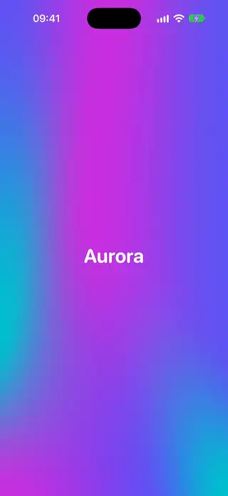
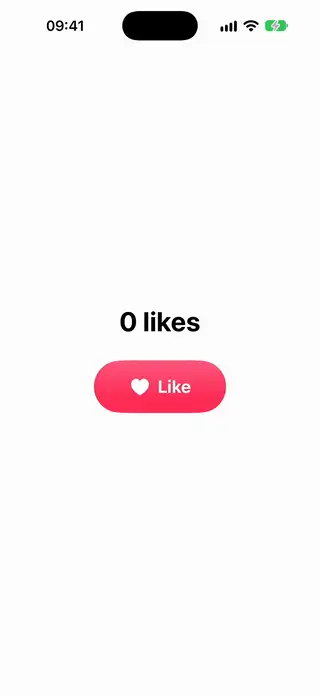
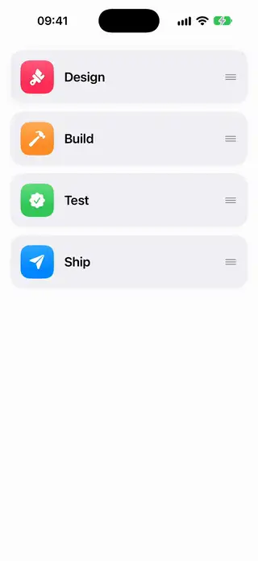

<div align="center">

# AwesomeSwiftUI

*Copy-paste SwiftUI components, animations and transitions for iOS 18 through iOS 27.*

[](https://github.com/magnoscg/AwesomeSwiftUI/actions/workflows/ci.yml)
[](LICENSE)
[](https://github.com/magnoscg/AwesomeSwiftUI/stargazers)

From a one-line button style to full animated transitions. No package to
install: find a component, copy its file, use it.

</div>

> **Status: early days.** The foundation of the repository, the catalog tooling,
> the Showcase app, the documentation site and CI are in place. The first
> components come next.

## What it will be

| | |
|---|---|
| Install | None. Copy one Swift file into your project |
| Platforms | iOS 18 to iOS 27. Each component states its own minimum |
| Language | Swift 6, with complete concurrency checking |
| Technologies | The current Apple API for each iOS version, and nothing deprecated |
| Search | Keywords on every component, for people and for AI agents |
| License | MIT |

## Catalog

<!-- catalog:start -->

### Backgrounds

| Preview | Component | What it does | iOS | Level |
|---|---|---|---|---|
|  | [Aurora Mesh Background](Components/Backgrounds/AuroraMeshBackground/AuroraMeshBackground.swift) | An animated aurora background made with a mesh gradient. | 18.0+ | intermediate |

### Buttons

| Preview | Component | What it does | iOS | Level |
|---|---|---|---|---|
|  | [Pressable Button Style](Components/Buttons/PressableButtonStyle/PressableButtonStyle.swift) | A button style that shrinks and dims on press, then springs back. | 18.0+ | beginner |

### Glass

| Preview | Component | What it does | iOS | Level |
|---|---|---|---|---|
|  | [Glass Action Menu](Components/Glass/GlassActionMenu/GlassActionMenu.swift) | A floating Liquid Glass button whose actions morph out of it. | 26.0+ | intermediate |

### Lists

| Preview | Component | What it does | iOS | Level |
|---|---|---|---|---|
|  | [Reorderable Card List](Components/Lists/ReorderableCardList/ReorderableCardList.swift) | A stack of cards you can drag into a new order, without using List. | 27.0+ | intermediate |

<!-- catalog:end -->

## How the catalog is organized

Each component lives in its own folder, under its category:

```text
Components/
  <Category>/
    <Name>/
      <Name>.swift       The component, a demo and a preview, in one file
      <Name>.meta.json   Keywords, minimum iOS, APIs used, difficulty, origin
      <Name>.webp        An animated preview of what it looks like
```

## The rules every component keeps

- **Self-contained.** One file wherever possible, with no dependency on
  another component, a package or an asset you would have to bring along.
- **Current.** Swift 6, Observation and Swift Testing. Nothing deprecated.
- **Honest about versions.** A component that needs a newer iOS says so with
  `@available` and in its metadata. It adds a fallback only where one is
  natural.
- **Accessible.** It respects Reduce Motion, Dynamic Type and VoiceOver.
- **Visible.** Every component has an animated preview, here and on the site.
- **Clean origin.** Original work, or code under a compatible license with its
  notice kept. See [where code may come from](CONTRIBUTING.md#where-code-may-come-from).

## For AI agents

[AGENTS.md](AGENTS.md) maps the repository and lists the rules a change has to
keep. To find a component, search [catalog.json](catalog.json) by keyword, in
English or Spanish, and fetch its `rawURL`. [llms.txt](llms.txt) is the short
index and [llms-full.txt](llms-full.txt) has every component with its source.

## Contributing

Ideas, components and fixes are welcome. Start with
[CONTRIBUTING.md](CONTRIBUTING.md). Everyone involved follows the
[code of conduct](CODE_OF_CONDUCT.md), and vulnerabilities go through
[SECURITY.md](SECURITY.md).

## License

[MIT](LICENSE). Each Swift file carries a short copyright header, so the notice
travels with the code when you copy it. Code imported from other projects keeps
its original license and notice.
