<div align="center">


# Awesome SwiftUI Components

*Copy-paste SwiftUI components, animations and transitions for iOS 18 through iOS 27.*

<a href="https://magnoscg.github.io/swiftui-components/"></a>

[](https://magnoscg.github.io/swiftui-components/)
[](https://github.com/magnoscg/swiftui-components/releases/latest)
[](https://github.com/magnoscg/swiftui-components/actions/workflows/ci.yml)
[](https://github.com/magnoscg/swiftui-components/stargazers)
[](LICENSE)

From a one-line button style to a view drawn by a Metal shader. There is no
package to install: find a component, copy its file into your project and it
is your code. Swift 6, nothing deprecated, and a preview of every one.

</div>

<div align="center">

<a href="Components/Cards/HolographicCard">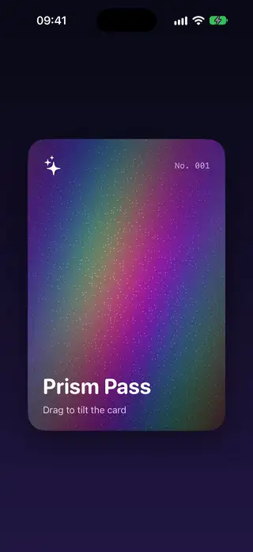</a>
<a href="Components/Effects/VoiceOrb">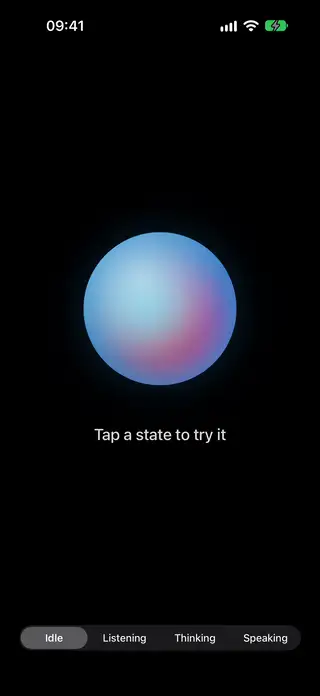</a>
<a href="Components/Effects/IntelligenceGlowBorder">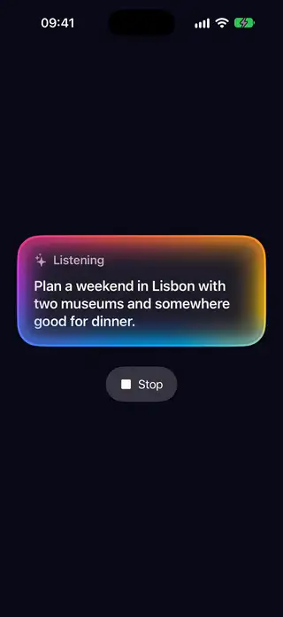</a>
<a href="Components/Cards/WalletCardStack">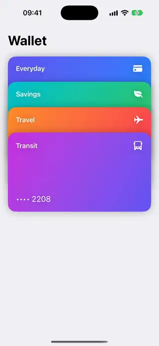</a>
<a href="Components/Transitions/DissolveShaderTransition">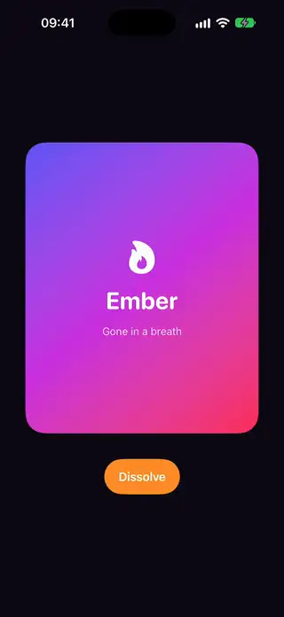</a>

<a href="Components/Menus/GooeyFloatingMenu"></a>
<a href="Components/Progress/ActivityRings">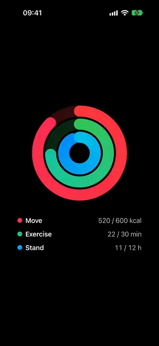</a>
<a href="Components/Text/KaraokeLyricsText">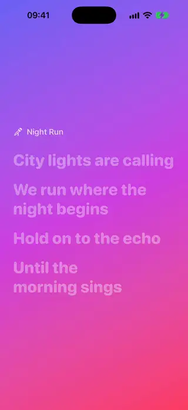</a>
<a href="Components/Playful/SpinWheelRoulette">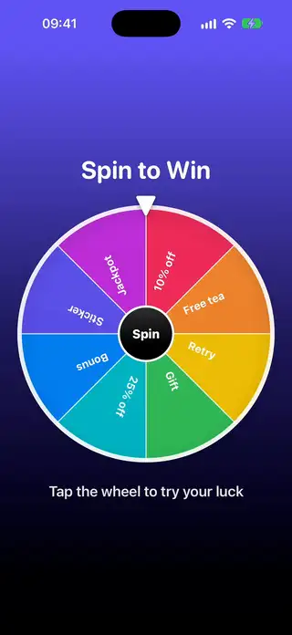</a>
<a href="Components/Backgrounds/SynthwaveGridBackground">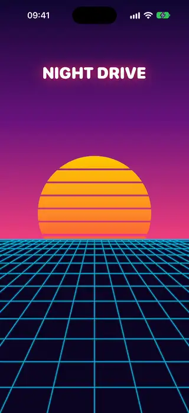</a>

<sub>Ten of them, playing. Every component has a preview like these.</sub>

</div>

## At a glance

| | |
|---|---|
| Install | None. Copy one Swift file into your project, and its Metal shader if it has one |
| Platforms | iOS 18 to iOS 27. Each component states its own minimum |
| Language | Swift 6, with complete concurrency checking, with or without the main actor as the default isolation |
| Technologies | The current Apple API for each iOS version, and nothing deprecated |
| Accessibility | Reduce Motion, Dynamic Type, VoiceOver and right-to-left layouts |
| Texts | What you pass to a component is a `LocalizedStringResource`, so it lands in your String Catalog |
| Search | Keywords on every component, in English and Spanish, for people and for AI agents |
| For agents | `llms.txt`, `llms-full.txt` and `catalog.json`, generated from the same metadata |
| License | MIT. Every file carries its notice |

## Contents

- [For AI agents](#for-ai-agents)
- [Use a component](#use-a-component)
- [Catalog](#catalog)
- [How the catalog is organized](#how-the-catalog-is-organized)
- [The rules every component keeps](#the-rules-every-component-keeps)
- [Development](#development)
- [Contributing](#contributing)
- [Credits](#credits)
- [License](#license)

## For AI agents

To add a component to an app you only need the index. Point your agent at it
and ask for what you need:

```text
Find a SwiftUI component for <what you need> in
https://raw.githubusercontent.com/magnoscg/swiftui-components/HEAD/llms.txt
and copy its file into my project.
```

| File | What it is for |
|---|---|
| [llms.txt](llms.txt) | The short index: every component with its summary and the address of its source |
| [llms-full.txt](llms-full.txt) | The same index with the source of every component inline |
| [catalog.json](catalog.json) | Every component as data: keywords in English and Spanish, minimum iOS, APIs, level, and `rawURL` to fetch, with `shaderRawURL` when it has a shader |

- Compare the `minIOS` of a component with the deployment target before you copy it.
- A component with a `shaderRawURL` is two files. Copy both into the same target: it draws nothing without its shader.
- Keep the two lines at the top of each file. They are the license notice.

To change the catalog itself, read [AGENTS.md](AGENTS.md).

## Use a component

1. **Find it.** [Search the catalog](https://magnoscg.github.io/swiftui-components/)
   by name, category, iOS version, level or the Apple API it uses, or look in
   [the table below](#catalog).
2. **Copy its file.** One `.swift` file holds the component, a demo and a
   preview. The few drawn by a shader have a `.metal` file to copy too.
3. **Use it.** It is your code now: no package, no version to track.

```swift
PulseRingButton(systemImage: "mic.fill", label: "Record") {
    startRecording()
}
```

The `Demo` view and the `#Preview` at the end of each file show how to use
it, and you can delete them afterwards. To try every component on a device,
open `Showcase/Showcase.xcodeproj` and run it.

## Catalog

<!-- catalog:start -->

**288 components.** Open a category to see every preview.

| Preview | Category | Count | Components |
|---|---|---|---|
| 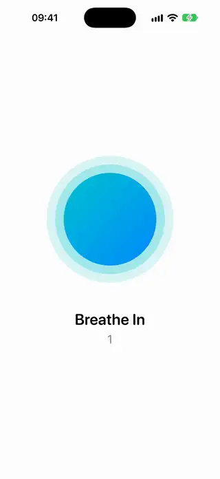 | [Animations](catalog/Animations.md) | 6 | [Breathing Guide Circle](Components/Animations/BreathingGuideCircle/BreathingGuideCircle.swift) · [Keyframe Timeline Showcase](Components/Animations/KeyframeTimelineShowcase/KeyframeTimelineShowcase.swift) · [Phase Animator Cycle](Components/Animations/PhaseAnimatorCycle/PhaseAnimatorCycle.swift) · [Split Flap Counter](Components/Animations/SplitFlapCounter/SplitFlapCounter.swift) · [Spring Study Playground](Components/Animations/SpringStudyPlayground/SpringStudyPlayground.swift) · [Symbol Effect Gallery](Components/Animations/SymbolEffectGallery/SymbolEffectGallery.swift) |
| 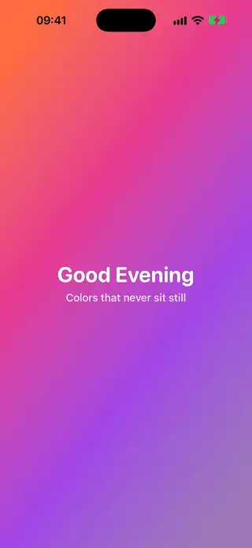 | [Backgrounds](catalog/Backgrounds.md) | 11 | [Animated Gradient Background](Components/Backgrounds/AnimatedGradientBackground/AnimatedGradientBackground.swift) · [Aurora Mesh Background](Components/Backgrounds/AuroraMeshBackground/AuroraMeshBackground.swift) · [Bubbles Background](Components/Backgrounds/BubblesBackground/BubblesBackground.swift) · [Color Orbs Background](Components/Backgrounds/ColorOrbsBackground/ColorOrbsBackground.swift) · [Grid Pulse Background](Components/Backgrounds/GridPulseBackground/GridPulseBackground.swift) · [Image Derived Gradient Background](Components/Backgrounds/ImageDerivedGradientBackground/ImageDerivedGradientBackground.swift) · [Particle Field Background](Components/Backgrounds/ParticleFieldBackground/ParticleFieldBackground.swift) · [Snowfall Background](Components/Backgrounds/SnowfallBackground/SnowfallBackground.swift) · [Starfield Background](Components/Backgrounds/StarfieldBackground/StarfieldBackground.swift) · [Synthwave Grid Background](Components/Backgrounds/SynthwaveGridBackground/SynthwaveGridBackground.swift) · [Waves Background](Components/Backgrounds/WavesBackground/WavesBackground.swift) |
|  | [Buttons](catalog/Buttons.md) | 15 | [Elastic Drag Button](Components/Buttons/ElasticDragButton/ElasticDragButton.swift) · [Emoji Reaction Picker](Components/Buttons/EmojiReactionPicker/EmojiReactionPicker.swift) · [Expanding Search Button](Components/Buttons/ExpandingSearchButton/ExpandingSearchButton.swift) · [Floating Action Menu](Components/Buttons/FloatingActionMenu/FloatingActionMenu.swift) · [Gradient Border Button](Components/Buttons/GradientBorderButton/GradientBorderButton.swift) · [Hamburger Menu Button](Components/Buttons/HamburgerMenuButton/HamburgerMenuButton.swift) · [Hold To Confirm Button](Components/Buttons/HoldToConfirmButton/HoldToConfirmButton.swift) · [Like Burst Button](Components/Buttons/LikeBurstButton/LikeBurstButton.swift) · [Morphing Submit Button](Components/Buttons/MorphingSubmitButton/MorphingSubmitButton.swift) · [Play Pause Morph Button](Components/Buttons/PlayPauseMorphButton/PlayPauseMorphButton.swift) · [Pressable Button Style](Components/Buttons/PressableButtonStyle/PressableButtonStyle.swift) · [Provider Sign In Button Stack](Components/Buttons/ProviderSignInButtonStack/ProviderSignInButtonStack.swift) · [Pulse Ring Button](Components/Buttons/PulseRingButton/PulseRingButton.swift) · [Shimmer Button](Components/Buttons/ShimmerButton/ShimmerButton.swift) · [Shrinking Extended Button](Components/Buttons/ShrinkingExtendedButton/ShrinkingExtendedButton.swift) |
| 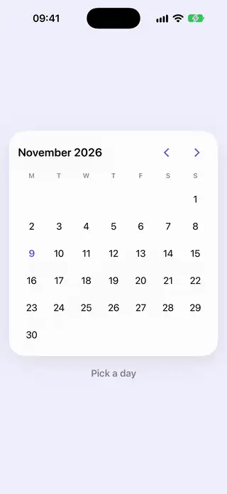 | [Calendars](catalog/Calendars.md) | 4 | [Calendar Month Grid](Components/Calendars/CalendarMonthGrid/CalendarMonthGrid.swift) · [Calendar Range Selector](Components/Calendars/CalendarRangeSelector/CalendarRangeSelector.swift) · [Date Strip Picker](Components/Calendars/DateStripPicker/DateStripPicker.swift) · [Day Schedule Timeline](Components/Calendars/DayScheduleTimeline/DayScheduleTimeline.swift) |
| 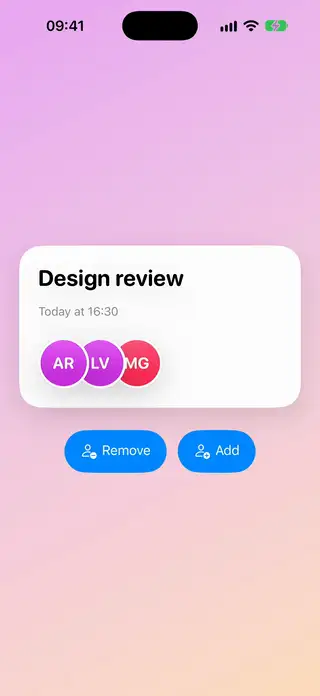 | [Cards](catalog/Cards.md) | 6 | [Avatar Stack](Components/Cards/AvatarStack/AvatarStack.swift) · [Expandable Info Card](Components/Cards/ExpandableInfoCard/ExpandableInfoCard.swift) · [Holographic Card](Components/Cards/HolographicCard/HolographicCard.swift) · [Swipeable Card Stack](Components/Cards/SwipeableCardStack/SwipeableCardStack.swift) · [Tilt Card](Components/Cards/TiltCard/TiltCard.swift) · [Wallet Card Stack](Components/Cards/WalletCardStack/WalletCardStack.swift) |
| 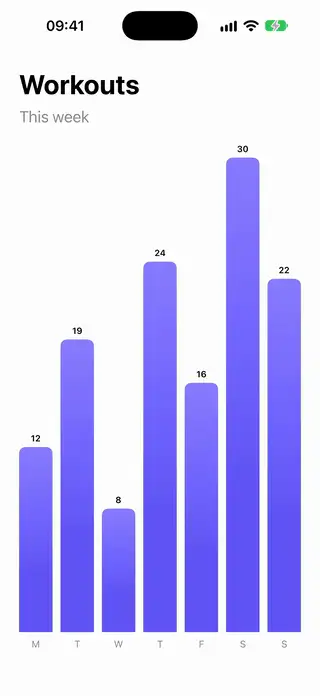 | [Charts](catalog/Charts.md) | 11 | [Animated Bar Chart](Components/Charts/AnimatedBarChart/AnimatedBarChart.swift) · [Animated Donut Chart](Components/Charts/AnimatedDonutChart/AnimatedDonutChart.swift) · [Candlestick Chart](Components/Charts/CandlestickChart/CandlestickChart.swift) · [Contribution Heatmap](Components/Charts/ContributionHeatmap/ContributionHeatmap.swift) · [Gauge Chart](Components/Charts/GaugeChart/GaugeChart.swift) · [Interactive Line Chart](Components/Charts/InteractiveLineChart/InteractiveLineChart.swift) · [Line Chart Draw In](Components/Charts/LineChartDrawIn/LineChartDrawIn.swift) · [Radar Chart](Components/Charts/RadarChart/RadarChart.swift) · [Scrollable Bar Chart](Components/Charts/ScrollableBarChart/ScrollableBarChart.swift) · [Sparkline Stat Tile](Components/Charts/SparklineStatTile/SparklineStatTile.swift) · [Surface 3D Chart](Components/Charts/Surface3DChart/Surface3DChart.swift) |
|  | [Chat](catalog/Chat.md) | 6 | [Chat Auto Scroll List](Components/Chat/ChatAutoScrollList/ChatAutoScrollList.swift) · [Chat Bubble Shape](Components/Chat/ChatBubbleShape/ChatBubbleShape.swift) · [Keyboard Tracking Input Bar](Components/Chat/KeyboardTrackingInputBar/KeyboardTrackingInputBar.swift) · [Nested Comment Thread](Components/Chat/NestedCommentThread/NestedCommentThread.swift) · [Tapback Reaction Bubble](Components/Chat/TapbackReactionBubble/TapbackReactionBubble.swift) · [Typing Indicator Bubble](Components/Chat/TypingIndicatorBubble/TypingIndicatorBubble.swift) |
|  | [Commerce](catalog/Commerce.md) | 5 | [Add To Cart Fly Button](Components/Commerce/AddToCartFlyButton/AddToCartFlyButton.swift) · [Add To Cart Stepper](Components/Commerce/AddToCartStepper/AddToCartStepper.swift) · [Billing Period Toggle](Components/Commerce/BillingPeriodToggle/BillingPeriodToggle.swift) · [Pricing Tier Cards](Components/Commerce/PricingTierCards/PricingTierCards.swift) · [Trial Timeline Paywall](Components/Commerce/TrialTimelinePaywall/TrialTimelinePaywall.swift) |
|  | [Controls](catalog/Controls.md) | 10 | [Animated Radio Button](Components/Controls/AnimatedRadioButton/AnimatedRadioButton.swift) · [Circular Range Slider](Components/Controls/CircularRangeSlider/CircularRangeSlider.swift) · [Counter Stepper](Components/Controls/CounterStepper/CounterStepper.swift) · [Day Night Toggle](Components/Controls/DayNightToggle/DayNightToggle.swift) · [Range Slider](Components/Controls/RangeSlider/RangeSlider.swift) · [Ruler Scroll Picker](Components/Controls/RulerScrollPicker/RulerScrollPicker.swift) · [Sliding Segmented Picker](Components/Controls/SlidingSegmentedPicker/SlidingSegmentedPicker.swift) · [Spring Toggle Style](Components/Controls/SpringToggleStyle/SpringToggleStyle.swift) · [Swipe To Confirm Slider](Components/Controls/SwipeToConfirmSlider/SwipeToConfirmSlider.swift) · [Tick Mark Slider](Components/Controls/TickMarkSlider/TickMarkSlider.swift) |
| 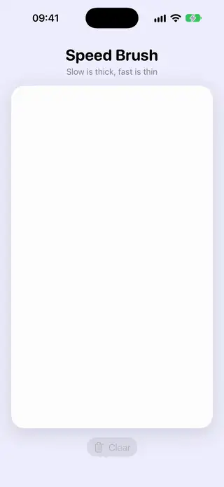 | [Drawing](catalog/Drawing.md) | 4 | [Drawing Pad Speed Brush](Components/Drawing/DrawingPadSpeedBrush/DrawingPadSpeedBrush.swift) · [Drawing Pad Undo Redo](Components/Drawing/DrawingPadUndoRedo/DrawingPadUndoRedo.swift) · [Path Trim Draw On](Components/Drawing/PathTrimDrawOn/PathTrimDrawOn.swift) · [Polygon Morph Shape](Components/Drawing/PolygonMorphShape/PolygonMorphShape.swift) |
| 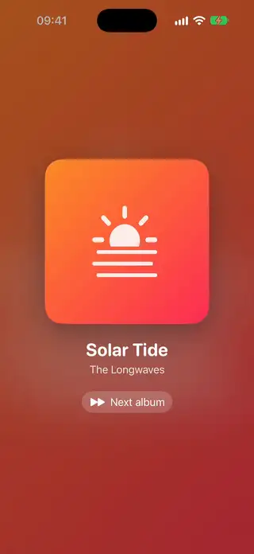 | [Effects](catalog/Effects.md) | 21 | [Blurred Image Backdrop](Components/Effects/BlurredImageBackdrop/BlurredImageBackdrop.swift) · [Border Beam Modifier](Components/Effects/BorderBeamModifier/BorderBeamModifier.swift) · [Chromatic Glitch Shader](Components/Effects/ChromaticGlitchShader/ChromaticGlitchShader.swift) · [Coin Flip View](Components/Effects/CoinFlipView/CoinFlipView.swift) · [Color Reveal Image](Components/Effects/ColorRevealImage/ColorRevealImage.swift) · [Confetti Burst](Components/Effects/ConfettiBurst/ConfettiBurst.swift) · [Fireworks Burst](Components/Effects/FireworksBurst/FireworksBurst.swift) · [Floating Reactions Emitter](Components/Effects/FloatingReactionsEmitter/FloatingReactionsEmitter.swift) · [Flow Field Particles](Components/Effects/FlowFieldParticles/FlowFieldParticles.swift) · [Globe 3D Wireframe](Components/Effects/Globe3DWireframe/Globe3DWireframe.swift) · [Intelligence Glow Border](Components/Effects/IntelligenceGlowBorder/IntelligenceGlowBorder.swift) · [Jiggle Edit Modifier](Components/Effects/JiggleEditModifier/JiggleEditModifier.swift) · [Metaball Lava Lamp](Components/Effects/MetaballLavaLamp/MetaballLavaLamp.swift) · [Noise Grain Overlay](Components/Effects/NoiseGrainOverlay/NoiseGrainOverlay.swift) · [Pixelate Shader Effect](Components/Effects/PixelateShaderEffect/PixelateShaderEffect.swift) · [Progressive Blur Header](Components/Effects/ProgressiveBlurHeader/ProgressiveBlurHeader.swift) · [Ripple Shader Effect](Components/Effects/RippleShaderEffect/RippleShaderEffect.swift) · [Ripple Tap Effect](Components/Effects/RippleTapEffect/RippleTapEffect.swift) · [Spotlight Overlay](Components/Effects/SpotlightOverlay/SpotlightOverlay.swift) · [Touch Particle Trail](Components/Effects/TouchParticleTrail/TouchParticleTrail.swift) · [Voice Orb](Components/Effects/VoiceOrb/VoiceOrb.swift) |
|  | [Feedback](catalog/Feedback.md) | 11 | [Animated Badge Count](Components/Feedback/AnimatedBadgeCount/AnimatedBadgeCount.swift) · [Animated Checkmark Badge](Components/Feedback/AnimatedCheckmarkBadge/AnimatedCheckmarkBadge.swift) · [Dynamic Island Pill](Components/Feedback/DynamicIslandPill/DynamicIslandPill.swift) · [Empty State Placeholder](Components/Feedback/EmptyStatePlaceholder/EmptyStatePlaceholder.swift) · [Notification Stack](Components/Feedback/NotificationStack/NotificationStack.swift) · [Rating Stars](Components/Feedback/RatingStars/RatingStars.swift) · [Shake Error Modifier](Components/Feedback/ShakeErrorModifier/ShakeErrorModifier.swift) · [Toast Banner](Components/Feedback/ToastBanner/ToastBanner.swift) · [Toast Host](Components/Feedback/ToastHost/ToastHost.swift) · [Tooltip Popover](Components/Feedback/TooltipPopover/TooltipPopover.swift) · [Undo Snackbar](Components/Feedback/UndoSnackbar/UndoSnackbar.swift) |
| 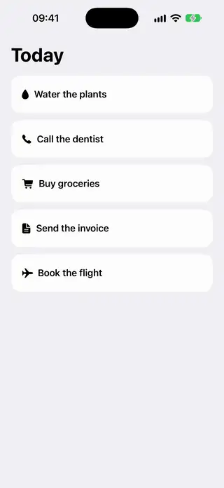 | [Gestures](catalog/Gestures.md) | 9 | [Completion Swipe Row](Components/Gestures/CompletionSwipeRow/CompletionSwipeRow.swift) · [Double Tap Heart Overlay](Components/Gestures/DoubleTapHeartOverlay/DoubleTapHeartOverlay.swift) · [Drag Select Grid](Components/Gestures/DragSelectGrid/DragSelectGrid.swift) · [Drop Zone Highlight](Components/Gestures/DropZoneHighlight/DropZoneHighlight.swift) · [Long Press Radial Menu](Components/Gestures/LongPressRadialMenu/LongPressRadialMenu.swift) · [Pinch Zoom View](Components/Gestures/PinchZoomView/PinchZoomView.swift) · [Scratch To Reveal](Components/Gestures/ScratchToReveal/ScratchToReveal.swift) · [Snap Corner Draggable](Components/Gestures/SnapCornerDraggable/SnapCornerDraggable.swift) · [Swipe Action Row](Components/Gestures/SwipeActionRow/SwipeActionRow.swift) |
| 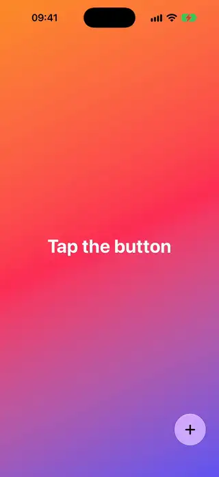 | [Glass](catalog/Glass.md) | 6 | [Glass Action Menu](Components/Glass/GlassActionMenu/GlassActionMenu.swift) · [Glass Button Gallery](Components/Glass/GlassButtonGallery/GlassButtonGallery.swift) · [Glass Segmented Control](Components/Glass/GlassSegmentedControl/GlassSegmentedControl.swift) · [Glass Tab Accessory](Components/Glass/GlassTabAccessory/GlassTabAccessory.swift) · [Glass Tag Cloud](Components/Glass/GlassTagCloud/GlassTagCloud.swift) · [Glass Tool Strip](Components/Glass/GlassToolStrip/GlassToolStrip.swift) |
| 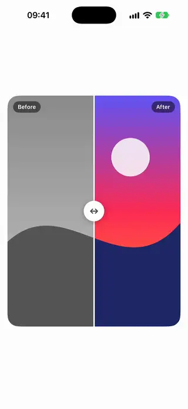 | [Images](catalog/Images.md) | 11 | [Before After Slider](Components/Images/BeforeAfterSlider/BeforeAfterSlider.swift) · [Blur Up Image](Components/Images/BlurUpImage/BlurUpImage.swift) · [Circular Avatar Cropper](Components/Images/CircularAvatarCropper/CircularAvatarCropper.swift) · [Crop Rectangle Overlay](Components/Images/CropRectangleOverlay/CropRectangleOverlay.swift) · [Double Tap Zoom Image](Components/Images/DoubleTapZoomImage/DoubleTapZoomImage.swift) · [Ken Burns Image](Components/Images/KenBurnsImage/KenBurnsImage.swift) · [Photo Adjustment Sliders](Components/Images/PhotoAdjustmentSliders/PhotoAdjustmentSliders.swift) · [Photo Filter Presets](Components/Images/PhotoFilterPresets/PhotoFilterPresets.swift) · [Photo Lightbox](Components/Images/PhotoLightbox/PhotoLightbox.swift) · [Photo Multi Select Grid](Components/Images/PhotoMultiSelectGrid/PhotoMultiSelectGrid.swift) · [Scattered Photo Board](Components/Images/ScatteredPhotoBoard/ScatteredPhotoBoard.swift) |
| 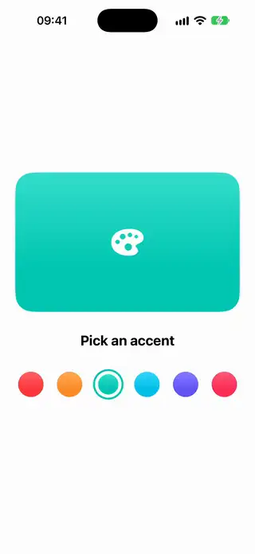 | [Inputs](catalog/Inputs.md) | 11 | [Color Swatch Picker](Components/Inputs/ColorSwatchPicker/ColorSwatchPicker.swift) · [Floating Label Text Field](Components/Inputs/FloatingLabelTextField/FloatingLabelTextField.swift) · [Masked Text Field](Components/Inputs/MaskedTextField/MaskedTextField.swift) · [Multi Step Form](Components/Inputs/MultiStepForm/MultiStepForm.swift) · [OTP Code Field](Components/Inputs/OTPCodeField/OTPCodeField.swift) · [Passcode Keypad](Components/Inputs/PasscodeKeypad/PasscodeKeypad.swift) · [Password Strength Field](Components/Inputs/PasswordStrengthField/PasswordStrengthField.swift) · [Rich Text Editor](Components/Inputs/RichTextEditor/RichTextEditor.swift) · [Search Field With Suggestions](Components/Inputs/SearchFieldWithSuggestions/SearchFieldWithSuggestions.swift) · [Tag Input Field](Components/Inputs/TagInputField/TagInputField.swift) · [Validated Text Field](Components/Inputs/ValidatedTextField/ValidatedTextField.swift) |
| 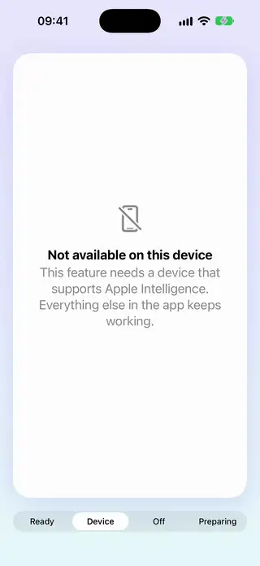 | [Intelligence](catalog/Intelligence.md) | 3 | [Model Availability Gate](Components/Intelligence/ModelAvailabilityGate/ModelAvailabilityGate.swift) · [On Device Streaming Answer](Components/Intelligence/OnDeviceStreamingAnswer/OnDeviceStreamingAnswer.swift) · [Structured Output Form](Components/Intelligence/StructuredOutputForm/StructuredOutputForm.swift) |
|  | [Layouts](catalog/Layouts.md) | 10 | [Adaptive Columns Grid](Components/Layouts/AdaptiveColumnsGrid/AdaptiveColumnsGrid.swift) · [Any Layout Adaptive Switch](Components/Layouts/AnyLayoutAdaptiveSwitch/AnyLayoutAdaptiveSwitch.swift) · [Bento Grid Layout](Components/Layouts/BentoGridLayout/BentoGridLayout.swift) · [Flow Tags Layout](Components/Layouts/FlowTagsLayout/FlowTagsLayout.swift) · [Kanban Board](Components/Layouts/KanbanBoard/KanbanBoard.swift) · [Masonry Layout](Components/Layouts/MasonryLayout/MasonryLayout.swift) · [Morphing Layout Switch](Components/Layouts/MorphingLayoutSwitch/MorphingLayoutSwitch.swift) · [Radial Layout](Components/Layouts/RadialLayout/RadialLayout.swift) · [Readable Width Container](Components/Layouts/ReadableWidthContainer/ReadableWidthContainer.swift) · [Subview Card Container](Components/Layouts/SubviewCardContainer/SubviewCardContainer.swift) |
| 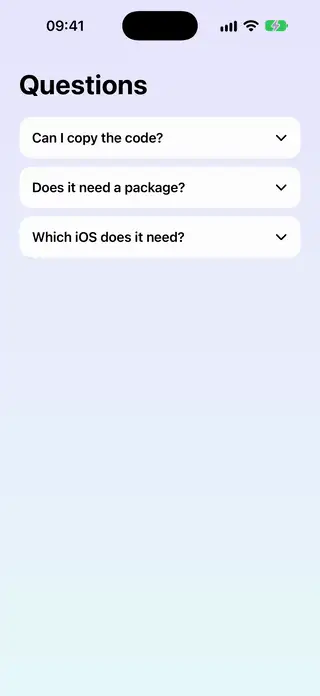 | [Lists](catalog/Lists.md) | 8 | [Accordion Section](Components/Lists/AccordionSection/AccordionSection.swift) · [Disclosure Tree View](Components/Lists/DisclosureTreeView/DisclosureTreeView.swift) · [Edit Mode Multi Select](Components/Lists/EditModeMultiSelect/EditModeMultiSelect.swift) · [Load More Footer](Components/Lists/LoadMoreFooter/LoadMoreFooter.swift) · [Reorderable Card List](Components/Lists/ReorderableCardList/ReorderableCardList.swift) · [Reorderable Grid](Components/Lists/ReorderableGrid/ReorderableGrid.swift) · [Sticky Section Headers](Components/Lists/StickySectionHeaders/StickySectionHeaders.swift) · [Swipe Action Cards](Components/Lists/SwipeActionCards/SwipeActionCards.swift) |
| 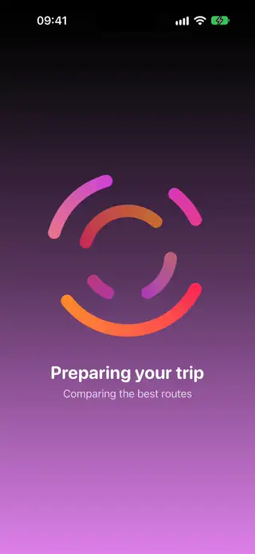 | [Loaders](catalog/Loaders.md) | 7 | [Arc Segments Loader](Components/Loaders/ArcSegmentsLoader/ArcSegmentsLoader.swift) · [Blob Morph Loader](Components/Loaders/BlobMorphLoader/BlobMorphLoader.swift) · [Dots Pulse Loader](Components/Loaders/DotsPulseLoader/DotsPulseLoader.swift) · [Orbit Loader](Components/Loaders/OrbitLoader/OrbitLoader.swift) · [Skeleton Shimmer Modifier](Components/Loaders/SkeletonShimmerModifier/SkeletonShimmerModifier.swift) · [Symbol Breathe Loader](Components/Loaders/SymbolBreatheLoader/SymbolBreatheLoader.swift) · [Wave Bars Loader](Components/Loaders/WaveBarsLoader/WaveBarsLoader.swift) |
| 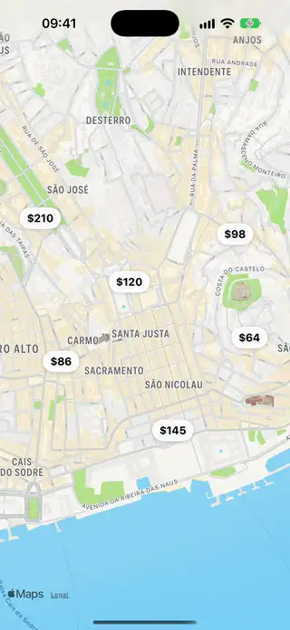 | [Maps](catalog/Maps.md) | 4 | [Map Annotation Callout](Components/Maps/MapAnnotationCallout/MapAnnotationCallout.swift) · [Map Cluster Annotations](Components/Maps/MapClusterAnnotations/MapClusterAnnotations.swift) · [Map Route Tracker](Components/Maps/MapRouteTracker/MapRouteTracker.swift) · [Map Search Sheet](Components/Maps/MapSearchSheet/MapSearchSheet.swift) |
|  | [Media](catalog/Media.md) | 8 | [Audio Player Card](Components/Media/AudioPlayerCard/AudioPlayerCard.swift) · [Double Tap Seek Overlay](Components/Media/DoubleTapSeekOverlay/DoubleTapSeekOverlay.swift) · [Expanding Mini Player](Components/Media/ExpandingMiniPlayer/ExpandingMiniPlayer.swift) · [Shutter Capture Button](Components/Media/ShutterCaptureButton/ShutterCaptureButton.swift) · [Spinning Vinyl Art](Components/Media/SpinningVinylArt/SpinningVinylArt.swift) · [Video Player Chrome](Components/Media/VideoPlayerChrome/VideoPlayerChrome.swift) · [Video Poster To Player](Components/Media/VideoPosterToPlayer/VideoPosterToPlayer.swift) · [Waveform Scrubber](Components/Media/WaveformScrubber/WaveformScrubber.swift) |
| 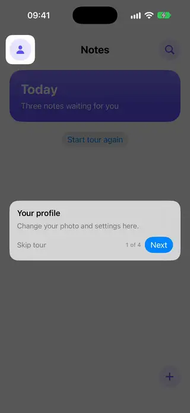 | [Menus](catalog/Menus.md) | 5 | [Coach Mark Tour](Components/Menus/CoachMarkTour/CoachMarkTour.swift) · [Command Palette](Components/Menus/CommandPalette/CommandPalette.swift) · [Context Menu Preview Card](Components/Menus/ContextMenuPreviewCard/ContextMenuPreviewCard.swift) · [Dropdown Select Menu](Components/Menus/DropdownSelectMenu/DropdownSelectMenu.swift) · [Gooey Floating Menu](Components/Menus/GooeyFloatingMenu/GooeyFloatingMenu.swift) |
| 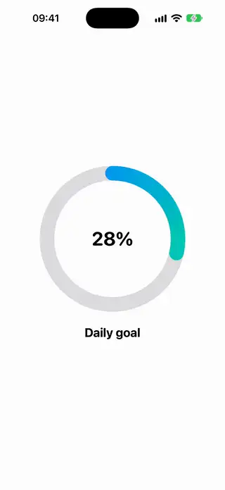 | [Modern](catalog/Modern.md) | 6 | [Animatable Ring](Components/Modern/AnimatableRing/AnimatableRing.swift) · [Concentric Card](Components/Modern/ConcentricCard/ConcentricCard.swift) · [Prominent Tab Bar](Components/Modern/ProminentTabBar/ProminentTabBar.swift) · [Scroll Edge Header](Components/Modern/ScrollEdgeHeader/ScrollEdgeHeader.swift) · [Symbol Draw On](Components/Modern/SymbolDrawOn/SymbolDrawOn.swift) · [Toolbar Overflow Demo](Components/Modern/ToolbarOverflowDemo/ToolbarOverflowDemo.swift) |
| 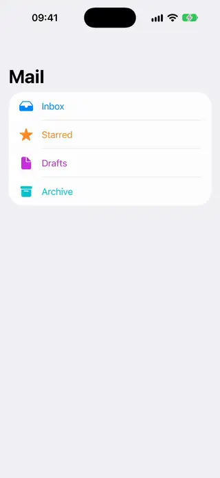 | [Navigation](catalog/Navigation.md) | 16 | [Adaptive Sidebar Layout](Components/Navigation/AdaptiveSidebarLayout/AdaptiveSidebarLayout.swift) · [Animated Tab Bar](Components/Navigation/AnimatedTabBar/AnimatedTabBar.swift) · [Bottom Drawer](Components/Navigation/BottomDrawer/BottomDrawer.swift) · [Breadcrumb Trail](Components/Navigation/BreadcrumbTrail/BreadcrumbTrail.swift) · [Drag To Dismiss Screen](Components/Navigation/DragToDismissScreen/DragToDismissScreen.swift) · [Embedded Web Browser](Components/Navigation/EmbeddedWebBrowser/EmbeddedWebBrowser.swift) · [Full Screen Menu Overlay](Components/Navigation/FullScreenMenuOverlay/FullScreenMenuOverlay.swift) · [Navigation Path Router](Components/Navigation/NavigationPathRouter/NavigationPathRouter.swift) · [Page Dots Indicator](Components/Navigation/PageDotsIndicator/PageDotsIndicator.swift) · [Scroll Spy Header](Components/Navigation/ScrollSpyHeader/ScrollSpyHeader.swift) · [Scroll To Top Button](Components/Navigation/ScrollToTopButton/ScrollToTopButton.swift) · [Search Scopes And Suggestions](Components/Navigation/SearchScopesAndSuggestions/SearchScopesAndSuggestions.swift) · [Side Drawer](Components/Navigation/SideDrawer/SideDrawer.swift) · [Sidebar Adaptive Tabs](Components/Navigation/SidebarAdaptiveTabs/SidebarAdaptiveTabs.swift) · [Tab Navigation State Preserve](Components/Navigation/TabNavigationStatePreserve/TabNavigationStatePreserve.swift) · [Two Pane Split Layout](Components/Navigation/TwoPaneSplitLayout/TwoPaneSplitLayout.swift) |
|  | [Patterns](catalog/Patterns.md) | 2 | [Permission Primer Screen](Components/Patterns/PermissionPrimerScreen/PermissionPrimerScreen.swift) · [Vertical Timeline](Components/Patterns/VerticalTimeline/VerticalTimeline.swift) |
| 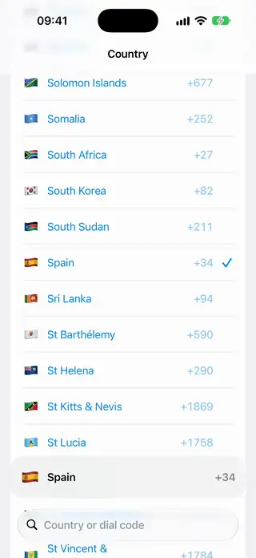 | [Pickers](catalog/Pickers.md) | 6 | [Country Picker](Components/Pickers/CountryPicker/CountryPicker.swift) · [Emoji Picker](Components/Pickers/EmojiPicker/EmojiPicker.swift) · [Inline Date Picker Disclosure](Components/Pickers/InlineDatePickerDisclosure/InlineDatePickerDisclosure.swift) · [Multi Photo Picker Tray](Components/Pickers/MultiPhotoPickerTray/MultiPhotoPickerTray.swift) · [Time Slot Grid Picker](Components/Pickers/TimeSlotGridPicker/TimeSlotGridPicker.swift) · [Wheel Picker](Components/Pickers/WheelPicker/WheelPicker.swift) |
| 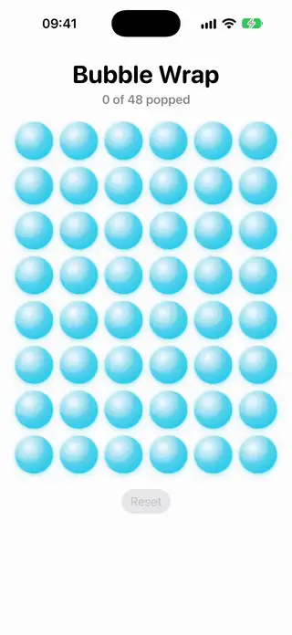 | [Playful](catalog/Playful.md) | 3 | [Bubble Wrap Pop](Components/Playful/BubbleWrapPop/BubbleWrapPop.swift) · [Slot Machine Reels](Components/Playful/SlotMachineReels/SlotMachineReels.swift) · [Spin Wheel Roulette](Components/Playful/SpinWheelRoulette/SpinWheelRoulette.swift) |
| 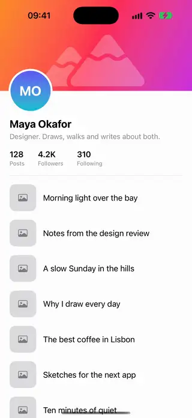 | [Profiles](catalog/Profiles.md) | 3 | [Profile Header Stretchy](Components/Profiles/ProfileHeaderStretchy/ProfileHeaderStretchy.swift) · [Stories Viewer](Components/Profiles/StoriesViewer/StoriesViewer.swift) · [Story Ring Avatar](Components/Profiles/StoryRingAvatar/StoryRingAvatar.swift) |
|  | [Progress](catalog/Progress.md) | 7 | [Activity Rings](Components/Progress/ActivityRings/ActivityRings.swift) · [Circular Progress Ring](Components/Progress/CircularProgressRing/CircularProgressRing.swift) · [Countdown Ring](Components/Progress/CountdownRing/CountdownRing.swift) · [Download Pill Progress](Components/Progress/DownloadPillProgress/DownloadPillProgress.swift) · [Gradient Progress Bar](Components/Progress/GradientProgressBar/GradientProgressBar.swift) · [Liquid Fill Progress](Components/Progress/LiquidFillProgress/LiquidFillProgress.swift) · [Step Progress Indicator](Components/Progress/StepProgressIndicator/StepProgressIndicator.swift) |
| 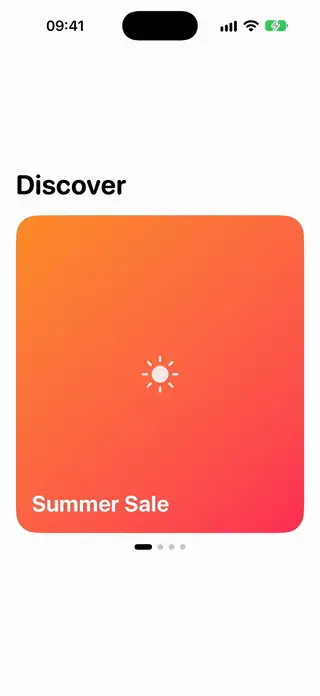 | [Scrolling](catalog/Scrolling.md) | 16 | [Auto Advance Carousel](Components/Scrolling/AutoAdvanceCarousel/AutoAdvanceCarousel.swift) · [Cover Flow Carousel](Components/Scrolling/CoverFlowCarousel/CoverFlowCarousel.swift) · [Hide On Scroll Bar](Components/Scrolling/HideOnScrollBar/HideOnScrollBar.swift) · [Infinite Marquee Row](Components/Scrolling/InfiniteMarqueeRow/InfiniteMarqueeRow.swift) · [Netflix Rows Scroller](Components/Scrolling/NetflixRowsScroller/NetflixRowsScroller.swift) · [Onboarding Pager](Components/Scrolling/OnboardingPager/OnboardingPager.swift) · [Paged Grid Launcher](Components/Scrolling/PagedGridLauncher/PagedGridLauncher.swift) · [Parallax Cards Row](Components/Scrolling/ParallaxCardsRow/ParallaxCardsRow.swift) · [Peek Carousel](Components/Scrolling/PeekCarousel/PeekCarousel.swift) · [Pull Progress Refresh](Components/Scrolling/PullProgressRefresh/PullProgressRefresh.swift) · [Scroll Fade Cards](Components/Scrolling/ScrollFadeCards/ScrollFadeCards.swift) · [Scroll Progress Bar](Components/Scrolling/ScrollProgressBar/ScrollProgressBar.swift) · [Scroll Visibility Reveal](Components/Scrolling/ScrollVisibilityReveal/ScrollVisibilityReveal.swift) · [Sticky Parallax Header](Components/Scrolling/StickyParallaxHeader/StickyParallaxHeader.swift) · [Sticky Stacked Cards](Components/Scrolling/StickyStackedCards/StickyStackedCards.swift) · [Vertical Full Screen Feed](Components/Scrolling/VerticalFullScreenFeed/VerticalFullScreenFeed.swift) |
| 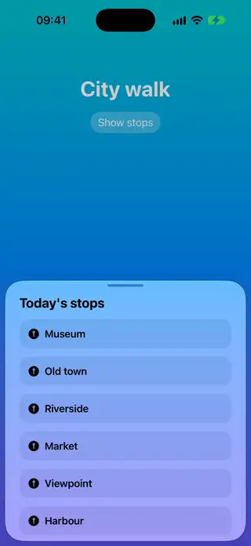 | [Sheets](catalog/Sheets.md) | 3 | [Custom Detent Sheet](Components/Sheets/CustomDetentSheet/CustomDetentSheet.swift) · [Dynamic Height Tray](Components/Sheets/DynamicHeightTray/DynamicHeightTray.swift) · [What's New Sheet](Components/Sheets/WhatsNewSheet/WhatsNewSheet.swift) |
| 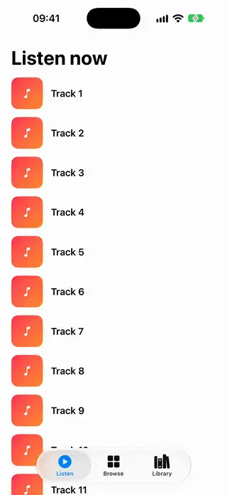 | [Tabs](catalog/Tabs.md) | 4 | [Minimizing Tab Bar](Components/Tabs/MinimizingTabBar/MinimizingTabBar.swift) · [Notched Tab Bar](Components/Tabs/NotchedTabBar/NotchedTabBar.swift) · [Scrolling Tab Strip](Components/Tabs/ScrollingTabStrip/ScrollingTabStrip.swift) · [Tabs Picker Pages](Components/Tabs/TabsPickerPages/TabsPickerPages.swift) |
| 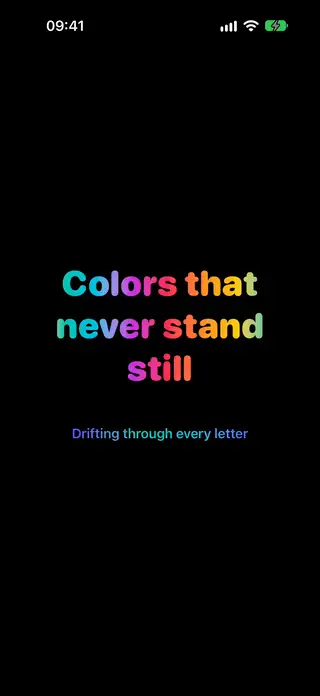 | [Text](catalog/Text.md) | 15 | [Animated Gradient Text](Components/Text/AnimatedGradientText/AnimatedGradientText.swift) · [Bouncy Letters Text](Components/Text/BouncyLettersText/BouncyLettersText.swift) · [Counting Number Text](Components/Text/CountingNumberText/CountingNumberText.swift) · [Glitch Text](Components/Text/GlitchText/GlitchText.swift) · [Glyph Wave Text](Components/Text/GlyphWaveText/GlyphWaveText.swift) · [Highlighted Search Text](Components/Text/HighlightedSearchText/HighlightedSearchText.swift) · [Karaoke Lyrics Text](Components/Text/KaraokeLyricsText/KaraokeLyricsText.swift) · [Marquee Text](Components/Text/MarqueeText/MarqueeText.swift) · [Read More Text](Components/Text/ReadMoreText/ReadMoreText.swift) · [Rotating Words Text](Components/Text/RotatingWordsText/RotatingWordsText.swift) · [Scramble Text](Components/Text/ScrambleText/ScrambleText.swift) · [Shimmer Text](Components/Text/ShimmerText/ShimmerText.swift) · [Streaming Text](Components/Text/StreamingText/StreamingText.swift) · [Text Blur Reveal](Components/Text/TextBlurReveal/TextBlurReveal.swift) · [Typewriter Text](Components/Text/TypewriterText/TypewriterText.swift) |
| 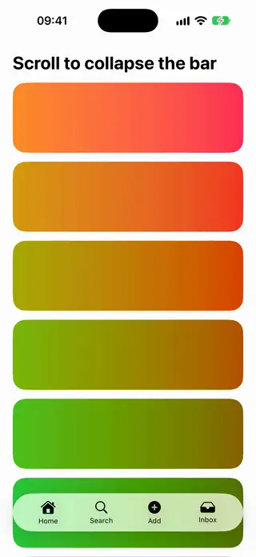 | [Toolbars](catalog/Toolbars.md) | 2 | [Collapsing Bottom Bar](Components/Toolbars/CollapsingBottomBar/CollapsingBottomBar.swift) · [Floating Dock Bar](Components/Toolbars/FloatingDockBar/FloatingDockBar.swift) |
|  | [Transitions](catalog/Transitions.md) | 13 | [Blur Fade Transition](Components/Transitions/BlurFadeTransition/BlurFadeTransition.swift) · [Circle Reveal Transition](Components/Transitions/CircleRevealTransition/CircleRevealTransition.swift) · [Content Swap Transition](Components/Transitions/ContentSwapTransition/ContentSwapTransition.swift) · [Cross Fade Navigation](Components/Transitions/CrossFadeNavigation/CrossFadeNavigation.swift) · [Dissolve Shader Transition](Components/Transitions/DissolveShaderTransition/DissolveShaderTransition.swift) · [Flip Card Transition](Components/Transitions/FlipCardTransition/FlipCardTransition.swift) · [Interactive Pager Transition](Components/Transitions/InteractivePagerTransition/InteractivePagerTransition.swift) · [Matched Hero Card](Components/Transitions/MatchedHeroCard/MatchedHeroCard.swift) · [Parallax Push Transition](Components/Transitions/ParallaxPushTransition/ParallaxPushTransition.swift) · [Slide Scale Transition](Components/Transitions/SlideScaleTransition/SlideScaleTransition.swift) · [Staggered Appear List](Components/Transitions/StaggeredAppearList/StaggeredAppearList.swift) · [Symbol Morph Toggle](Components/Transitions/SymbolMorphToggle/SymbolMorphToggle.swift) · [Zoom Hero Transition](Components/Transitions/ZoomHeroTransition/ZoomHeroTransition.swift) |

<!-- catalog:end -->

## How the catalog is organized

Each component lives in its own folder, under its category:

```text
Components/
  <Category>/
    <Name>/
      <Name>.swift       The component, a demo and a preview, in one file
      <Name>.meta.json   Keywords, minimum iOS, APIs used, difficulty, origin
      <Name>.webp        An animated preview of what it looks like
      <Name>.metal       Its Metal shader, in the few components that have one
```

## The rules every component keeps

- **Self-contained.** One file wherever possible, with no dependency on
  another component, a package or an asset you would have to bring along. The
  one exception is a component drawn by a Metal shader: it has a second file to
  copy, `<Name>.metal`, and its documentation says so.
- **Current.** Swift 6, Observation and Swift Testing. Nothing deprecated.
- **Honest about versions.** A component that needs a newer iOS says so with
  `@available` and in its metadata. It adds a fallback only where one is
  natural.
- **Accessible.** It respects Reduce Motion, Dynamic Type and VoiceOver, and it
  works in right-to-left layouts.
- **Visible.** Every component has an animated preview, here and on the site.
- **Clean origin.** Original work, or code under a compatible license with its
  notice kept. See [where code may come from](CONTRIBUTING.md#where-code-may-come-from).

## Development

Node 24 or later and Xcode 27.2 or later. The scripts have no dependencies.

```sh
make catalog         # rewrite the generated files after changing a component
make check           # fail if a component breaks a rule or a generated file is stale
make test            # the tests of the catalog tooling
make record          # record the preview of a component in the simulator
make docs            # build the site into docs/dist
make showcase-test   # run the Swift Testing suite in the simulator
make verify          # check, test, the main-actor build and the Showcase tests
```

CI runs the checks, the site and the Showcase tests on iOS 26 and iOS 18 for
every pull request. A change is done when `make verify` passes.
[AGENTS.md](AGENTS.md) has every command and the rules.

## Contributing

Ideas, components and fixes are welcome. Start with
[CONTRIBUTING.md](CONTRIBUTING.md). Everyone involved follows the
[code of conduct](CODE_OF_CONDUCT.md), and vulnerabilities go through
[SECURITY.md](SECURITY.md).

## Credits

Most components are original. The ones that take an idea from somewhere say
so in their metadata, with a link: nine from the tutorials of
[Kavsoft](https://www.youtube.com/@Kavsoft), and others from Apple's own apps,
two WWDC sessions, Blinkist, Family and Magic UI. No code was taken from any
of them: each is an implementation written from scratch.

## License

[MIT](LICENSE) © 2026 Oscar Canton and contributors. Each Swift and Metal file
carries a short copyright header, so the notice travels with the code when you
copy it. Code imported from other projects keeps its original license and
notice.
