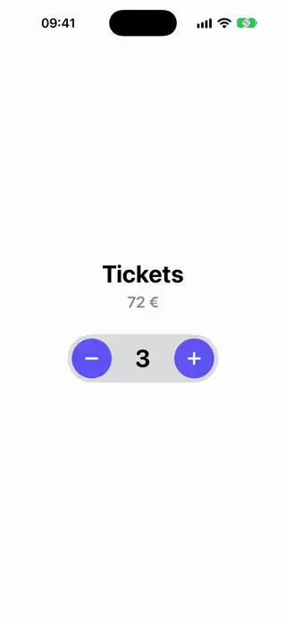
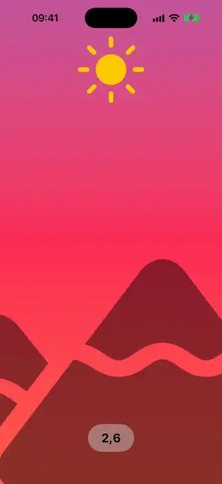
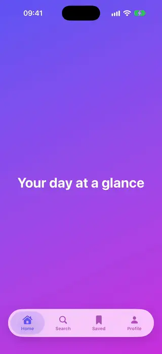
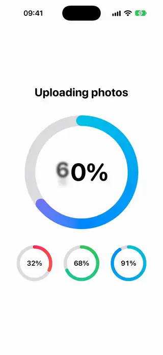
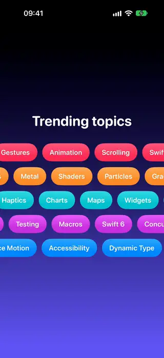

<div align="center">

# AwesomeSwiftUI

*Copy-paste SwiftUI components, animations and transitions for iOS 18 through iOS 27.*

[](https://github.com/magnoscg/AwesomeSwiftUI/actions/workflows/ci.yml)
[](https://github.com/magnoscg/AwesomeSwiftUI/releases/latest)
[](LICENSE)
[](https://github.com/magnoscg/AwesomeSwiftUI/stargazers)

From a one-line button style to full animated transitions. No package to
install: find a component, copy its file, use it.

</div>

**[Browse the catalog](https://magnoscg.github.io/AwesomeSwiftUI/)**

## At a glance

| | |
|---|---|
| Install | None. Copy one Swift file into your project |
| Platforms | iOS 18 to iOS 27. Each component states its own minimum |
| Language | Swift 6, with complete concurrency checking |
| Technologies | The current Apple API for each iOS version, and nothing deprecated |
| Search | Keywords on every component, for people and for AI agents |
| License | MIT |

## Catalog

<!-- catalog:start -->

**100 components.** Open a category to see every preview.

| Preview | Category | Count | Components |
|---|---|---|---|
|  | [Backgrounds](catalog/Backgrounds.md) | 9 | [Animated Gradient Background](Components/Backgrounds/AnimatedGradientBackground/AnimatedGradientBackground.swift) · [Aurora Mesh Background](Components/Backgrounds/AuroraMeshBackground/AuroraMeshBackground.swift) · [Bubbles Background](Components/Backgrounds/BubblesBackground/BubblesBackground.swift) · [Color Orbs Background](Components/Backgrounds/ColorOrbsBackground/ColorOrbsBackground.swift) · [Grid Pulse Background](Components/Backgrounds/GridPulseBackground/GridPulseBackground.swift) · [Particle Field Background](Components/Backgrounds/ParticleFieldBackground/ParticleFieldBackground.swift) · [Snowfall Background](Components/Backgrounds/SnowfallBackground/SnowfallBackground.swift) · [Starfield Background](Components/Backgrounds/StarfieldBackground/StarfieldBackground.swift) · [Waves Background](Components/Backgrounds/WavesBackground/WavesBackground.swift) |
|  | [Buttons](catalog/Buttons.md) | 9 | [Elastic Drag Button](Components/Buttons/ElasticDragButton/ElasticDragButton.swift) · [Expanding Search Button](Components/Buttons/ExpandingSearchButton/ExpandingSearchButton.swift) · [Gradient Border Button](Components/Buttons/GradientBorderButton/GradientBorderButton.swift) · [Hold To Confirm Button](Components/Buttons/HoldToConfirmButton/HoldToConfirmButton.swift) · [Like Burst Button](Components/Buttons/LikeBurstButton/LikeBurstButton.swift) · [Morphing Submit Button](Components/Buttons/MorphingSubmitButton/MorphingSubmitButton.swift) · [Pressable Button Style](Components/Buttons/PressableButtonStyle/PressableButtonStyle.swift) · [Pulse Ring Button](Components/Buttons/PulseRingButton/PulseRingButton.swift) · [Shimmer Button](Components/Buttons/ShimmerButton/ShimmerButton.swift) |
|  | [Cards](catalog/Cards.md) | 4 | [Avatar Stack](Components/Cards/AvatarStack/AvatarStack.swift) · [Expandable Info Card](Components/Cards/ExpandableInfoCard/ExpandableInfoCard.swift) · [Swipeable Card Stack](Components/Cards/SwipeableCardStack/SwipeableCardStack.swift) · [Tilt Card](Components/Cards/TiltCard/TiltCard.swift) |
|  | [Controls](catalog/Controls.md) | 4 | [Counter Stepper](Components/Controls/CounterStepper/CounterStepper.swift) · [Sliding Segmented Picker](Components/Controls/SlidingSegmentedPicker/SlidingSegmentedPicker.swift) · [Spring Toggle Style](Components/Controls/SpringToggleStyle/SpringToggleStyle.swift) · [Swipe To Confirm Slider](Components/Controls/SwipeToConfirmSlider/SwipeToConfirmSlider.swift) |
|  | [Effects](catalog/Effects.md) | 4 | [Confetti Burst](Components/Effects/ConfettiBurst/ConfettiBurst.swift) · [Noise Grain Overlay](Components/Effects/NoiseGrainOverlay/NoiseGrainOverlay.swift) · [Ripple Tap Effect](Components/Effects/RippleTapEffect/RippleTapEffect.swift) · [Spotlight Overlay](Components/Effects/SpotlightOverlay/SpotlightOverlay.swift) |
|  | [Feedback](catalog/Feedback.md) | 4 | [Rating Stars](Components/Feedback/RatingStars/RatingStars.swift) · [Shake Error Modifier](Components/Feedback/ShakeErrorModifier/ShakeErrorModifier.swift) · [Toast Banner](Components/Feedback/ToastBanner/ToastBanner.swift) · [Undo Snackbar](Components/Feedback/UndoSnackbar/UndoSnackbar.swift) |
|  | [Gestures](catalog/Gestures.md) | 1 | [Pinch Zoom View](Components/Gestures/PinchZoomView/PinchZoomView.swift) |
|  | [Glass](catalog/Glass.md) | 6 | [Glass Action Menu](Components/Glass/GlassActionMenu/GlassActionMenu.swift) · [Glass Button Gallery](Components/Glass/GlassButtonGallery/GlassButtonGallery.swift) · [Glass Segmented Control](Components/Glass/GlassSegmentedControl/GlassSegmentedControl.swift) · [Glass Tab Accessory](Components/Glass/GlassTabAccessory/GlassTabAccessory.swift) · [Glass Tag Cloud](Components/Glass/GlassTagCloud/GlassTagCloud.swift) · [Glass Tool Strip](Components/Glass/GlassToolStrip/GlassToolStrip.swift) |
|  | [Inputs](catalog/Inputs.md) | 3 | [Color Swatch Picker](Components/Inputs/ColorSwatchPicker/ColorSwatchPicker.swift) · [Floating Label Text Field](Components/Inputs/FloatingLabelTextField/FloatingLabelTextField.swift) · [OTP Code Field](Components/Inputs/OTPCodeField/OTPCodeField.swift) |
|  | [Layouts](catalog/Layouts.md) | 4 | [Bento Grid Layout](Components/Layouts/BentoGridLayout/BentoGridLayout.swift) · [Flow Tags Layout](Components/Layouts/FlowTagsLayout/FlowTagsLayout.swift) · [Radial Layout](Components/Layouts/RadialLayout/RadialLayout.swift) · [Subview Card Container](Components/Layouts/SubviewCardContainer/SubviewCardContainer.swift) |
|  | [Lists](catalog/Lists.md) | 2 | [Reorderable Card List](Components/Lists/ReorderableCardList/ReorderableCardList.swift) · [Reorderable Grid](Components/Lists/ReorderableGrid/ReorderableGrid.swift) |
|  | [Loaders](catalog/Loaders.md) | 7 | [Arc Segments Loader](Components/Loaders/ArcSegmentsLoader/ArcSegmentsLoader.swift) · [Blob Morph Loader](Components/Loaders/BlobMorphLoader/BlobMorphLoader.swift) · [Dots Pulse Loader](Components/Loaders/DotsPulseLoader/DotsPulseLoader.swift) · [Orbit Loader](Components/Loaders/OrbitLoader/OrbitLoader.swift) · [Skeleton Shimmer Modifier](Components/Loaders/SkeletonShimmerModifier/SkeletonShimmerModifier.swift) · [Symbol Breathe Loader](Components/Loaders/SymbolBreatheLoader/SymbolBreatheLoader.swift) · [Wave Bars Loader](Components/Loaders/WaveBarsLoader/WaveBarsLoader.swift) |
|  | [Modern](catalog/Modern.md) | 6 | [Animatable Ring](Components/Modern/AnimatableRing/AnimatableRing.swift) · [Concentric Card](Components/Modern/ConcentricCard/ConcentricCard.swift) · [Prominent Tab Bar](Components/Modern/ProminentTabBar/ProminentTabBar.swift) · [Scroll Edge Header](Components/Modern/ScrollEdgeHeader/ScrollEdgeHeader.swift) · [Symbol Draw On](Components/Modern/SymbolDrawOn/SymbolDrawOn.swift) · [Toolbar Overflow Demo](Components/Modern/ToolbarOverflowDemo/ToolbarOverflowDemo.swift) |
|  | [Navigation](catalog/Navigation.md) | 5 | [Animated Tab Bar](Components/Navigation/AnimatedTabBar/AnimatedTabBar.swift) · [Bottom Drawer](Components/Navigation/BottomDrawer/BottomDrawer.swift) · [Page Dots Indicator](Components/Navigation/PageDotsIndicator/PageDotsIndicator.swift) · [Scroll To Top Button](Components/Navigation/ScrollToTopButton/ScrollToTopButton.swift) · [Side Drawer](Components/Navigation/SideDrawer/SideDrawer.swift) |
|  | [Progress](catalog/Progress.md) | 5 | [Circular Progress Ring](Components/Progress/CircularProgressRing/CircularProgressRing.swift) · [Countdown Ring](Components/Progress/CountdownRing/CountdownRing.swift) · [Gradient Progress Bar](Components/Progress/GradientProgressBar/GradientProgressBar.swift) · [Liquid Fill Progress](Components/Progress/LiquidFillProgress/LiquidFillProgress.swift) · [Step Progress Indicator](Components/Progress/StepProgressIndicator/StepProgressIndicator.swift) |
|  | [Scrolling](catalog/Scrolling.md) | 5 | [Infinite Marquee Row](Components/Scrolling/InfiniteMarqueeRow/InfiniteMarqueeRow.swift) · [Parallax Cards Row](Components/Scrolling/ParallaxCardsRow/ParallaxCardsRow.swift) · [Peek Carousel](Components/Scrolling/PeekCarousel/PeekCarousel.swift) · [Scroll Fade Cards](Components/Scrolling/ScrollFadeCards/ScrollFadeCards.swift) · [Sticky Parallax Header](Components/Scrolling/StickyParallaxHeader/StickyParallaxHeader.swift) |
|  | [Text](catalog/Text.md) | 12 | [Animated Gradient Text](Components/Text/AnimatedGradientText/AnimatedGradientText.swift) · [Bouncy Letters Text](Components/Text/BouncyLettersText/BouncyLettersText.swift) · [Counting Number Text](Components/Text/CountingNumberText/CountingNumberText.swift) · [Glitch Text](Components/Text/GlitchText/GlitchText.swift) · [Glyph Wave Text](Components/Text/GlyphWaveText/GlyphWaveText.swift) · [Highlighted Search Text](Components/Text/HighlightedSearchText/HighlightedSearchText.swift) · [Marquee Text](Components/Text/MarqueeText/MarqueeText.swift) · [Rotating Words Text](Components/Text/RotatingWordsText/RotatingWordsText.swift) · [Scramble Text](Components/Text/ScrambleText/ScrambleText.swift) · [Shimmer Text](Components/Text/ShimmerText/ShimmerText.swift) · [Text Blur Reveal](Components/Text/TextBlurReveal/TextBlurReveal.swift) · [Typewriter Text](Components/Text/TypewriterText/TypewriterText.swift) |
|  | [Transitions](catalog/Transitions.md) | 10 | [Blur Fade Transition](Components/Transitions/BlurFadeTransition/BlurFadeTransition.swift) · [Circle Reveal Transition](Components/Transitions/CircleRevealTransition/CircleRevealTransition.swift) · [Content Swap Transition](Components/Transitions/ContentSwapTransition/ContentSwapTransition.swift) · [Cross Fade Navigation](Components/Transitions/CrossFadeNavigation/CrossFadeNavigation.swift) · [Flip Card Transition](Components/Transitions/FlipCardTransition/FlipCardTransition.swift) · [Matched Hero Card](Components/Transitions/MatchedHeroCard/MatchedHeroCard.swift) · [Slide Scale Transition](Components/Transitions/SlideScaleTransition/SlideScaleTransition.swift) · [Staggered Appear List](Components/Transitions/StaggeredAppearList/StaggeredAppearList.swift) · [Symbol Morph Toggle](Components/Transitions/SymbolMorphToggle/SymbolMorphToggle.swift) · [Zoom Hero Transition](Components/Transitions/ZoomHeroTransition/ZoomHeroTransition.swift) |

<!-- catalog:end -->

## How the catalog is organized

Each component lives in its own folder, under its category:

```text
Components/
  <Category>/
    <Name>/
      <Name>.swift       The component, a demo and a preview, in one file
      <Name>.meta.json   Keywords, minimum iOS, APIs used, difficulty, origin
      <Name>.webp        An animated preview of what it looks like
```

## The rules every component keeps

- **Self-contained.** One file wherever possible, with no dependency on
  another component, a package or an asset you would have to bring along.
- **Current.** Swift 6, Observation and Swift Testing. Nothing deprecated.
- **Honest about versions.** A component that needs a newer iOS says so with
  `@available` and in its metadata. It adds a fallback only where one is
  natural.
- **Accessible.** It respects Reduce Motion, Dynamic Type and VoiceOver.
- **Visible.** Every component has an animated preview, here and on the site.
- **Clean origin.** Original work, or code under a compatible license with its
  notice kept. See [where code may come from](CONTRIBUTING.md#where-code-may-come-from).

## For AI agents

[AGENTS.md](AGENTS.md) maps the repository and lists the rules a change has to
keep. To find a component, search [catalog.json](catalog.json) by keyword, in
English or Spanish, and fetch its `rawURL`. [llms.txt](llms.txt) is the short
index and [llms-full.txt](llms-full.txt) has every component with its source.

## Contributing

Ideas, components and fixes are welcome. Start with
[CONTRIBUTING.md](CONTRIBUTING.md). Everyone involved follows the
[code of conduct](CODE_OF_CONDUCT.md), and vulnerabilities go through
[SECURITY.md](SECURITY.md).

## License

[MIT](LICENSE). Each Swift file carries a short copyright header, so the notice
travels with the code when you copy it. Code imported from other projects keeps
its original license and notice.
