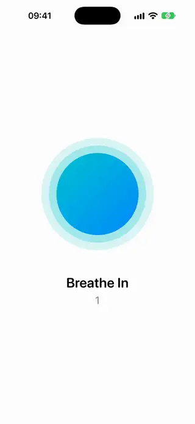
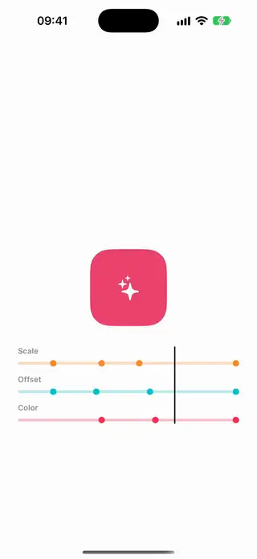
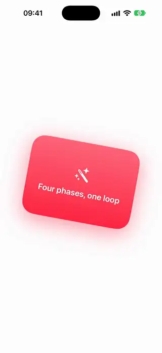
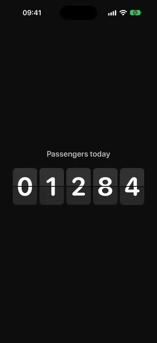
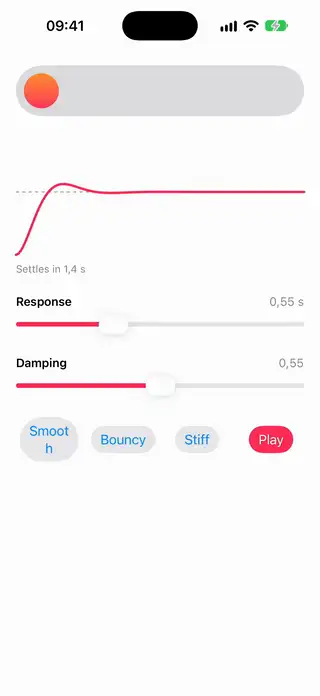
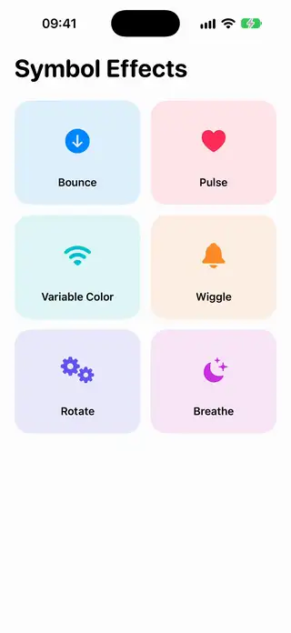

# Animations

[All categories](../README.md#catalog)

| Preview | Component | What it does | iOS | Level |
|---|---|---|---|---|
|  | [Breathing Guide Circle](../Components/Animations/BreathingGuideCircle/BreathingGuideCircle.swift) | A circle that expands and contracts through breathe in, hold and breathe out phases, with a label and a countdown. | 18.0+ | beginner |
|  | [Keyframe Timeline Showcase](../Components/Animations/KeyframeTimelineShowcase/KeyframeTimelineShowcase.swift) | A view animated by keyframe tracks for scale, offset and color, with the tracks and a playhead drawn on one shared timeline. | 18.0+ | intermediate |
|  | [Phase Animator Cycle](../Components/Animations/PhaseAnimatorCycle/PhaseAnimatorCycle.swift) | A card that loops through several phases of scale, rotation and color. | 18.0+ | beginner |
|  | [Split Flap Counter](../Components/Animations/SplitFlapCounter/SplitFlapCounter.swift) | A split-flap display where each digit flips down to its new value. | 18.0+ | intermediate |
|  | [Spring Study Playground](../Components/Animations/SpringStudyPlayground/SpringStudyPlayground.swift) | Sliders for response and damping that show how a spring moves a view and draw its curve. | 18.0+ | beginner |
|  | [Symbol Effect Gallery](../Components/Animations/SymbolEffectGallery/SymbolEffectGallery.swift) | A gallery of SF Symbol effects, each played on demand and labeled with its name. | 18.0+ | beginner |
