# Backgrounds

[All categories](../README.md#catalog)

| Preview | Component | What it does | iOS | Level |
|---|---|---|---|---|
| 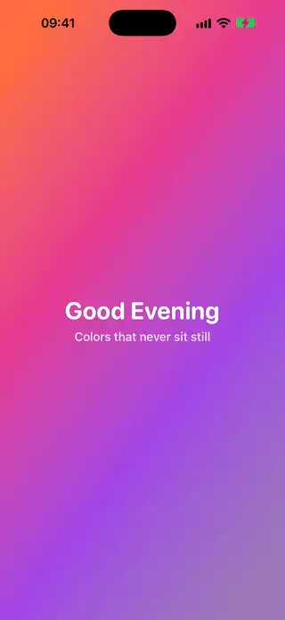 | [Animated Gradient Background](../Components/Backgrounds/AnimatedGradientBackground/AnimatedGradientBackground.swift) | A linear gradient that slowly drifts its colors and turns its direction. | 18.0+ | beginner |
| 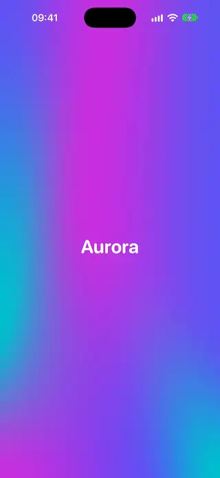 | [Aurora Mesh Background](../Components/Backgrounds/AuroraMeshBackground/AuroraMeshBackground.swift) | An animated aurora background made with a mesh gradient. | 18.0+ | intermediate |
| 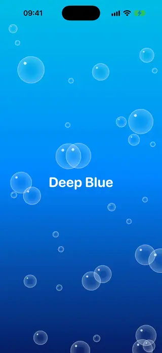 | [Bubbles Background](../Components/Backgrounds/BubblesBackground/BubblesBackground.swift) | Translucent bubbles that rise and sway across the screen. | 18.0+ | intermediate |
| 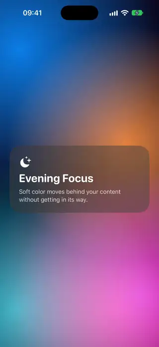 | [Color Orbs Background](../Components/Backgrounds/ColorOrbsBackground/ColorOrbsBackground.swift) | Large, soft colored orbs drifting slowly over a dark base. | 18.0+ | beginner |
| 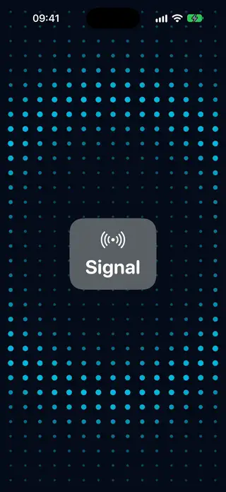 | [Grid Pulse Background](../Components/Backgrounds/GridPulseBackground/GridPulseBackground.swift) | A grid of dots with a pulse of light spreading out from the center. | 18.0+ | intermediate |
|  | [Image Derived Gradient Background](../Components/Backgrounds/ImageDerivedGradientBackground/ImageDerivedGradientBackground.swift) | A full-screen gradient whose colors are sampled from the pixels of an image and cross-fade when the image changes. | 18.0+ | advanced |
| 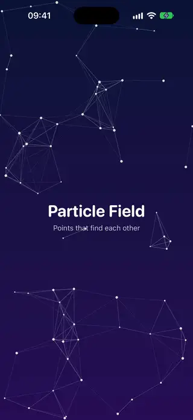 | [Particle Field Background](../Components/Backgrounds/ParticleFieldBackground/ParticleFieldBackground.swift) | Drifting points that are joined by faint lines when they come close. | 18.0+ | intermediate |
| 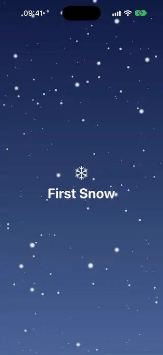 | [Snowfall Background](../Components/Backgrounds/SnowfallBackground/SnowfallBackground.swift) | Snowflakes falling at different speeds across three layers of depth. | 18.0+ | intermediate |
| 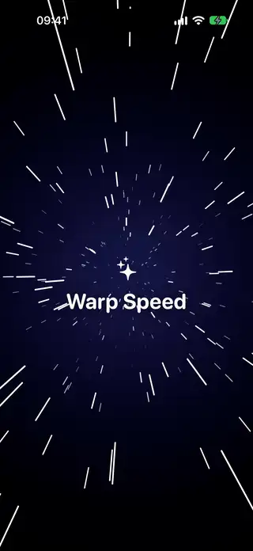 | [Starfield Background](../Components/Backgrounds/StarfieldBackground/StarfieldBackground.swift) | Stars streaking toward the viewer with a simple perspective projection. | 18.0+ | intermediate |
| 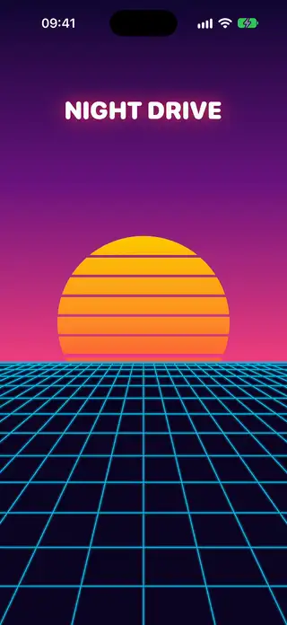 | [Synthwave Grid Background](../Components/Backgrounds/SynthwaveGridBackground/SynthwaveGridBackground.swift) | A retro perspective grid that scrolls under a gradient sky with a striped sun. | 18.0+ | intermediate |
| 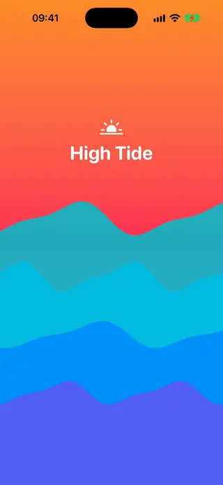 | [Waves Background](../Components/Backgrounds/WavesBackground/WavesBackground.swift) | Layered waves animated with a custom animatable Shape. | 18.0+ | intermediate |
| 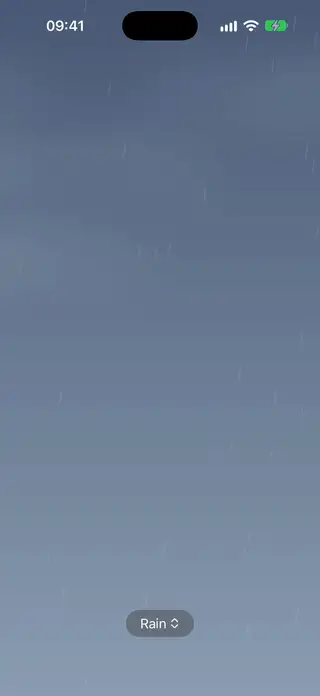 | [Weather Effects Background](../Components/Backgrounds/WeatherEffectsBackground/WeatherEffectsBackground.swift) | An animated sky for seven kinds of weather, with a turning sun, twinkling stars, drifting clouds, rain with splashes, lightning, swaying snow and fog, that fades from one to the next. | 18.0+ | advanced |
