# Buttons

[All categories](../README.md#catalog)

| Preview | Component | What it does | iOS | Level |
|---|---|---|---|---|
| 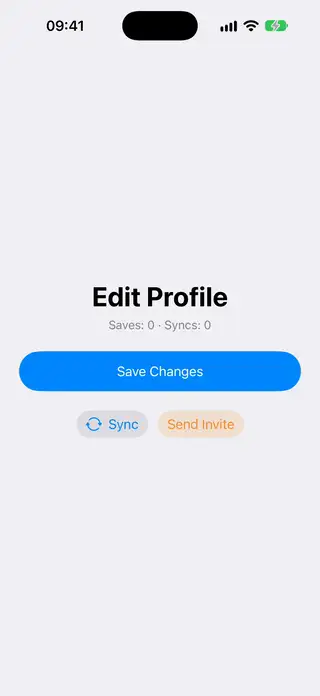 | [Async Action Button](../Components/Buttons/AsyncActionButton/AsyncActionButton.swift) | A button that runs an async action, swaps its label for a spinner in the label color without changing width and ignores taps until the action ends. | 18.0+ | beginner |
| 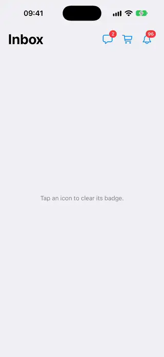 | [Badged Icon Button](../Components/Buttons/BadgedIconButton/BadgedIconButton.swift) | An icon button with a count badge on its corner that pops in, rolls its number, caps at 99+ and bounces the icon when the count goes up. | 18.0+ | beginner |
| 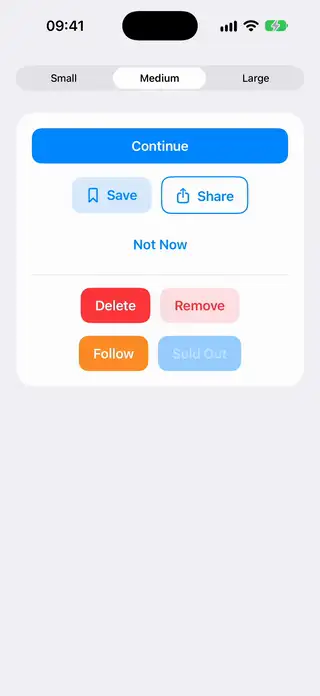 | [Button Variant Style](../Components/Buttons/ButtonVariantStyle/ButtonVariantStyle.swift) | A button style with filled, tinted, outlined and plain variants that follows the control size, the disabled state and the destructive role. | 18.0+ | beginner |
| 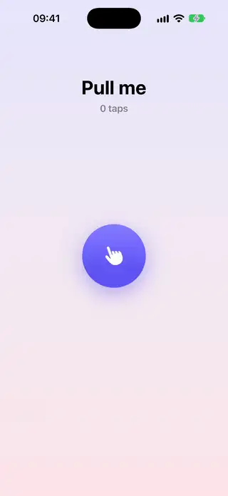 | [Elastic Drag Button](../Components/Buttons/ElasticDragButton/ElasticDragButton.swift) | A round button that stretches toward the finger and springs back on release. | 18.0+ | intermediate |
| 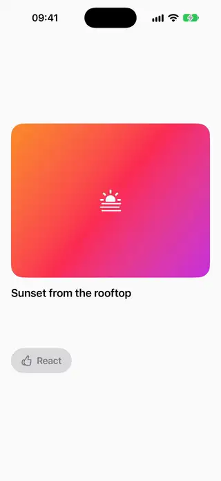 | [Emoji Reaction Picker](../Components/Buttons/EmojiReactionPicker/EmojiReactionPicker.swift) | A long-press control that reveals a row of reaction emoji, magnifies the one under the finger and selects it on release. | 18.0+ | advanced |
| 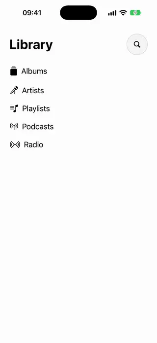 | [Expanding Search Button](../Components/Buttons/ExpandingSearchButton/ExpandingSearchButton.swift) | A round magnifying glass button that opens into a search field. | 18.0+ | beginner |
| 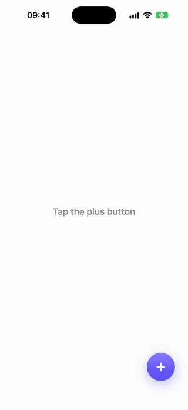 | [Floating Action Menu](../Components/Buttons/FloatingActionMenu/FloatingActionMenu.swift) | A plus button that rotates into a close icon and fans out its actions around it. | 18.0+ | intermediate |
| 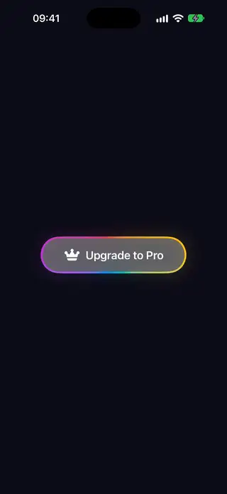 | [Gradient Border Button](../Components/Buttons/GradientBorderButton/GradientBorderButton.swift) | A capsule button whose border is an angular gradient that keeps rotating. | 18.0+ | beginner |
| 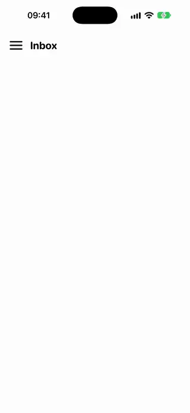 | [Hamburger Menu Button](../Components/Buttons/HamburgerMenuButton/HamburgerMenuButton.swift) | A three-line menu button whose bars animate into a close cross when toggled. | 18.0+ | intermediate |
| 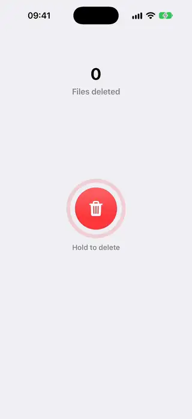 | [Hold To Confirm Button](../Components/Buttons/HoldToConfirmButton/HoldToConfirmButton.swift) | A round button that fires only after a long press fills its progress ring, and cancels if released early. | 18.0+ | intermediate |
| 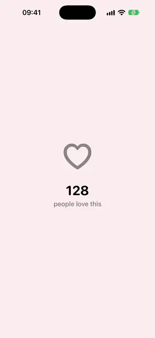 | [Like Burst Button](../Components/Buttons/LikeBurstButton/LikeBurstButton.swift) | A heart button that pops and throws out a burst of small particles when liked. | 18.0+ | intermediate |
| 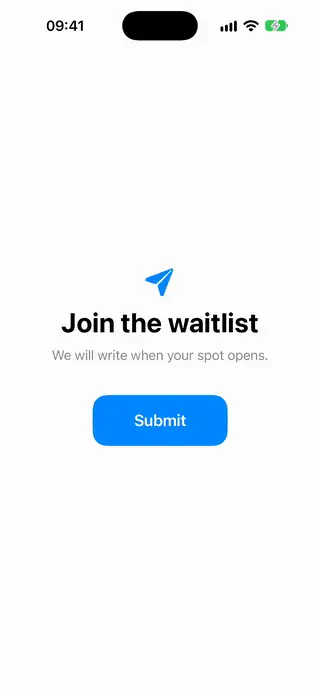 | [Morphing Submit Button](../Components/Buttons/MorphingSubmitButton/MorphingSubmitButton.swift) | A submit button that morphs into a spinner while it works and then into a checkmark. | 18.0+ | intermediate |
| 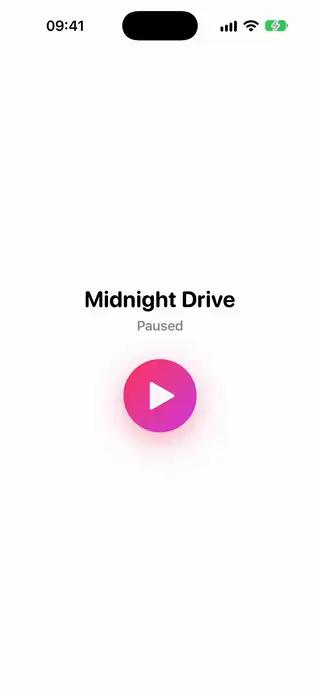 | [Play Pause Morph Button](../Components/Buttons/PlayPauseMorphButton/PlayPauseMorphButton.swift) | A play button whose triangle morphs into two pause bars by interpolating its path. | 18.0+ | intermediate |
| 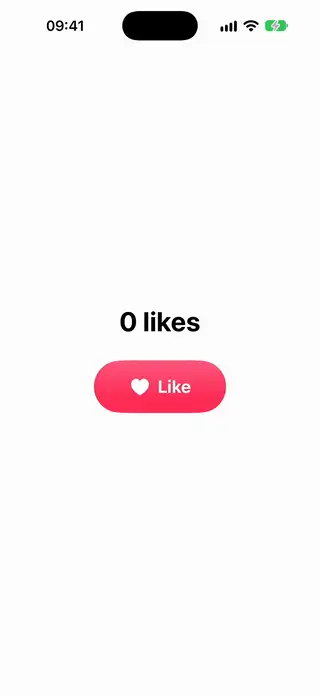 | [Pressable Button Style](../Components/Buttons/PressableButtonStyle/PressableButtonStyle.swift) | A button style that shrinks and dims on press, then springs back. | 18.0+ | beginner |
| 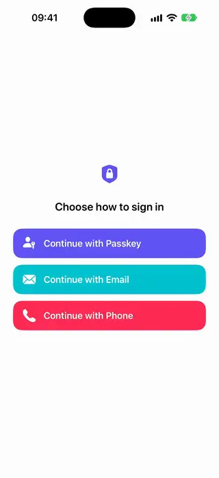 | [Provider Sign In Button Stack](../Components/Buttons/ProviderSignInButtonStack/ProviderSignInButtonStack.swift) | A stack of full-width sign-in buttons, each with a leading icon slot and its own loading state while authenticating. | 18.0+ | beginner |
| 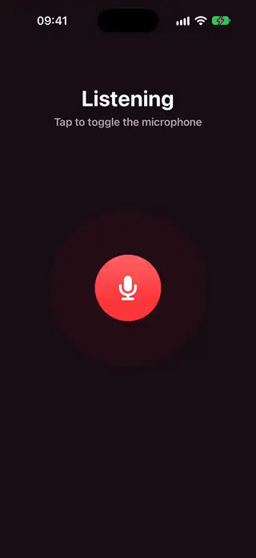 | [Pulse Ring Button](../Components/Buttons/PulseRingButton/PulseRingButton.swift) | A round button with rings that keep radiating out from behind it. | 18.0+ | intermediate |
| 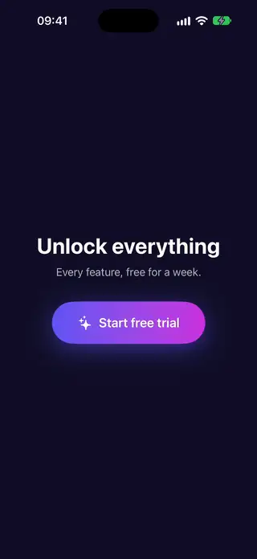 | [Shimmer Button](../Components/Buttons/ShimmerButton/ShimmerButton.swift) | A gradient capsule button with a band of light that sweeps across it in a loop. | 18.0+ | beginner |
| 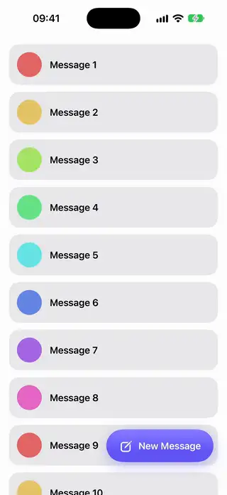 | [Shrinking Extended Button](../Components/Buttons/ShrinkingExtendedButton/ShrinkingExtendedButton.swift) | An extended floating button that collapses from a labeled pill to a plain icon as the scroll view moves down. | 18.0+ | intermediate |
