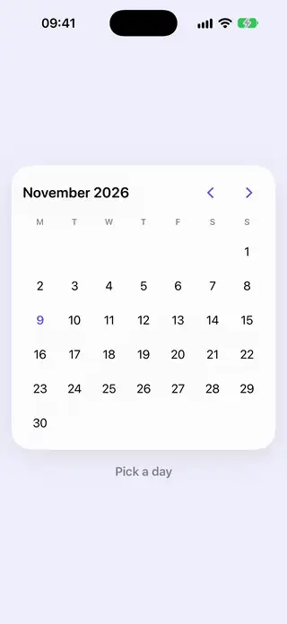
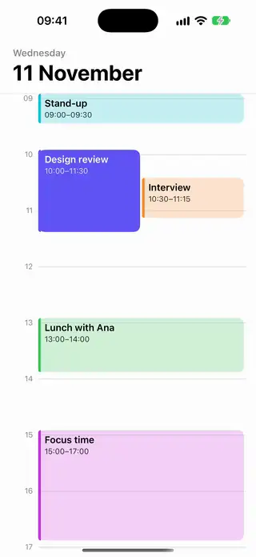

# Calendars

[All categories](../README.md#catalog)

| Preview | Component | What it does | iOS | Level |
|---|---|---|---|---|
|  | [Calendar Month Grid](../Components/Calendars/CalendarMonthGrid/CalendarMonthGrid.swift) | A month calendar for picking one day, with swipe paging between months. | 18.0+ | intermediate |
|  | [Calendar Range Selector](../Components/Calendars/CalendarRangeSelector/CalendarRangeSelector.swift) | A month calendar that picks a start and an end day and shades the days between them. | 18.0+ | intermediate |
|  | [Date Strip Picker](../Components/Calendars/DateStripPicker/DateStripPicker.swift) | A horizontal strip of days that keeps the selected day centered as you scroll. | 18.0+ | beginner |
|  | [Day Schedule Timeline](../Components/Calendars/DayScheduleTimeline/DayScheduleTimeline.swift) | The hours of a day down a column, with each event drawn over the time it takes, overlapping events side by side and a line at the current time. | 18.0+ | advanced |
