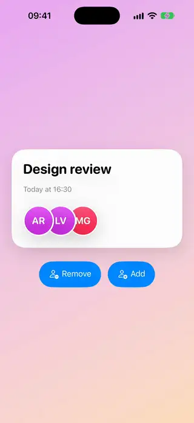
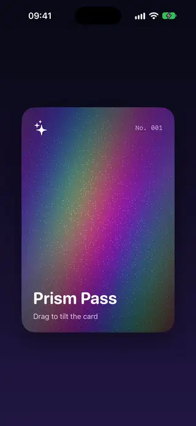
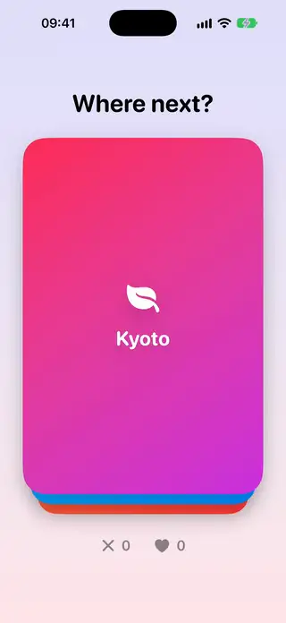
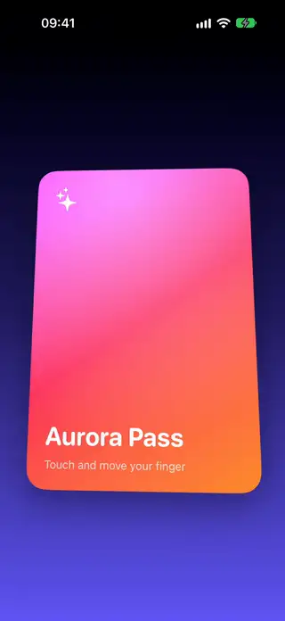
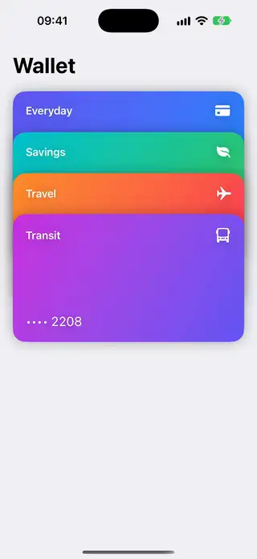

# Cards

[All categories](../README.md#catalog)

| Preview | Component | What it does | iOS | Level |
|---|---|---|---|---|
|  | [Avatar Stack](../Components/Cards/AvatarStack/AvatarStack.swift) | Overlapping avatars of initials with a badge counting the rest. | 18.0+ | beginner |
|  | [Expandable Info Card](../Components/Cards/ExpandableInfoCard/ExpandableInfoCard.swift) | A card that expands to show more, with a chevron that turns. | 18.0+ | beginner |
|  | [Holographic Card](../Components/Cards/HolographicCard/HolographicCard.swift) and its [shader](../Components/Cards/HolographicCard/HolographicCard.metal) | A card with a holographic foil whose colors, glints and glare shift as you tilt it by dragging, drawn by a Metal shader. | 18.0+ | advanced |
|  | [Swipeable Card Stack](../Components/Cards/SwipeableCardStack/SwipeableCardStack.swift) | A deck of cards you swipe away to reveal the next one. | 18.0+ | intermediate |
|  | [Tilt Card](../Components/Cards/TiltCard/TiltCard.swift) | A card that tilts in 3D toward the finger with a moving highlight. | 18.0+ | intermediate |
|  | [Wallet Card Stack](../Components/Cards/WalletCardStack/WalletCardStack.swift) | A stack of cards where the one you tap rises to the top with its details and the rest wait in a pile below. | 18.0+ | intermediate |
