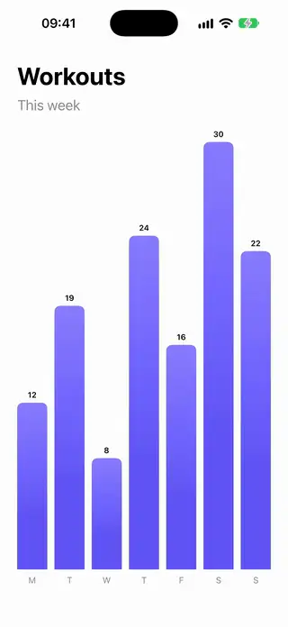
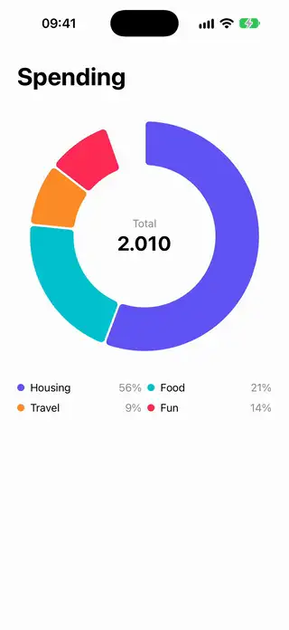
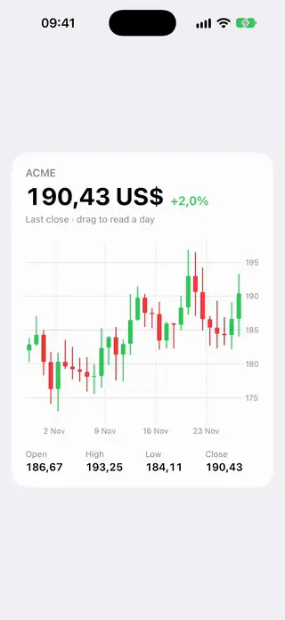
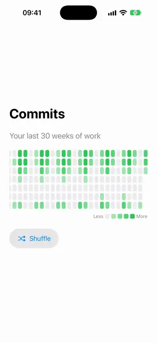
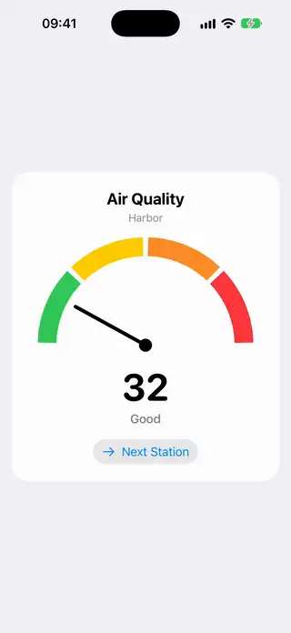
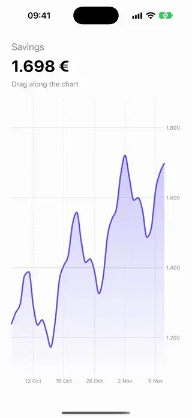
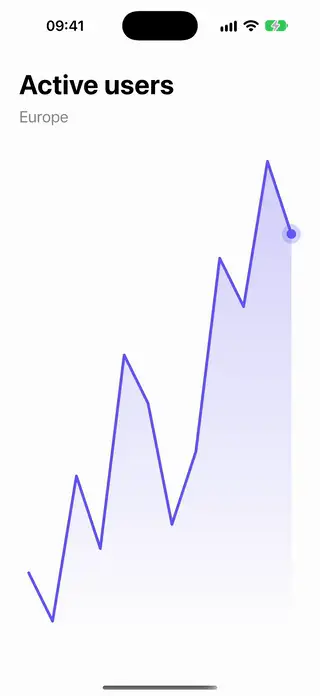
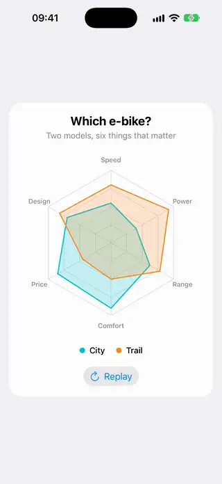
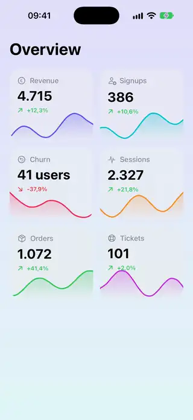
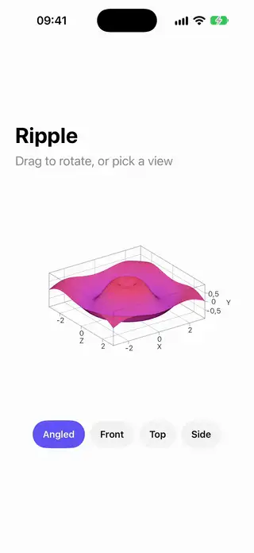

# Charts

[All categories](../README.md#catalog)

| Preview | Component | What it does | iOS | Level |
|---|---|---|---|---|
|  | [Animated Bar Chart](../Components/Charts/AnimatedBarChart/AnimatedBarChart.swift) | Bars that grow from the baseline one after another with a spring. | 18.0+ | beginner |
|  | [Animated Donut Chart](../Components/Charts/AnimatedDonutChart/AnimatedDonutChart.swift) | A donut chart whose segments grow in one by one, and the selected segment lifts out. | 18.0+ | intermediate |
|  | [Candlestick Chart](../Components/Charts/CandlestickChart/CandlestickChart.swift) | A candlestick chart of open, high, low and close prices, with a rule that reads the day under the finger. | 18.0+ | intermediate |
|  | [Contribution Heatmap](../Components/Charts/ContributionHeatmap/ContributionHeatmap.swift) | A calendar grid of colored cells whose intensity shows the activity of each day. | 18.0+ | intermediate |
|  | [Gauge Chart](../Components/Charts/GaugeChart/GaugeChart.swift) | A half-moon gauge with colored zones and a needle that swings to the value. | 18.0+ | intermediate |
|  | [Interactive Line Chart](../Components/Charts/InteractiveLineChart/InteractiveLineChart.swift) | A line chart that shows a rule and a value tooltip under the finger as it scrubs along the time axis. | 18.0+ | intermediate |
|  | [Line Chart Draw In](../Components/Charts/LineChartDrawIn/LineChartDrawIn.swift) | A line chart whose line draws in from left to right while a dot follows its tip. | 18.0+ | intermediate |
|  | [Radar Chart](../Components/Charts/RadarChart/RadarChart.swift) | A radar chart with an axis per quality around a center and a shape per series that grows out when it appears. | 18.0+ | intermediate |
|  | [Sparkline Stat Tile](../Components/Charts/SparklineStatTile/SparklineStatTile.swift) | A stat tile with a small trend line behind its value. | 18.0+ | beginner |
|  | [Surface 3D Chart](../Components/Charts/Surface3DChart/Surface3DChart.swift) | A 3D surface plot that rotates when dragged, with buttons for preset viewing angles. | 26.0+ | intermediate |
