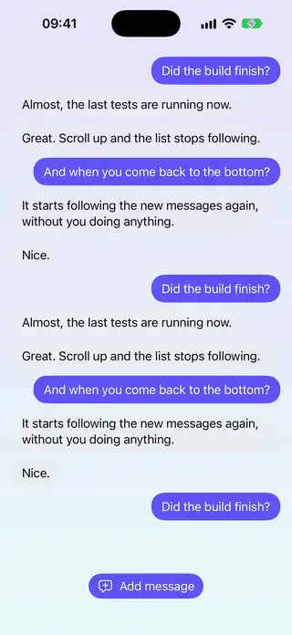
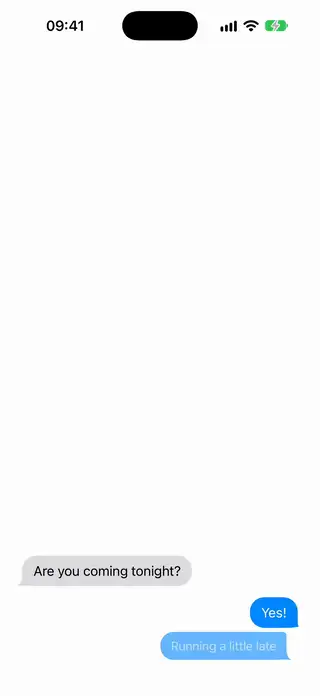
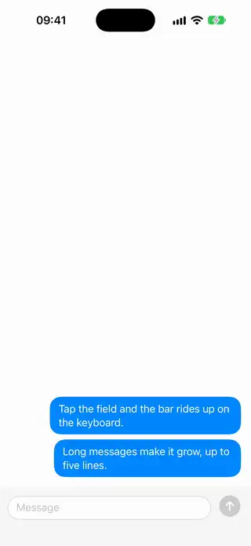
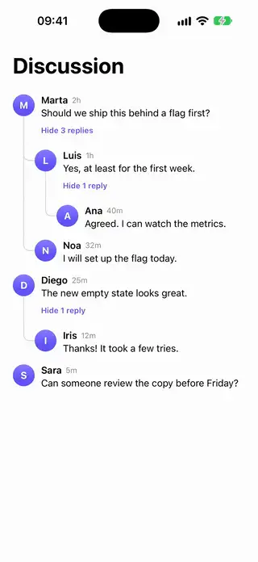
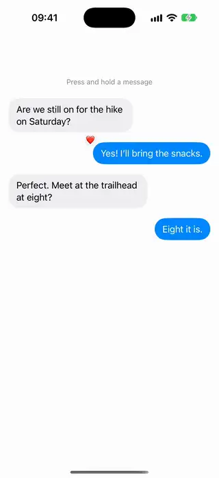

# Chat

[All categories](../README.md#catalog)

| Preview | Component | What it does | iOS | Level |
|---|---|---|---|---|
|  | [Chat Auto Scroll List](../Components/Chat/ChatAutoScrollList/ChatAutoScrollList.swift) | A message list that stays on the newest message as messages arrive, and stops following when the user scrolls up to read. | 18.0+ | intermediate |
|  | [Chat Bubble Shape](../Components/Chat/ChatBubbleShape/ChatBubbleShape.swift) | A message bubble with a tail, whose corners adapt to grouped consecutive messages. | 18.0+ | intermediate |
|  | [Keyboard Tracking Input Bar](../Components/Chat/KeyboardTrackingInputBar/KeyboardTrackingInputBar.swift) | A composer bar pinned below its content that rises with the keyboard and grows as the user types more lines. | 18.0+ | beginner |
|  | [Nested Comment Thread](../Components/Chat/NestedCommentThread/NestedCommentThread.swift) | Threaded comments with indentation, connector lines and collapsible replies. | 18.0+ | intermediate |
|  | [Tapback Reaction Bubble](../Components/Chat/TapbackReactionBubble/TapbackReactionBubble.swift) | A message you press and hold to react to, with a bar of reactions above it and the chosen one kept as a badge on its corner. | 18.0+ | intermediate |
