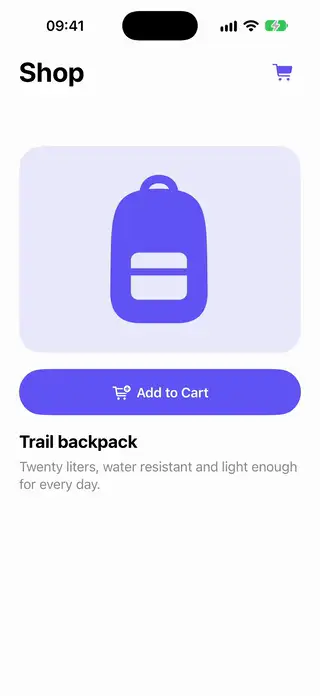

# Commerce

[All categories](../README.md#catalog)

| Preview | Component | What it does | iOS | Level |
|---|---|---|---|---|
|  | [Add To Cart Fly Button](../Components/Commerce/AddToCartFlyButton/AddToCartFlyButton.swift) | An add-to-cart button that sends a copy of the product image arcing into the cart badge. | 18.0+ | advanced |
|  | [Add To Cart Stepper](../Components/Commerce/AddToCartStepper/AddToCartStepper.swift) | An add button that morphs into a quantity stepper and collapses back to the button when the quantity returns to zero. | 18.0+ | beginner |
|  | [Billing Period Toggle](../Components/Commerce/BillingPeriodToggle/BillingPeriodToggle.swift) | A monthly and yearly switch where the price rolls to its new value and a savings badge appears. | 18.0+ | intermediate |
|  | [Pricing Tier Cards](../Components/Commerce/PricingTierCards/PricingTierCards.swift) | Snapping horizontal pricing cards with the recommended plan highlighted and enlarged. | 18.0+ | beginner |
|  | [Trial Timeline Paywall](../Components/Commerce/TrialTimelinePaywall/TrialTimelinePaywall.swift) | A paywall that shows what happens on each day of the free trial, with the plans and the button to start it. | 18.0+ | intermediate |
