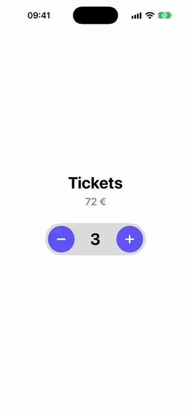
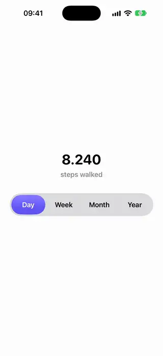
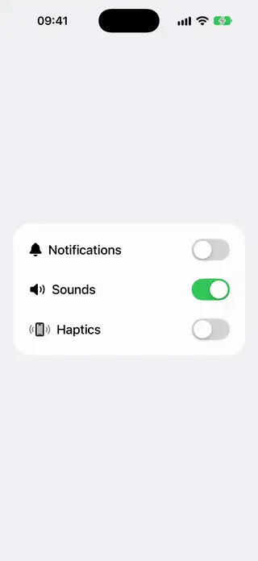
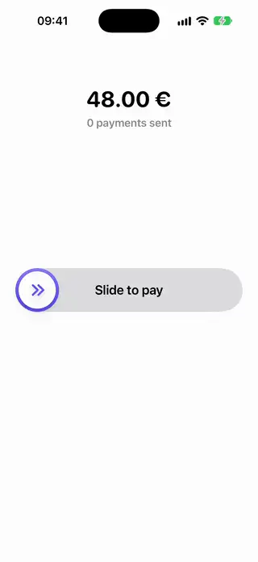

# Controls

[All categories](../README.md#catalog)

| Preview | Component | What it does | iOS | Level |
|---|---|---|---|---|
|  | [Counter Stepper](../Components/Controls/CounterStepper/CounterStepper.swift) | Minus and plus buttons around a number that rolls as it changes and stops at its limits. | 18.0+ | beginner |
|  | [Sliding Segmented Picker](../Components/Controls/SlidingSegmentedPicker/SlidingSegmentedPicker.swift) | A segmented picker whose selected pill glides between the options. | 18.0+ | beginner |
|  | [Spring Toggle Style](../Components/Controls/SpringToggleStyle/SpringToggleStyle.swift) | A custom toggle style whose knob widens under the finger and overshoots as it lands. | 18.0+ | beginner |
|  | [Swipe To Confirm Slider](../Components/Controls/SwipeToConfirmSlider/SwipeToConfirmSlider.swift) | A track with a thumb you drag to the end to confirm, which springs back if released early. | 18.0+ | intermediate |
