# Effects

[All categories](../README.md#catalog)

| Preview | Component | What it does | iOS | Level |
|---|---|---|---|---|
| 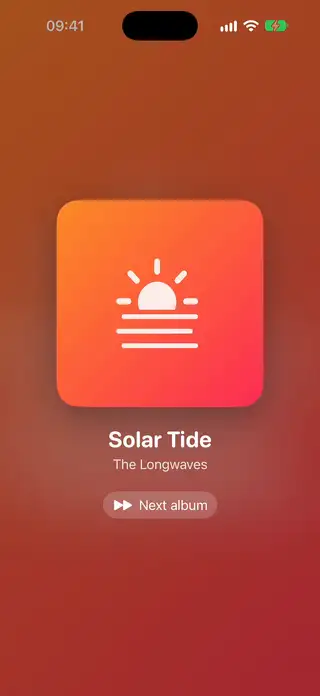 | [Blurred Image Backdrop](../Components/Effects/BlurredImageBackdrop/BlurredImageBackdrop.swift) | A full-screen backdrop made from a blurred image with a tint layer, for placing content on top of it. | 18.0+ | beginner |
| 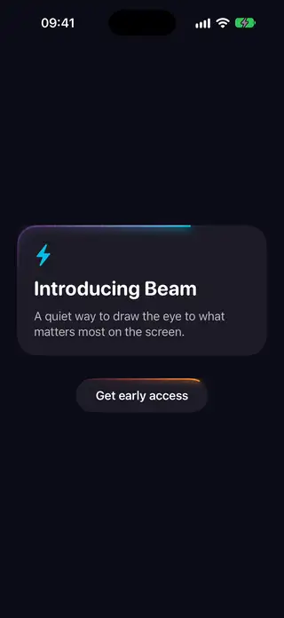 | [Border Beam Modifier](../Components/Effects/BorderBeamModifier/BorderBeamModifier.swift) | A light beam with a fading tail that travels continuously around a rounded border. | 18.0+ | intermediate |
| 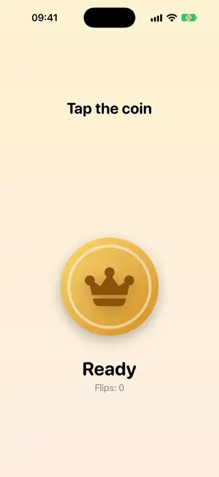 | [Coin Flip View](../Components/Effects/CoinFlipView/CoinFlipView.swift) | A coin that flips in 3D over several turns and lands on heads or tails. | 18.0+ | intermediate |
| 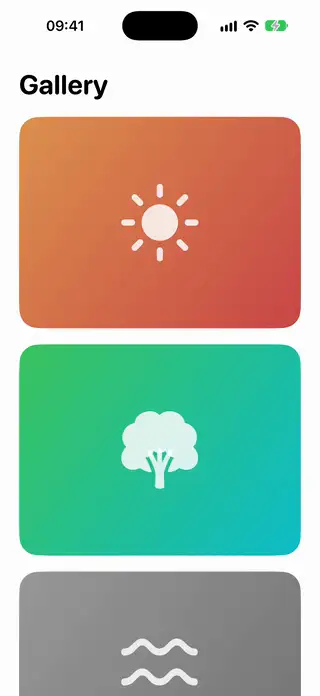 | [Color Reveal Image](../Components/Effects/ColorRevealImage/ColorRevealImage.swift) | A black and white image that gains its color as it scrolls toward the middle or when tapped. | 18.0+ | beginner |
| 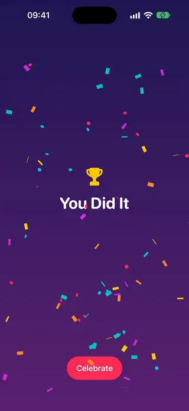 | [Confetti Burst](../Components/Effects/ConfettiBurst/ConfettiBurst.swift) | A one-shot confetti burst with simple physics, fired by changing a trigger. | 18.0+ | intermediate |
| 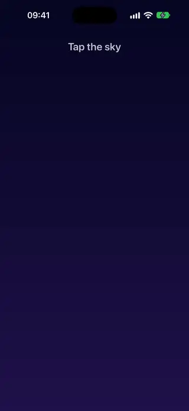 | [Fireworks Burst](../Components/Effects/FireworksBurst/FireworksBurst.swift) | Rockets that climb to where you tap and explode into particle sparks. | 18.0+ | intermediate |
| 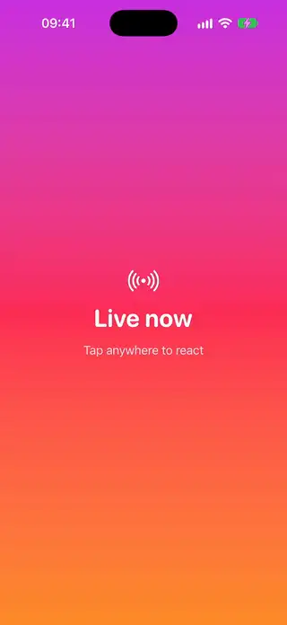 | [Floating Reactions Emitter](../Components/Effects/FloatingReactionsEmitter/FloatingReactionsEmitter.swift) | Emoji that float up from the tap point with a random drift and fade out. | 18.0+ | intermediate |
| 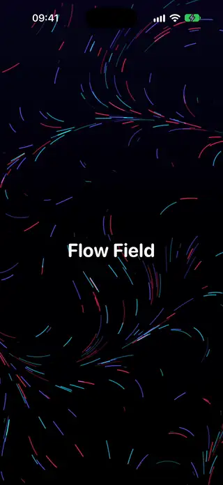 | [Flow Field Particles](../Components/Effects/FlowFieldParticles/FlowFieldParticles.swift) | Particles that drift along a smooth field of angles computed from position and time. | 18.0+ | advanced |
| 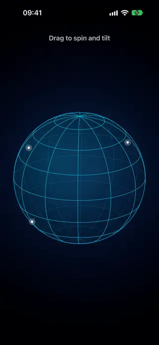 | [Globe 3D Wireframe](../Components/Effects/Globe3DWireframe/Globe3DWireframe.swift) | A wireframe globe drawn on a Canvas that spins by itself and turns and tilts as the finger drags it. | 18.0+ | advanced |
| 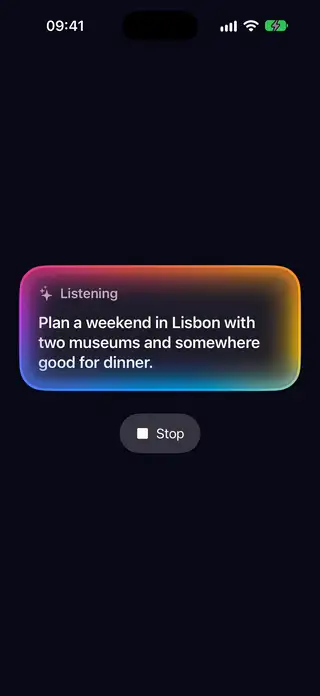 | [Intelligence Glow Border](../Components/Effects/IntelligenceGlowBorder/IntelligenceGlowBorder.swift) | A soft band of color that travels around a view's edge and spreads inward, like an assistant that is listening. | 18.0+ | intermediate |
| 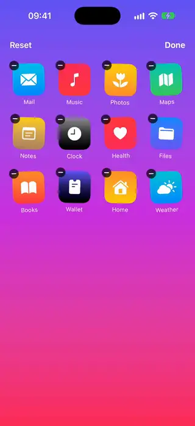 | [Jiggle Edit Modifier](../Components/Effects/JiggleEditModifier/JiggleEditModifier.swift) | A view modifier that makes views wobble slightly, like app icons in edit mode. | 18.0+ | beginner |
| 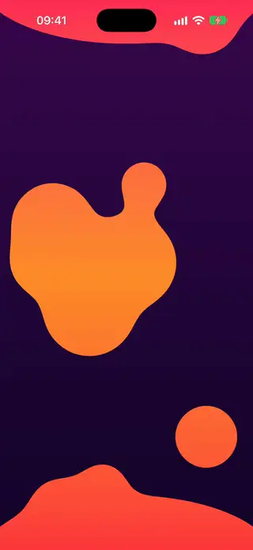 | [Metaball Lava Lamp](../Components/Effects/MetaballLavaLamp/MetaballLavaLamp.swift) | Round blobs that merge and separate like a lava lamp, drawn with a blur and alpha threshold on a Canvas. | 18.0+ | advanced |
| 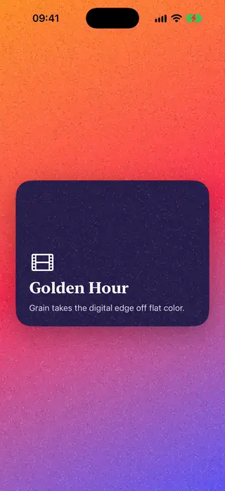 | [Noise Grain Overlay](../Components/Effects/NoiseGrainOverlay/NoiseGrainOverlay.swift) | A view modifier that lays a subtle animated film grain over any view. | 18.0+ | intermediate |
| 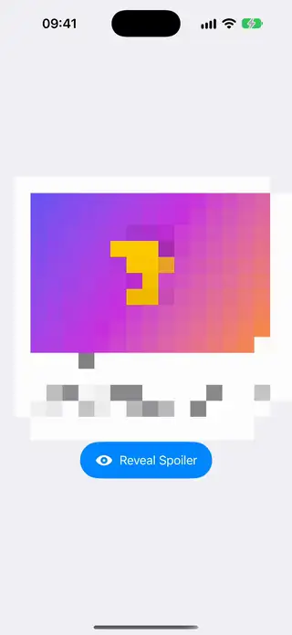 | [Pixelate Shader Effect](../Components/Effects/PixelateShaderEffect/PixelateShaderEffect.swift) and its [shader](../Components/Effects/PixelateShaderEffect/PixelateShaderEffect.metal) | A view modifier that draws a view in big square blocks, like a spoiler, and brings it into focus as they shrink, drawn by a Metal shader. | 18.0+ | intermediate |
| 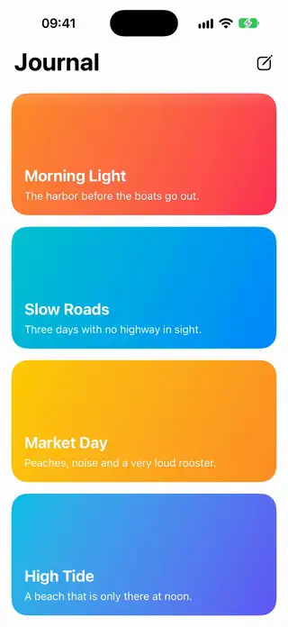 | [Progressive Blur Header](../Components/Effects/ProgressiveBlurHeader/ProgressiveBlurHeader.swift) and its [shader](../Components/Effects/ProgressiveBlurHeader/ProgressiveBlurHeader.metal) | A blur that grows toward the top edge of a scroll view, drawn by a Metal shader, so what scrolls under a header melts away. | 18.0+ | advanced |
| 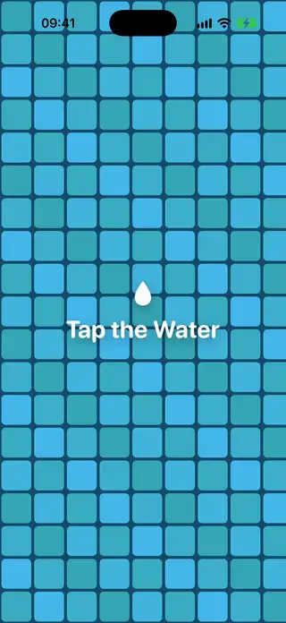 | [Ripple Shader Effect](../Components/Effects/RippleShaderEffect/RippleShaderEffect.swift) and its [shader](../Components/Effects/RippleShaderEffect/RippleShaderEffect.metal) | A view modifier that sends a wave from the tapped point and bends the view as it passes, drawn by a Metal shader. | 18.0+ | advanced |
| 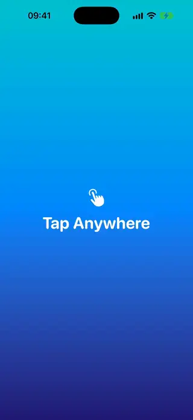 | [Ripple Tap Effect](../Components/Effects/RippleTapEffect/RippleTapEffect.swift) | A view modifier that spawns an expanding ripple wherever the user taps. | 18.0+ | intermediate |
| 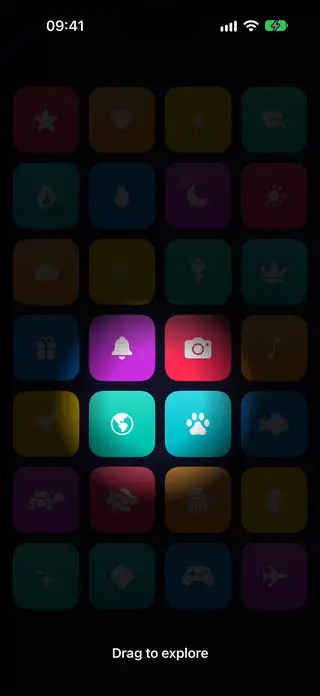 | [Spotlight Overlay](../Components/Effects/SpotlightOverlay/SpotlightOverlay.swift) | A dark overlay with a soft hole that follows the finger. | 18.0+ | beginner |
| 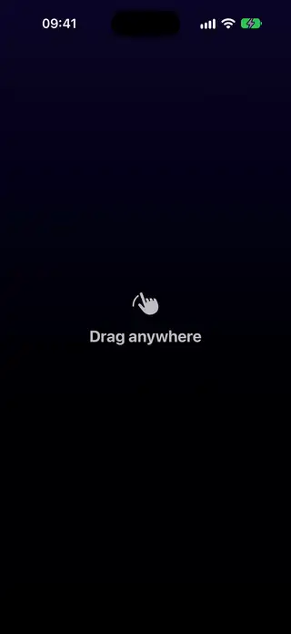 | [Touch Particle Trail](../Components/Effects/TouchParticleTrail/TouchParticleTrail.swift) | A trail of fading particles that follows the finger while it drags. | 18.0+ | intermediate |
| 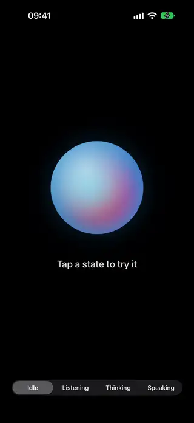 | [Voice Orb](../Components/Effects/VoiceOrb/VoiceOrb.swift) | A glowing orb for a voice assistant whose colors swirl and that swells with the voice while it listens or speaks. | 18.0+ | intermediate |
