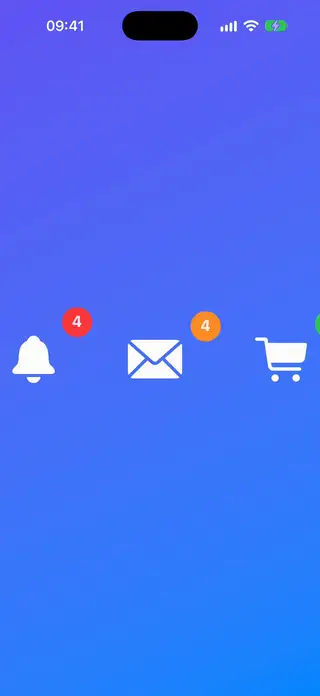
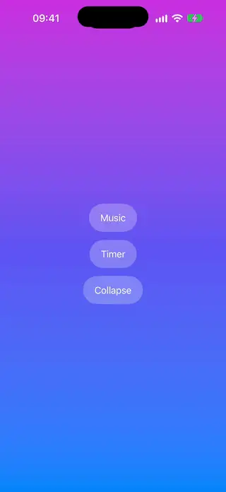
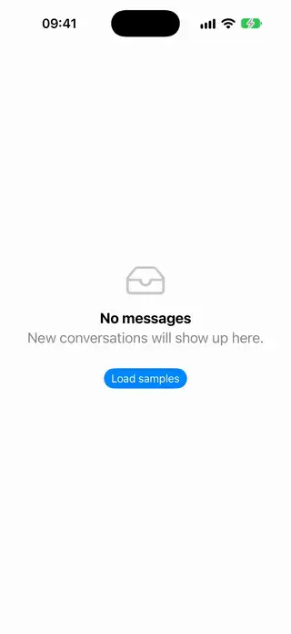
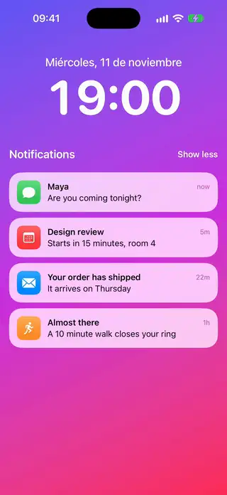
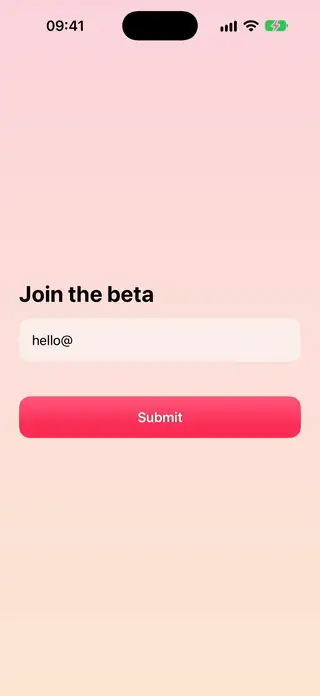
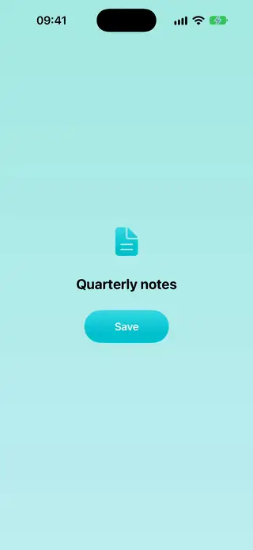
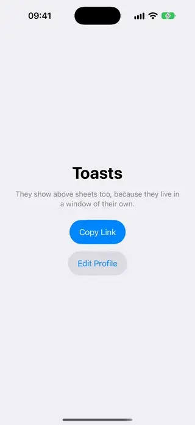
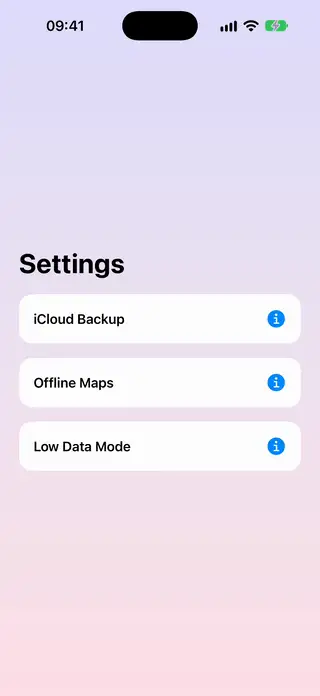
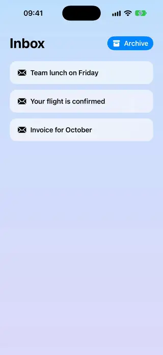

# Feedback

[All categories](../README.md#catalog)

| Preview | Component | What it does | iOS | Level |
|---|---|---|---|---|
|  | [Animated Badge Count](../Components/Feedback/AnimatedBadgeCount/AnimatedBadgeCount.swift) | A count badge whose number rolls to its new value and whose capsule springs to fit it. | 18.0+ | beginner |
|  | [Animated Checkmark Badge](../Components/Feedback/AnimatedCheckmarkBadge/AnimatedCheckmarkBadge.swift) | A success badge where a circle springs in and the checkmark draws itself inside it. | 18.0+ | beginner |
|  | [Dynamic Island Pill](../Components/Feedback/DynamicIslandPill/DynamicIslandPill.swift) | A black capsule at the top of the screen that grows to show a live status and shrinks back to a pill. | 18.0+ | intermediate |
|  | [Empty State Placeholder](../Components/Feedback/EmptyStatePlaceholder/EmptyStatePlaceholder.swift) | An empty screen with a breathing symbol, a message and an optional call to action. | 18.0+ | beginner |
|  | [Notification Stack](../Components/Feedback/NotificationStack/NotificationStack.swift) | Notifications piled under the newest one, like a lock screen, that open into a column with a tap and can be swiped away one by one. | 18.0+ | advanced |
|  | [Rating Stars](../Components/Feedback/RatingStars/RatingStars.swift) | Tappable rating stars that pop with a spring and work as an adjustable value in VoiceOver. | 18.0+ | beginner |
|  | [Shake Error Modifier](../Components/Feedback/ShakeErrorModifier/ShakeErrorModifier.swift) | A modifier that shakes a view with keyframes whenever a trigger value changes. | 18.0+ | beginner |
|  | [Toast Banner](../Components/Feedback/ToastBanner/ToastBanner.swift) | A toast modifier that slides a banner from the top, announces it to VoiceOver and dismisses by itself. | 18.0+ | beginner |
|  | [Toast Host](../Components/Feedback/ToastHost/ToastHost.swift) | A queue of toasts that show above everything, sheets and full-screen covers included. | 18.0+ | advanced |
|  | [Tooltip Popover](../Components/Feedback/TooltipPopover/TooltipPopover.swift) | A tooltip bubble that pops out of its arrow next to an anchor view and closes on a tap outside. | 18.0+ | intermediate |
|  | [Undo Snackbar](../Components/Feedback/UndoSnackbar/UndoSnackbar.swift) | A bottom bar with an Undo button and a shrinking timer line. | 18.0+ | beginner |
