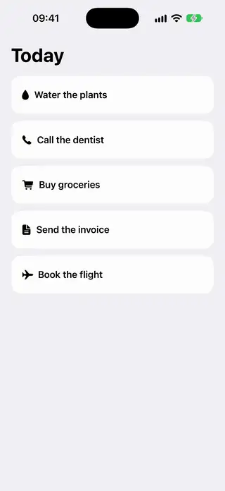
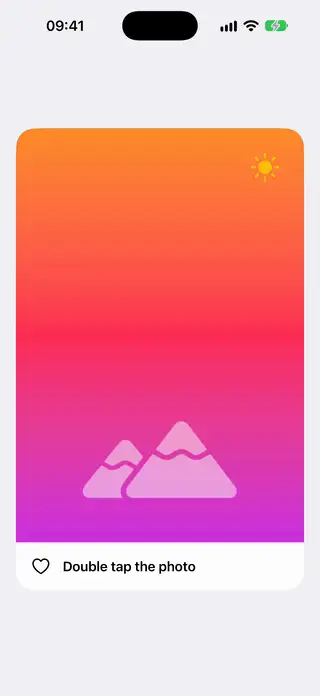
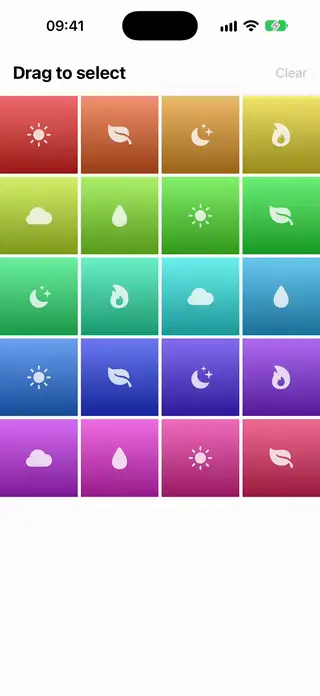
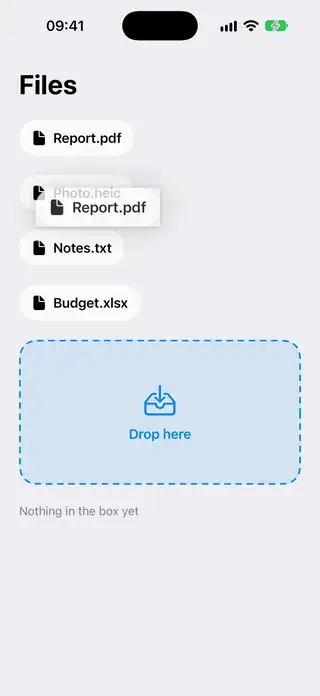
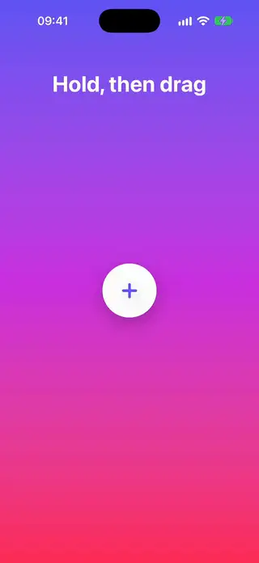
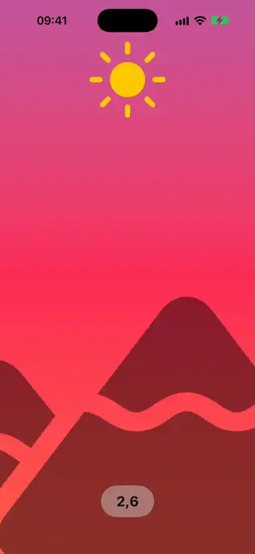
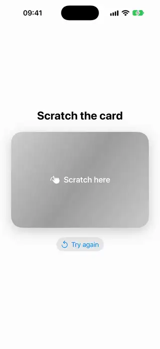
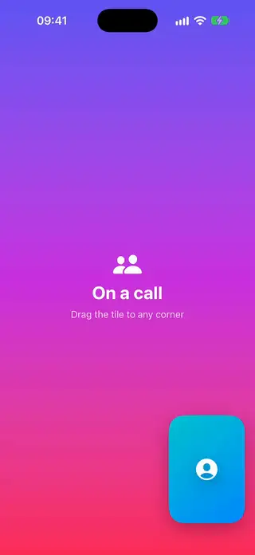
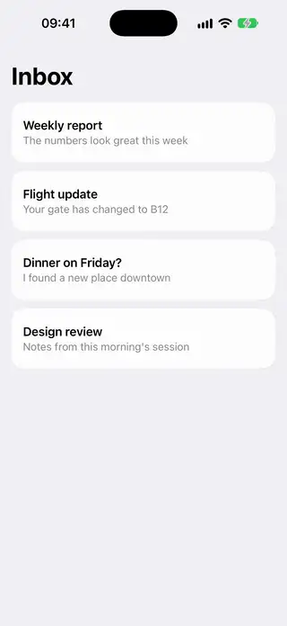

# Gestures

[All categories](../README.md#catalog)

| Preview | Component | What it does | iOS | Level |
|---|---|---|---|---|
|  | [Completion Swipe Row](../Components/Gestures/CompletionSwipeRow/CompletionSwipeRow.swift) | A row you swipe to the right to complete, where a checkmark pops in and the row collapses. | 18.0+ | intermediate |
|  | [Double Tap Heart Overlay](../Components/Gestures/DoubleTapHeartOverlay/DoubleTapHeartOverlay.swift) | Double tapping a photo throws a heart at the finger and marks the photo as liked. | 18.0+ | beginner |
|  | [Drag Select Grid](../Components/Gestures/DragSelectGrid/DragSelectGrid.swift) | A grid where dragging across tiles selects them all in one stroke, as in photo libraries. | 18.0+ | intermediate |
|  | [Drop Zone Highlight](../Components/Gestures/DropZoneHighlight/DropZoneHighlight.swift) | A drop target that highlights and shows a hint while a dragged item hovers over it and clears when the drag leaves. | 18.0+ | beginner |
|  | [Long Press Radial Menu](../Components/Gestures/LongPressRadialMenu/LongPressRadialMenu.swift) | A long press opens a ring of actions, and dragging onto one of them selects it on release. | 18.0+ | intermediate |
|  | [Pinch Zoom View](../Components/Gestures/PinchZoomView/PinchZoomView.swift) | A view you pinch to zoom and drag, which springs back to its bounds. | 18.0+ | intermediate |
|  | [Scratch To Reveal](../Components/Gestures/ScratchToReveal/ScratchToReveal.swift) | A cover you scratch with a finger to uncover the content beneath it. | 18.0+ | advanced |
|  | [Snap Corner Draggable](../Components/Gestures/SnapCornerDraggable/SnapCornerDraggable.swift) | A floating view that can be dragged anywhere and springs to the nearest safe-area corner when released. | 18.0+ | beginner |
|  | [Swipe Action Row](../Components/Gestures/SwipeActionRow/SwipeActionRow.swift) | A row that reveals action buttons under a horizontal swipe and snaps open or closed. | 18.0+ | intermediate |
