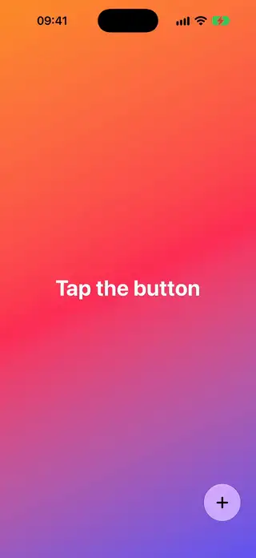
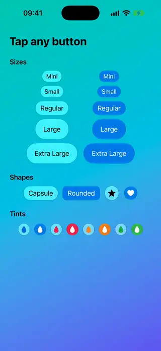
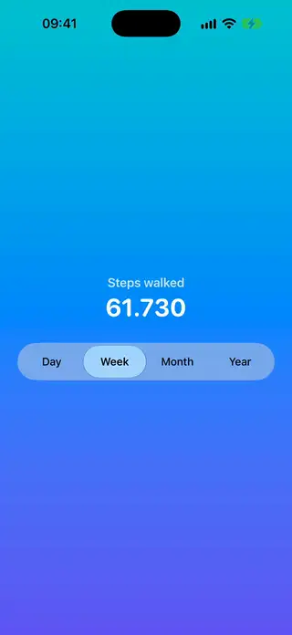
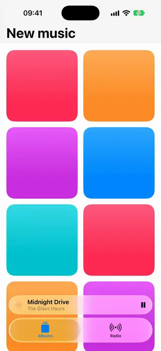
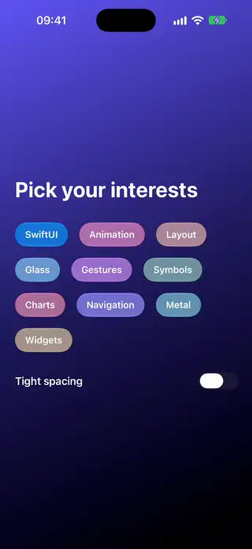
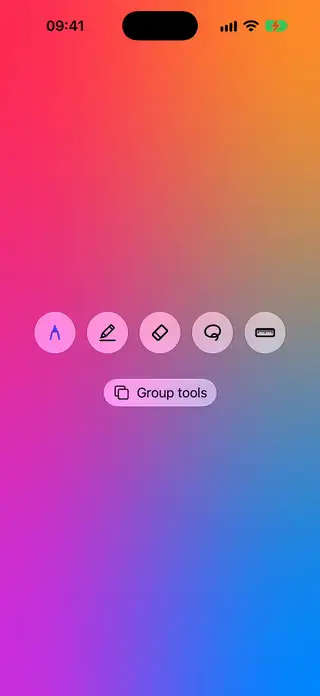

# Glass

[All categories](../README.md#catalog)

| Preview | Component | What it does | iOS | Level |
|---|---|---|---|---|
|  | [Glass Action Menu](../Components/Glass/GlassActionMenu/GlassActionMenu.swift) | A floating Liquid Glass button whose actions morph out of it. | 26.0+ | intermediate |
|  | [Glass Button Gallery](../Components/Glass/GlassButtonGallery/GlassButtonGallery.swift) | A reference gallery of the glass and prominent glass button styles in several sizes, shapes and tints. | 26.0+ | beginner |
|  | [Glass Segmented Control](../Components/Glass/GlassSegmentedControl/GlassSegmentedControl.swift) | A segmented control with a Liquid Glass thumb that slides between segments. | 26.0+ | intermediate |
|  | [Glass Tab Accessory](../Components/Glass/GlassTabAccessory/GlassTabAccessory.swift) | A tab view with a Liquid Glass accessory above a tab bar that minimizes on scroll. | 26.0+ | intermediate |
|  | [Glass Tag Cloud](../Components/Glass/GlassTagCloud/GlassTagCloud.swift) | Tags of tinted, interactive Liquid Glass that melt together when they get close. | 26.0+ | intermediate |
|  | [Glass Tool Strip](../Components/Glass/GlassToolStrip/GlassToolStrip.swift) | A row of Liquid Glass tool buttons with related tools fused into one shape. | 26.0+ | intermediate |
