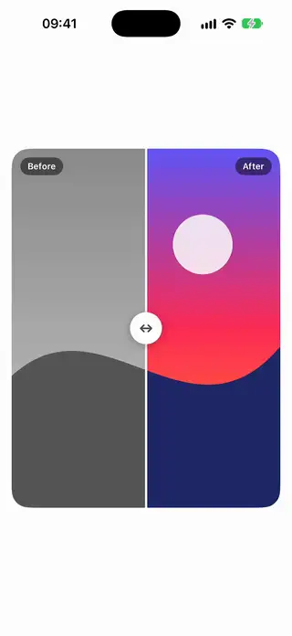
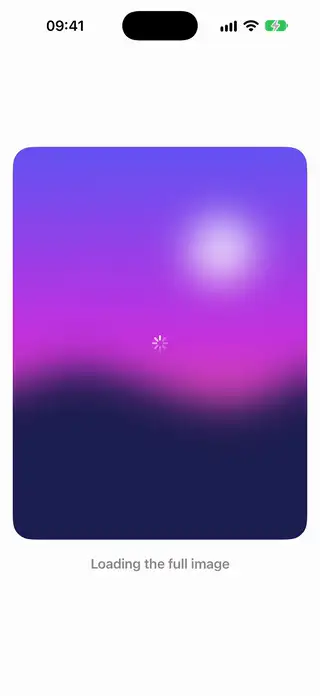
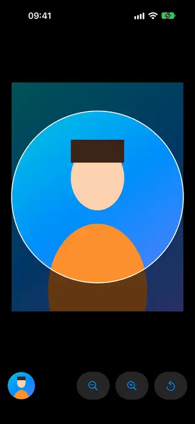
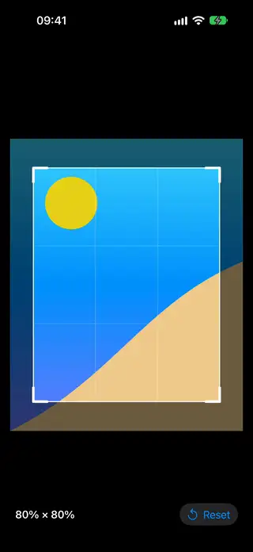
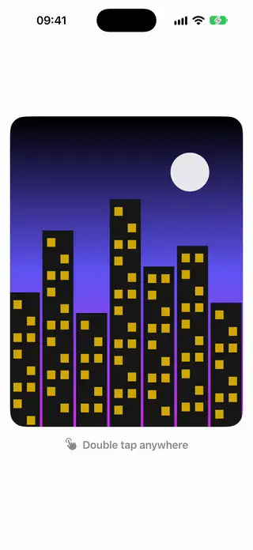
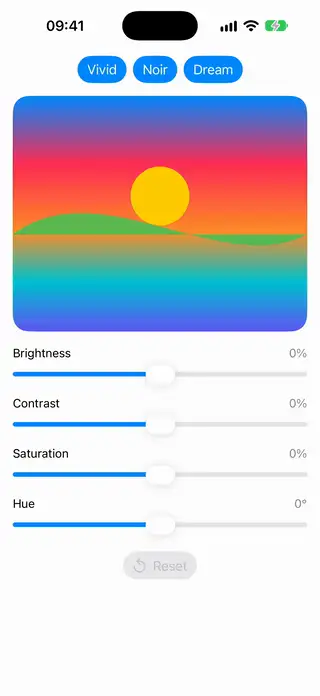
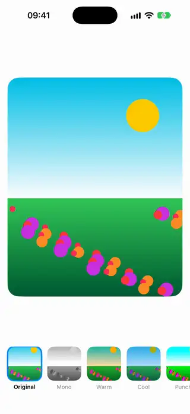
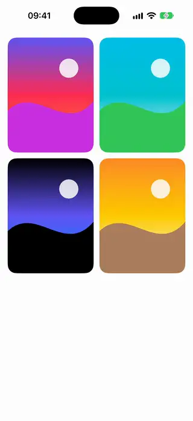
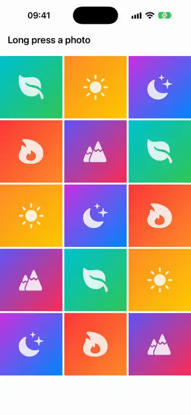
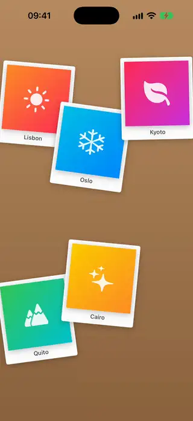

# Images

[All categories](../README.md#catalog)

| Preview | Component | What it does | iOS | Level |
|---|---|---|---|---|
|  | [Before After Slider](../Components/Images/BeforeAfterSlider/BeforeAfterSlider.swift) | Two stacked images split by a draggable handle that compares the before and after versions. | 18.0+ | intermediate |
|  | [Blur Up Image](../Components/Images/BlurUpImage/BlurUpImage.swift) | An image that goes from a blurred preview into sharp focus once the full picture arrives. | 18.0+ | intermediate |
|  | [Circular Avatar Cropper](../Components/Images/CircularAvatarCropper/CircularAvatarCropper.swift) | A photo you pan and pinch under a fixed circular window to choose an avatar crop. | 18.0+ | advanced |
|  | [Crop Rectangle Overlay](../Components/Images/CropRectangleOverlay/CropRectangleOverlay.swift) | A crop frame with draggable corners and edges over an image, dimming the area outside the selection. | 18.0+ | advanced |
|  | [Double Tap Zoom Image](../Components/Images/DoubleTapZoomImage/DoubleTapZoomImage.swift) | An image that zooms in on the point you double tap and returns to fit on the next double tap. | 18.0+ | intermediate |
|  | [Ken Burns Image](../Components/Images/KenBurnsImage/KenBurnsImage.swift) | A still picture that slowly zooms and pans so that it appears to move. | 18.0+ | beginner |
|  | [Photo Adjustment Sliders](../Components/Images/PhotoAdjustmentSliders/PhotoAdjustmentSliders.swift) | Brightness, contrast, saturation and hue sliders that update a photo live as they move. | 18.0+ | intermediate |
|  | [Photo Filter Presets](../Components/Images/PhotoFilterPresets/PhotoFilterPresets.swift) | A row of preset thumbnails that apply mono, warm, cool and high contrast looks to a photo using SwiftUI modifiers. | 18.0+ | beginner |
|  | [Photo Lightbox](../Components/Images/PhotoLightbox/PhotoLightbox.swift) | A full-screen photo pager where each page zooms independently and the viewer closes on a swipe down. | 18.0+ | advanced |
|  | [Photo Multi Select Grid](../Components/Images/PhotoMultiSelectGrid/PhotoMultiSelectGrid.swift) | A photo grid where a long press enters a multi-select mode that shows checkmarks on the chosen photos. | 18.0+ | intermediate |
|  | [Scattered Photo Board](../Components/Images/ScatteredPhotoBoard/ScatteredPhotoBoard.swift) | Photos scattered at slight angles on a board that can be dragged around and brought to the front on touch. | 18.0+ | advanced |
