# Inputs

[All categories](../README.md#catalog)

| Preview | Component | What it does | iOS | Level |
|---|---|---|---|---|
| 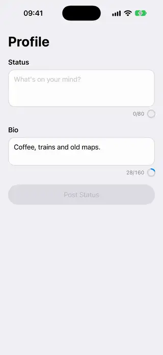 | [Character Count Text Editor](../Components/Inputs/CharacterCountTextEditor/CharacterCountTextEditor.swift) | A multiline text field with a placeholder, a ring that fills toward the limit and a count that turns orange near it and red past it. | 18.0+ | beginner |
| 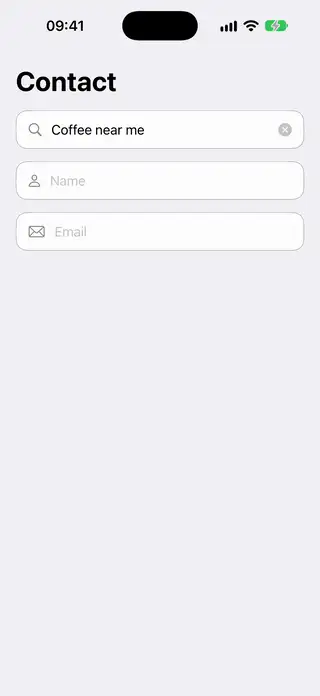 | [Clearable Text Field](../Components/Inputs/ClearableTextField/ClearableTextField.swift) | A text field with a leading symbol, a clear button that keeps the focus, a tinted border while editing and an optional error message. | 18.0+ | beginner |
| 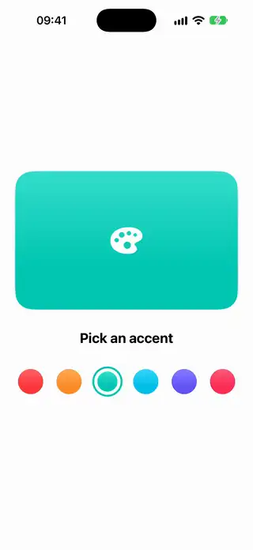 | [Color Swatch Picker](../Components/Inputs/ColorSwatchPicker/ColorSwatchPicker.swift) | A grid of selectable color swatches where the chosen one grows a ring. | 18.0+ | beginner |
|  | [Floating Label Text Field](../Components/Inputs/FloatingLabelTextField/FloatingLabelTextField.swift) | A text field whose placeholder floats up when it gains focus or has text. | 18.0+ | beginner |
| 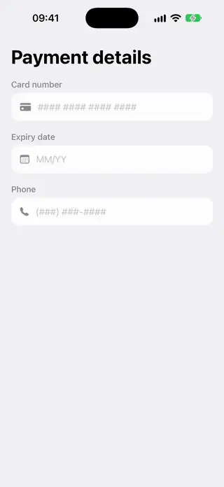 | [Masked Text Field](../Components/Inputs/MaskedTextField/MaskedTextField.swift) | A text field that formats input as the user types, such as 12/34 or a phone number, using a mask. | 18.0+ | intermediate |
| 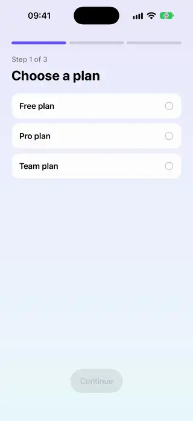 | [Multi Step Form](../Components/Inputs/MultiStepForm/MultiStepForm.swift) | A multi-step form with a progress bar that moves forward only when the current step is valid. | 18.0+ | intermediate |
|  | [OTP Code Field](../Components/Inputs/OTPCodeField/OTPCodeField.swift) | A one-time code field with one box per digit, backed by a single hidden text field. | 18.0+ | intermediate |
| 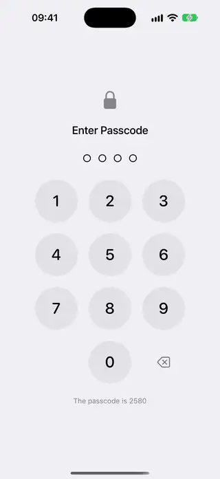 | [Passcode Keypad](../Components/Inputs/PasscodeKeypad/PasscodeKeypad.swift) | A number pad with a dot per digit that shakes and empties when the passcode is wrong. | 18.0+ | intermediate |
| 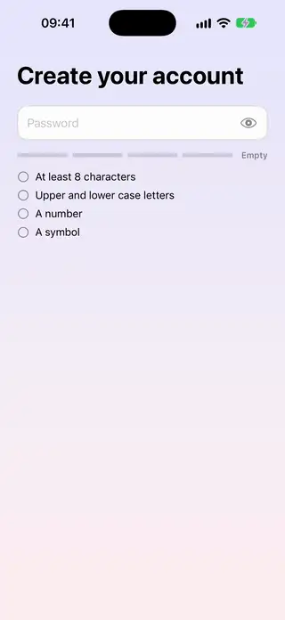 | [Password Strength Field](../Components/Inputs/PasswordStrengthField/PasswordStrengthField.swift) | A password field with a strength meter and a checklist of rules that tick off as they are met. | 18.0+ | intermediate |
| 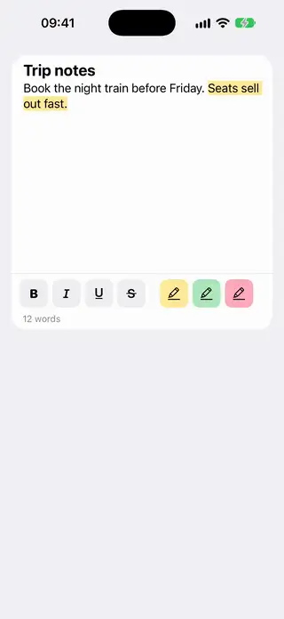 | [Rich Text Editor](../Components/Inputs/RichTextEditor/RichTextEditor.swift) | A text editor with a bar to make the selection bold, italic, underlined, struck through or highlighted. | 26.0+ | intermediate |
| 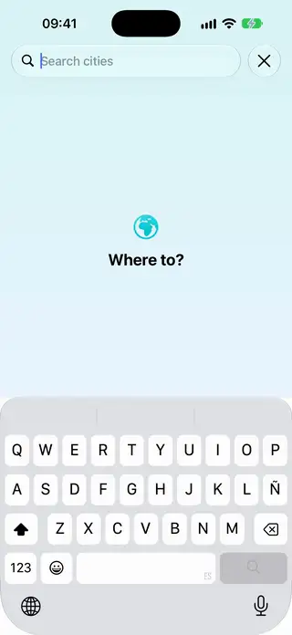 | [Search Field With Suggestions](../Components/Inputs/SearchFieldWithSuggestions/SearchFieldWithSuggestions.swift) | A search field that lists matching suggestions as the user types and fills the field when one is chosen. | 18.0+ | beginner |
| 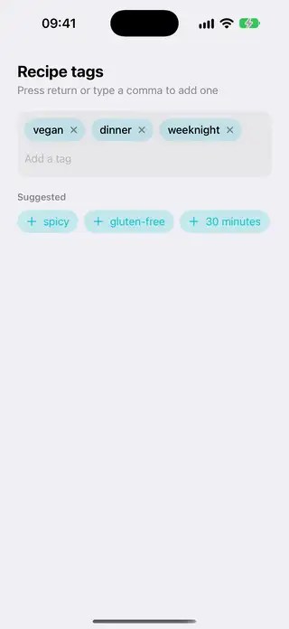 | [Tag Input Field](../Components/Inputs/TagInputField/TagInputField.swift) | A field that turns what you type into removable tags, which wrap onto as many lines as they need. | 18.0+ | advanced |
| 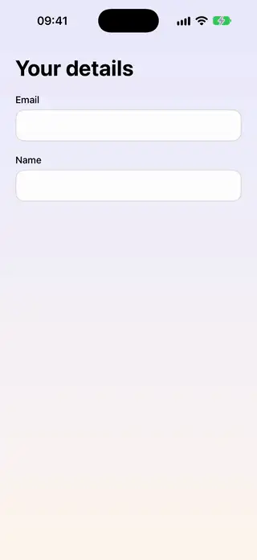 | [Validated Text Field](../Components/Inputs/ValidatedTextField/ValidatedTextField.swift) | A text field that checks its value when it loses focus and shows its error only after that. | 18.0+ | beginner |
