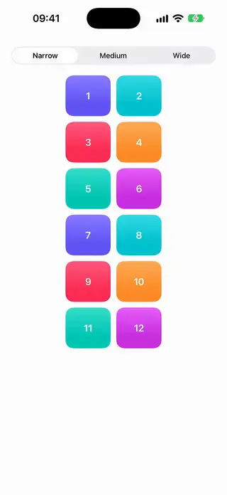
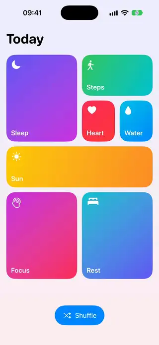
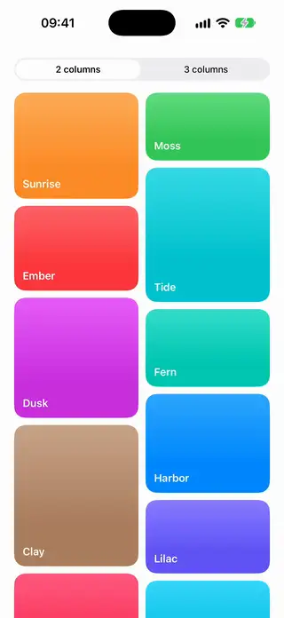
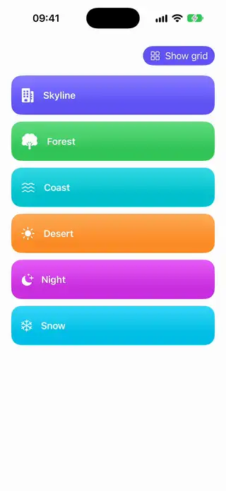
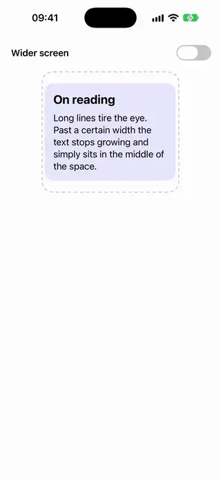

# Layouts

[All categories](../README.md#catalog)

| Preview | Component | What it does | iOS | Level |
|---|---|---|---|---|
|  | [Adaptive Columns Grid](../Components/Layouts/AdaptiveColumnsGrid/AdaptiveColumnsGrid.swift) | A grid whose column count is computed from the available width, so it gives more columns on iPad and fewer on iPhone. | 18.0+ | beginner |
|  | [Any Layout Adaptive Switch](../Components/Layouts/AnyLayoutAdaptiveSwitch/AnyLayoutAdaptiveSwitch.swift) | A group that animates between a row and a column when its available width changes. | 18.0+ | beginner |
|  | [Bento Grid Layout](../Components/Layouts/BentoGridLayout/BentoGridLayout.swift) | A custom Layout that packs tiles of varied spans into a bento grid. | 18.0+ | advanced |
|  | [Flow Tags Layout](../Components/Layouts/FlowTagsLayout/FlowTagsLayout.swift) | A custom Layout that wraps tags onto as many lines as they need. | 18.0+ | intermediate |
|  | [Kanban Board](../Components/Layouts/KanbanBoard/KanbanBoard.swift) | Columns of cards that the user drags from one column to another. | 18.0+ | advanced |
|  | [Masonry Layout](../Components/Layouts/MasonryLayout/MasonryLayout.swift) | A custom layout that places items of different heights into the shortest of several columns, like a Pinterest board. | 18.0+ | intermediate |
|  | [Morphing Layout Switch](../Components/Layouts/MorphingLayoutSwitch/MorphingLayoutSwitch.swift) | A switch that moves items between a list and a grid in one lazy grid, keeping the state of each cell. | 18.0+ | intermediate |
|  | [Radial Layout](../Components/Layouts/RadialLayout/RadialLayout.swift) | A custom Layout that spreads views around a circle and animates as the count changes. | 18.0+ | intermediate |
|  | [Readable Width Container](../Components/Layouts/ReadableWidthContainer/ReadableWidthContainer.swift) | A wrapper that caps its content to a comfortable reading width and centers it on large iPad screens. | 18.0+ | beginner |
|  | [Subview Card Container](../Components/Layouts/SubviewCardContainer/SubviewCardContainer.swift) | A custom container that styles each child of its ViewBuilder as a card. | 18.0+ | intermediate |
