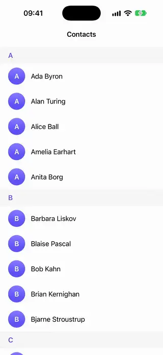

# Lists

[All categories](../README.md#catalog)

| Preview | Component | What it does | iOS | Level |
|---|---|---|---|---|
|  | [Accordion Section](../Components/Lists/AccordionSection/AccordionSection.swift) | A stack of sections where opening one section closes the others, with the content height animated. | 18.0+ | beginner |
|  | [Disclosure Tree View](../Components/Lists/DisclosureTreeView/DisclosureTreeView.swift) | A nested tree of rows that expand and collapse, indenting each level, for folders or category hierarchies. | 18.0+ | intermediate |
|  | [Edit Mode Multi Select](../Components/Lists/EditModeMultiSelect/EditModeMultiSelect.swift) | A list with a Select mode that shows selection circles on each row and a bottom bar of bulk actions. | 18.0+ | intermediate |
|  | [Load More Footer](../Components/Lists/LoadMoreFooter/LoadMoreFooter.swift) | An infinite list footer that requests the next page when it appears and shows loading, retry and end states. | 18.0+ | beginner |
|  | [Reorderable Card List](../Components/Lists/ReorderableCardList/ReorderableCardList.swift) | A stack of cards you can drag into a new order, without using List. | 27.0+ | intermediate |
|  | [Reorderable Grid](../Components/Lists/ReorderableGrid/ReorderableGrid.swift) | A grid of tiles the user can drag into a new order. | 27.0+ | intermediate |
|  | [Sticky Section Headers](../Components/Lists/StickySectionHeaders/StickySectionHeaders.swift) | A scrolling list of sections whose headers pin to the top until the next header pushes them off. | 18.0+ | beginner |
|  | [Swipe Action Cards](../Components/Lists/SwipeActionCards/SwipeActionCards.swift) | A column of cards with the system's swipe actions, outside a List. | 27.0+ | beginner |
