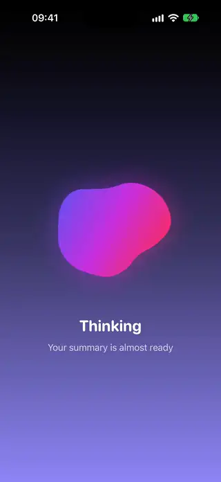
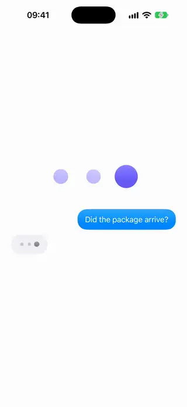
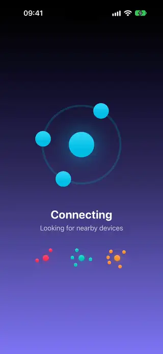
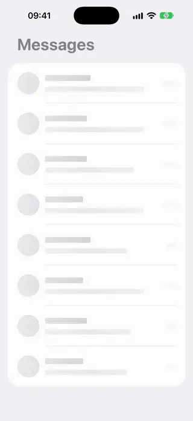
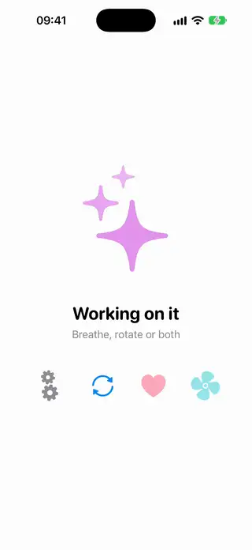
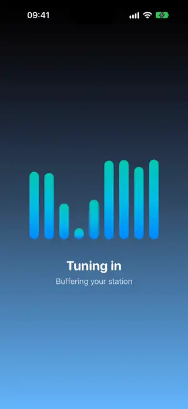

# Loaders

[All categories](../README.md#catalog)

| Preview | Component | What it does | iOS | Level |
|---|---|---|---|---|
|  | [Arc Segments Loader](../Components/Loaders/ArcSegmentsLoader/ArcSegmentsLoader.swift) | A spinner with gradient arc segments of different lengths turning in opposite directions. | 18.0+ | beginner |
|  | [Blob Morph Loader](../Components/Loaders/BlobMorphLoader/BlobMorphLoader.swift) | A soft gradient blob drawn in a canvas that keeps changing shape while content loads. | 18.0+ | advanced |
|  | [Dots Pulse Loader](../Components/Loaders/DotsPulseLoader/DotsPulseLoader.swift) | Three dots that pulse in sequence, as in a typing indicator. | 18.0+ | beginner |
|  | [Orbit Loader](../Components/Loaders/OrbitLoader/OrbitLoader.swift) | A loading indicator with dots that orbit a glowing center. | 18.0+ | beginner |
|  | [Skeleton Shimmer Modifier](../Components/Loaders/SkeletonShimmerModifier/SkeletonShimmerModifier.swift) | A view modifier that turns any view into a shimmering redacted placeholder while it loads. | 18.0+ | intermediate |
|  | [Symbol Breathe Loader](../Components/Loaders/SymbolBreatheLoader/SymbolBreatheLoader.swift) | A loading indicator made of an SF Symbol that uses the breathe and rotate symbol effects. | 18.0+ | beginner |
|  | [Wave Bars Loader](../Components/Loaders/WaveBarsLoader/WaveBarsLoader.swift) | A loading indicator with bars that rise and fall like an audio equalizer. | 18.0+ | beginner |
