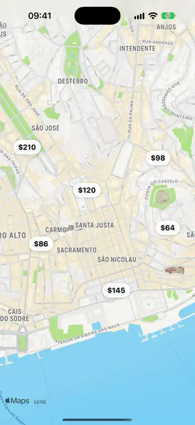
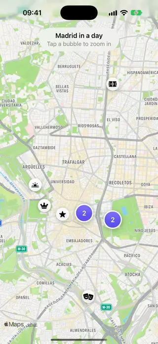
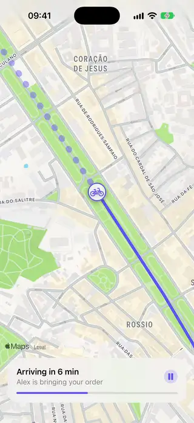
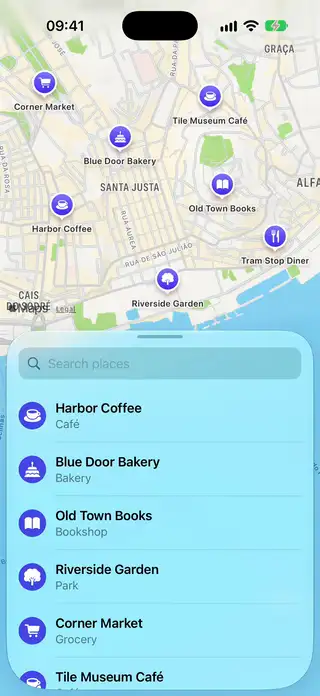

# Maps

[All categories](../README.md#catalog)

| Preview | Component | What it does | iOS | Level |
|---|---|---|---|---|
|  | [Map Annotation Callout](../Components/Maps/MapAnnotationCallout/MapAnnotationCallout.swift) | Map pins with a short label that open a callout above them when tapped, while the camera moves to fit it. | 18.0+ | intermediate |
|  | [Map Cluster Annotations](../Components/Maps/MapClusterAnnotations/MapClusterAnnotations.swift) | A map where places that are close together are drawn as one bubble with their count, which splits into its places as the map zooms in. | 18.0+ | advanced |
|  | [Map Route Tracker](../Components/Maps/MapRouteTracker/MapRouteTracker.swift) | A route on a map with a marker that travels along it, the part done in solid and the rest dotted, like an order on its way. | 18.0+ | advanced |
|  | [Map Search Sheet](../Components/Maps/MapSearchSheet/MapSearchSheet.swift) | A map with a sheet of places that rests at the bottom, filters as you type and flies to the place you choose. | 18.0+ | intermediate |
