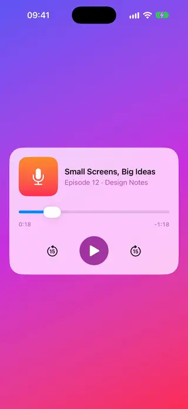
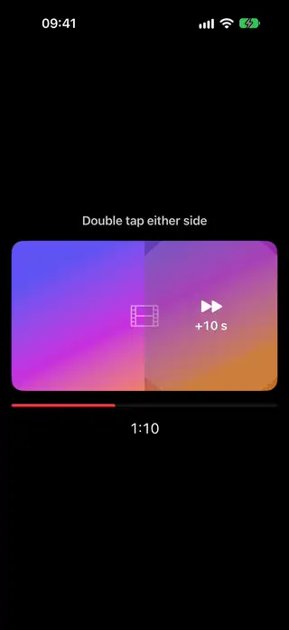
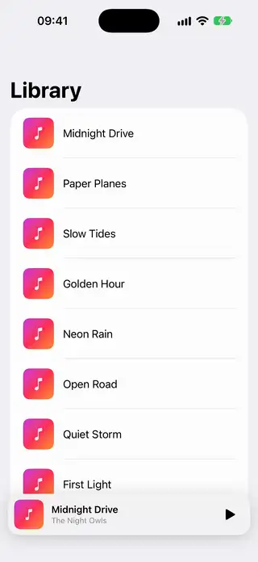
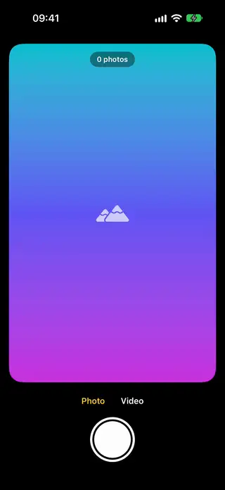
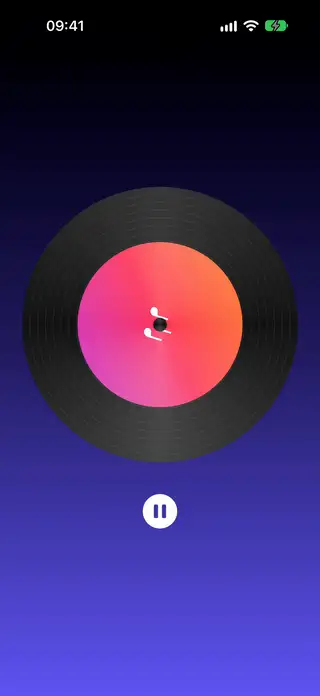
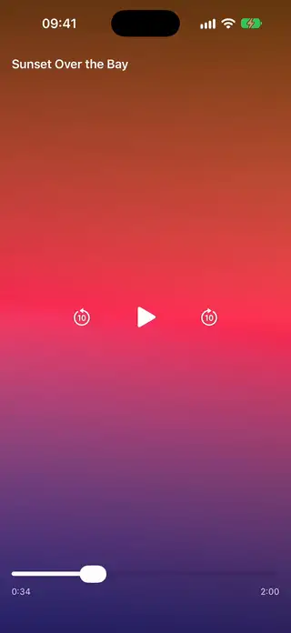
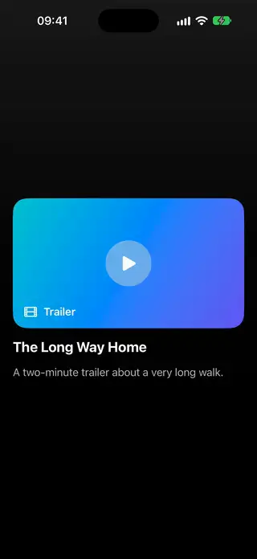
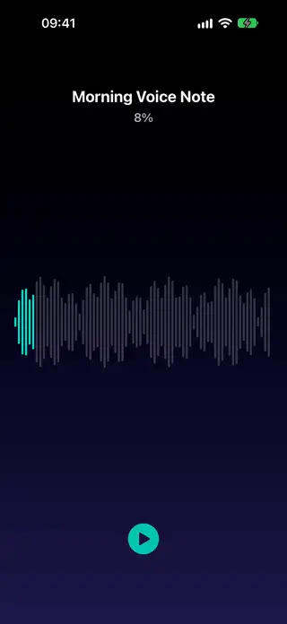

# Media

[All categories](../README.md#catalog)

| Preview | Component | What it does | iOS | Level |
|---|---|---|---|---|
|  | [Audio Player Card](../Components/Media/AudioPlayerCard/AudioPlayerCard.swift) | A podcast-style player card with artwork, a scrubber, skip buttons and a play and pause toggle. | 18.0+ | intermediate |
|  | [Double Tap Seek Overlay](../Components/Media/DoubleTapSeekOverlay/DoubleTapSeekOverlay.swift) | Double tapping the left or right half of a video skips back or forward with a ripple and a seconds label. | 18.0+ | intermediate |
|  | [Expanding Mini Player](../Components/Media/ExpandingMiniPlayer/ExpandingMiniPlayer.swift) | A mini player bar that morphs into a full player when it is tapped or pulled up. | 18.0+ | advanced |
|  | [Shutter Capture Button](../Components/Media/ShutterCaptureButton/ShutterCaptureButton.swift) | A camera shutter whose inner shape shrinks on press and flashes a ring on capture, with a photo and video toggle. | 18.0+ | intermediate |
|  | [Spinning Vinyl Art](../Components/Media/SpinningVinylArt/SpinningVinylArt.swift) | Circular album art on a vinyl disc that spins while playing and eases to a stop when paused. | 18.0+ | intermediate |
|  | [Video Player Chrome](../Components/Media/VideoPlayerChrome/VideoPlayerChrome.swift) | Custom controls over any video view that show on tap, hide after a few seconds and include a scrubber. | 18.0+ | intermediate |
|  | [Video Poster To Player](../Components/Media/VideoPosterToPlayer/VideoPosterToPlayer.swift) | A poster with a play button that opens into the playing video in the same frame through a growing circle. | 18.0+ | intermediate |
|  | [Waveform Scrubber](../Components/Media/WaveformScrubber/WaveformScrubber.swift) | An audio waveform of bars that you drag to seek and that fills as playback moves on. | 18.0+ | intermediate |
