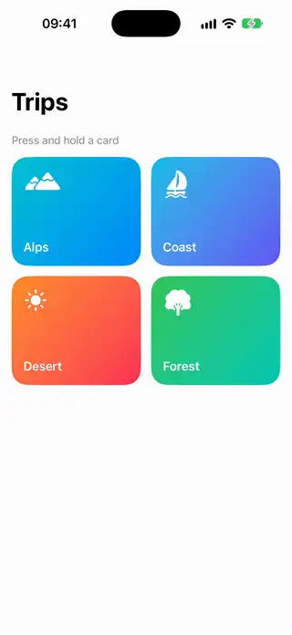
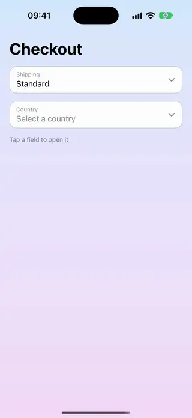

# Menus

[All categories](../README.md#catalog)

| Preview | Component | What it does | iOS | Level |
|---|---|---|---|---|
|  | [Coach Mark Tour](../Components/Menus/CoachMarkTour/CoachMarkTour.swift) | A guided tour that dims the screen and spotlights a sequence of views with a step card next to each one. | 18.0+ | intermediate |
|  | [Command Palette](../Components/Menus/CommandPalette/CommandPalette.swift) | A searchable sheet of commands with shortcut hints and live filtering as you type. | 18.0+ | intermediate |
|  | [Context Menu Preview Card](../Components/Menus/ContextMenuPreviewCard/ContextMenuPreviewCard.swift) | A card that lifts a richer preview above its menu when you press and hold it. | 18.0+ | beginner |
|  | [Dropdown Select Menu](../Components/Menus/DropdownSelectMenu/DropdownSelectMenu.swift) | A custom dropdown field whose list of options grows out of it and collapses on selection. | 18.0+ | intermediate |
|  | [Gooey Floating Menu](../Components/Menus/GooeyFloatingMenu/GooeyFloatingMenu.swift) | A floating button whose option bubbles melt and merge out of it like liquid. | 18.0+ | advanced |
