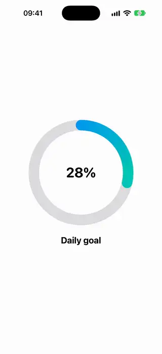
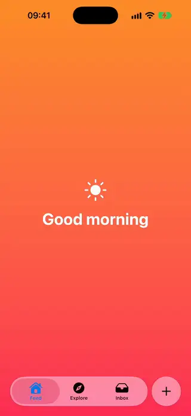
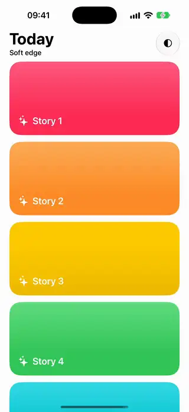
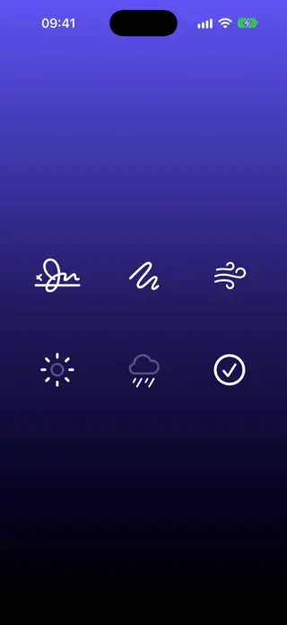
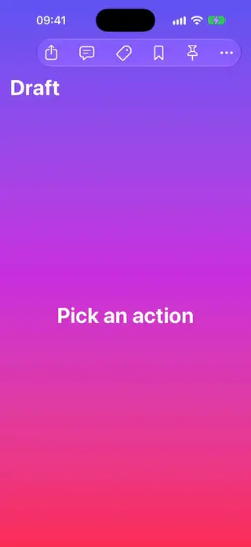

# Modern

[All categories](../README.md#catalog)

| Preview | Component | What it does | iOS | Level |
|---|---|---|---|---|
|  | [Animatable Ring](../Components/Modern/AnimatableRing/AnimatableRing.swift) | A progress ring whose arc animates through the @Animatable macro. | 26.0+ | intermediate |
|  | [Concentric Card](../Components/Modern/ConcentricCard/ConcentricCard.swift) | Nested cards whose corners stay concentric with ConcentricRectangle, however deep they sit. | 26.0+ | beginner |
|  | [Prominent Tab Bar](../Components/Modern/ProminentTabBar/ProminentTabBar.swift) | A tab view whose main action gets the system's prominent tab treatment. | 27.0+ | beginner |
|  | [Scroll Edge Header](../Components/Modern/ScrollEdgeHeader/ScrollEdgeHeader.swift) | A scroll view whose content dissolves under a custom header using the scroll edge effect. | 26.0+ | beginner |
|  | [Symbol Draw On](../Components/Modern/SymbolDrawOn/SymbolDrawOn.swift) | An SF Symbol that draws itself on and off, stroke by stroke. | 26.0+ | beginner |
|  | [Toolbar Overflow Demo](../Components/Modern/ToolbarOverflowDemo/ToolbarOverflowDemo.swift) | A toolbar that ranks which actions survive when space runs out and keeps others in the overflow menu. | 27.0+ | intermediate |
