# Navigation

[All categories](../README.md#catalog)

| Preview | Component | What it does | iOS | Level |
|---|---|---|---|---|
| 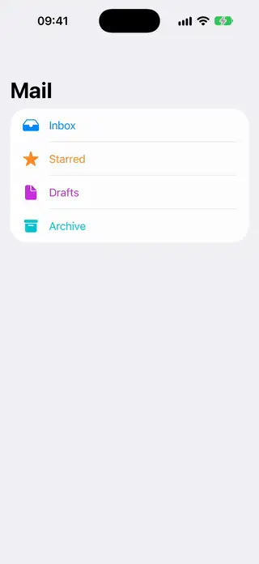 | [Adaptive Sidebar Layout](../Components/Navigation/AdaptiveSidebarLayout/AdaptiveSidebarLayout.swift) | A split view driven by one Boolean that collapses to the detail on iPad and swaps columns on iPhone. | 18.0+ | intermediate |
| 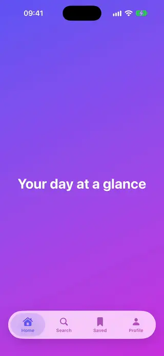 | [Animated Tab Bar](../Components/Navigation/AnimatedTabBar/AnimatedTabBar.swift) | A custom tab bar with a sliding indicator and icons that bounce on selection. | 18.0+ | intermediate |
| 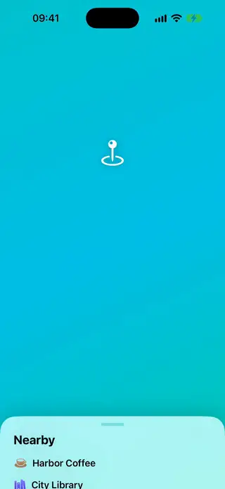 | [Bottom Drawer](../Components/Navigation/BottomDrawer/BottomDrawer.swift) | A draggable bottom drawer that snaps to detents, built as a custom overlay. | 18.0+ | intermediate |
| 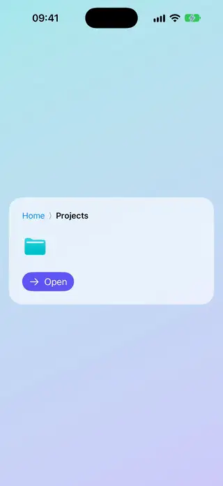 | [Breadcrumb Trail](../Components/Navigation/BreadcrumbTrail/BreadcrumbTrail.swift) | A breadcrumb path that moves its middle crumbs into a menu when it runs out of width. | 18.0+ | beginner |
| 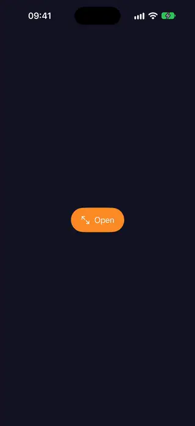 | [Drag To Dismiss Screen](../Components/Navigation/DragToDismissScreen/DragToDismissScreen.swift) | A full-screen page that follows a downward drag, shrinks and fades, then leaves when released past a threshold. | 18.0+ | intermediate |
| 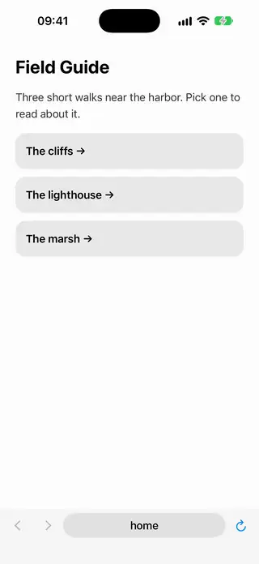 | [Embedded Web Browser](../Components/Navigation/EmbeddedWebBrowser/EmbeddedWebBrowser.swift) | A small browser inside the app, with an address bar, back, forward, reload and a line that fills while the page loads. | 26.0+ | intermediate |
| 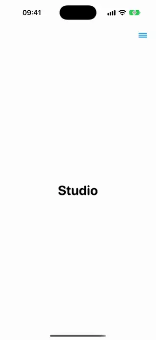 | [Full Screen Menu Overlay](../Components/Navigation/FullScreenMenuOverlay/FullScreenMenuOverlay.swift) | A full-screen menu that opens over the content and brings its links in one by one. | 18.0+ | intermediate |
| 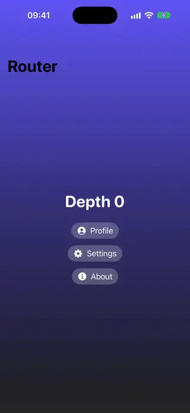 | [Navigation Path Router](../Components/Navigation/NavigationPathRouter/NavigationPathRouter.swift) | A router that owns a NavigationPath so any view can push or pop screens by a typed value. | 18.0+ | intermediate |
|  | [Page Dots Indicator](../Components/Navigation/PageDotsIndicator/PageDotsIndicator.swift) | Page dots where the current one stretches into a capsule, following a paged TabView or scroll. | 18.0+ | beginner |
| 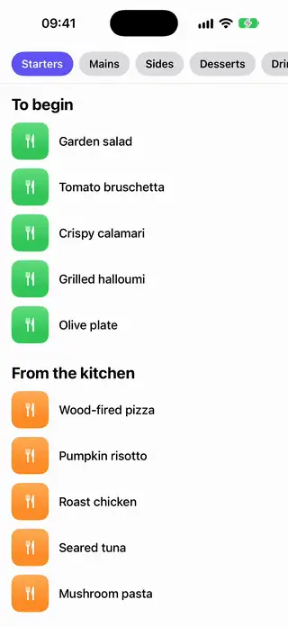 | [Scroll Spy Header](../Components/Navigation/ScrollSpyHeader/ScrollSpyHeader.swift) | A bar of chips that highlights the section at the top of a scroll view and jumps to a section when tapped. | 18.0+ | intermediate |
| 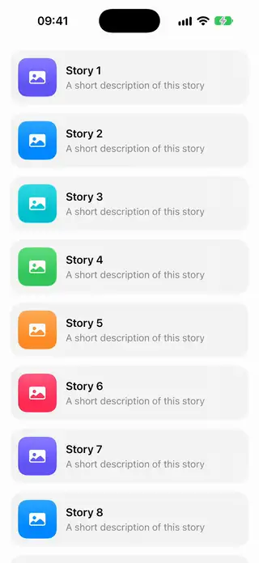 | [Scroll To Top Button](../Components/Navigation/ScrollToTopButton/ScrollToTopButton.swift) | A floating button that appears after scrolling down and returns the scroll view to the top. | 18.0+ | beginner |
| 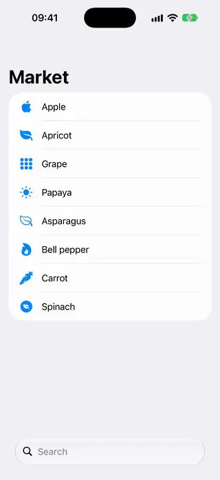 | [Search Scopes And Suggestions](../Components/Navigation/SearchScopesAndSuggestions/SearchScopesAndSuggestions.swift) | A modifier that adds a search field with scope buttons and suggestion rows that narrow as you type. | 18.0+ | intermediate |
| 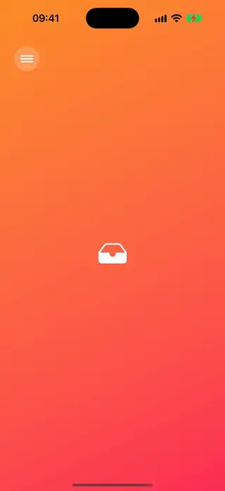 | [Side Drawer](../Components/Navigation/SideDrawer/SideDrawer.swift) | A side menu that slides in and pushes the content away, with drag to open and close. | 18.0+ | intermediate |
| 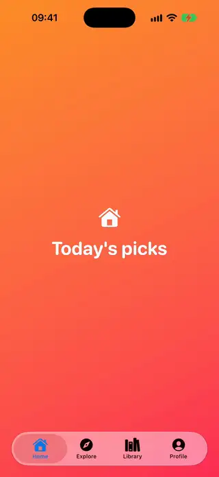 | [Sidebar Adaptive Tabs](../Components/Navigation/SidebarAdaptiveTabs/SidebarAdaptiveTabs.swift) | The same tabs as a bottom tab bar on iPhone and as a sidebar on iPad. | 18.0+ | beginner |
| 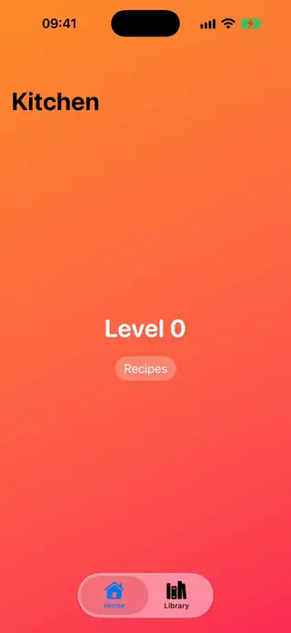 | [Tab Navigation State Preserve](../Components/Navigation/TabNavigationStatePreserve/TabNavigationStatePreserve.swift) | A tab bar where each tab keeps its own navigation path in one store, so switching back restores your place. | 18.0+ | intermediate |
| 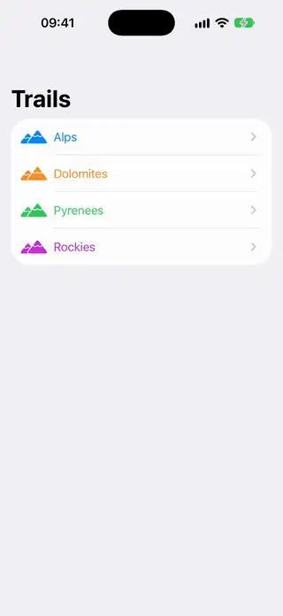 | [Two Pane Split Layout](../Components/Navigation/TwoPaneSplitLayout/TwoPaneSplitLayout.swift) | A list and its detail that sit side by side on iPad and share one navigation stack on iPhone. | 18.0+ | intermediate |
