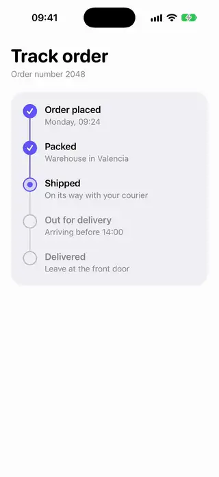
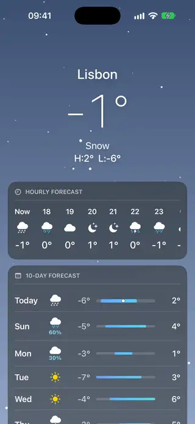

# Patterns

[All categories](../README.md#catalog)

| Preview | Component | What it does | iOS | Level |
|---|---|---|---|---|
|  | [Permission Primer Screen](../Components/Patterns/PermissionPrimerScreen/PermissionPrimerScreen.swift) | The screen shown before the system asks for a permission: what it is for, what the person gets, and one button that leads to the system's question. | 18.0+ | beginner |
|  | [Vertical Timeline](../Components/Patterns/VerticalTimeline/VerticalTimeline.swift) | A vertical timeline with a connector line and done, current and upcoming steps. | 18.0+ | beginner |
|  | [Weather Forecast Screen](../Components/Patterns/WeatherForecastScreen/WeatherForecastScreen.swift) | A weather screen with a header that shrinks to one line as it scrolls, an hourly strip, a ten-day list of temperature range bars over the week and an animated sky with rain or snow. | 18.0+ | advanced |
