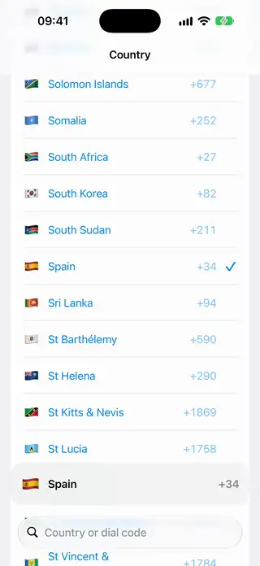
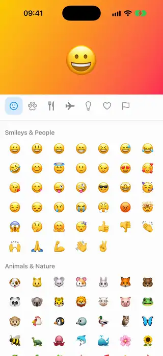
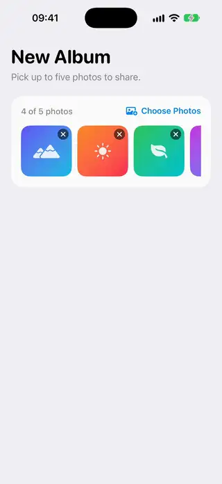
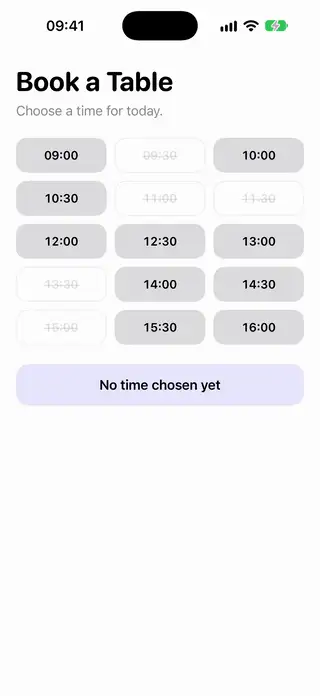
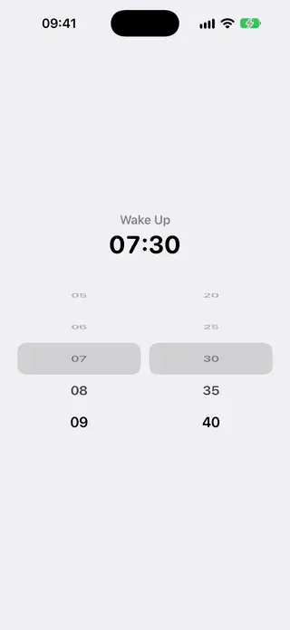

# Pickers

[All categories](../README.md#catalog)

| Preview | Component | What it does | iOS | Level |
|---|---|---|---|---|
|  | [Country Picker](../Components/Pickers/CountryPicker/CountryPicker.swift) | A searchable list of countries with flags and dial codes that opens on the current region. | 18.0+ | intermediate |
|  | [Emoji Picker](../Components/Pickers/EmojiPicker/EmojiPicker.swift) | A grid of emoji grouped by category, with tabs that jump between sections and a row of recent picks. | 18.0+ | intermediate |
|  | [Inline Date Picker Disclosure](../Components/Pickers/InlineDatePickerDisclosure/InlineDatePickerDisclosure.swift) | A date row that opens in place into a calendar and closes again once a day is chosen. | 18.0+ | intermediate |
|  | [Multi Photo Picker Tray](../Components/Pickers/MultiPhotoPickerTray/MultiPhotoPickerTray.swift) | A photo picker limited to a maximum count, with a tray of chosen thumbnails that can be removed. | 18.0+ | intermediate |
|  | [Time Slot Grid Picker](../Components/Pickers/TimeSlotGridPicker/TimeSlotGridPicker.swift) | A grid of time slots where unavailable times are disabled and the chosen slot is highlighted. | 18.0+ | beginner |
|  | [Wheel Picker](../Components/Pickers/WheelPicker/WheelPicker.swift) | A vertical wheel that picks one value from a list, with rows turning in 3D as they leave the center. | 18.0+ | intermediate |
