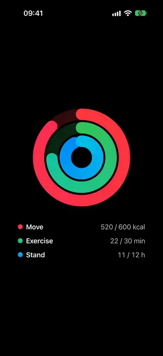
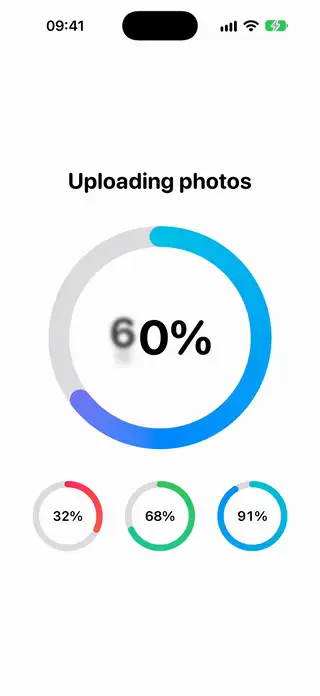
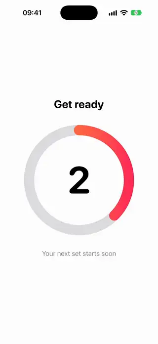
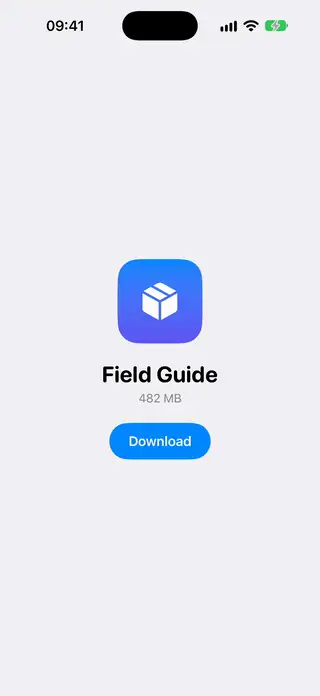
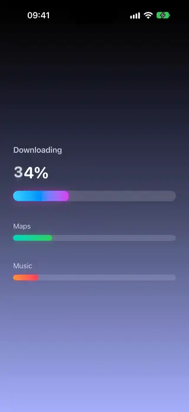
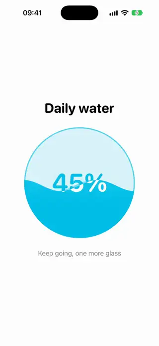
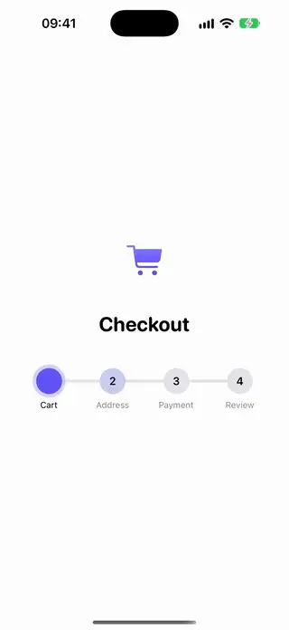

# Progress

[All categories](../README.md#catalog)

| Preview | Component | What it does | iOS | Level |
|---|---|---|---|---|
|  | [Activity Rings](../Components/Progress/ActivityRings/ActivityRings.swift) | Concentric gradient rings that close as daily goals are reached. | 18.0+ | intermediate |
|  | [Circular Progress Ring](../Components/Progress/CircularProgressRing/CircularProgressRing.swift) | An animated gradient ring that shows progress with a percentage in the middle. | 18.0+ | beginner |
|  | [Countdown Ring](../Components/Progress/CountdownRing/CountdownRing.swift) | A ring that empties and a number that counts down to a date. | 18.0+ | intermediate |
|  | [Download Pill Progress](../Components/Progress/DownloadPillProgress/DownloadPillProgress.swift) | A capsule button that turns into a progress ring while downloading, then into a checkmark. | 18.0+ | intermediate |
|  | [Gradient Progress Bar](../Components/Progress/GradientProgressBar/GradientProgressBar.swift) | A rounded progress bar with a gradient fill that glows more strongly as it advances. | 18.0+ | beginner |
|  | [Liquid Fill Progress](../Components/Progress/LiquidFillProgress/LiquidFillProgress.swift) | A circular progress view filled by a moving liquid wave drawn with an animatable shape. | 18.0+ | advanced |
|  | [Step Progress Indicator](../Components/Progress/StepProgressIndicator/StepProgressIndicator.swift) | Numbered steps joined by a line that fills as the current step advances. | 18.0+ | intermediate |
