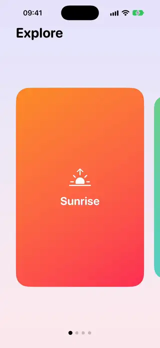
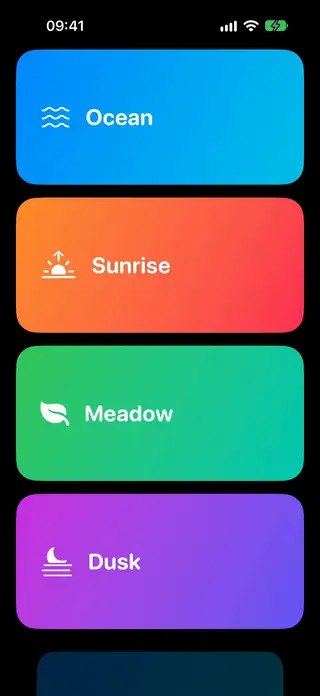

# Scrolling

[All categories](../README.md#catalog)

| Preview | Component | What it does | iOS | Level |
|---|---|---|---|---|
|  | [Infinite Marquee Row](../Components/Scrolling/InfiniteMarqueeRow/InfiniteMarqueeRow.swift) | A row of content that scrolls forever without a visible seam. | 18.0+ | intermediate |
|  | [Parallax Cards Row](../Components/Scrolling/ParallaxCardsRow/ParallaxCardsRow.swift) | A horizontal carousel whose card artwork moves in parallax using visualEffect. | 18.0+ | intermediate |
|  | [Peek Carousel](../Components/Scrolling/PeekCarousel/PeekCarousel.swift) | A paging carousel that shows the edges of its neighbours. | 18.0+ | beginner |
|  | [Scroll Fade Cards](../Components/Scrolling/ScrollFadeCards/ScrollFadeCards.swift) | A vertical scroll of cards that scale down and fade at its edges with scrollTransition. | 18.0+ | beginner |
|  | [Sticky Parallax Header](../Components/Scrolling/StickyParallaxHeader/StickyParallaxHeader.swift) | A parallax header that stretches on overscroll and collapses into a pinned bar. | 18.0+ | intermediate |
