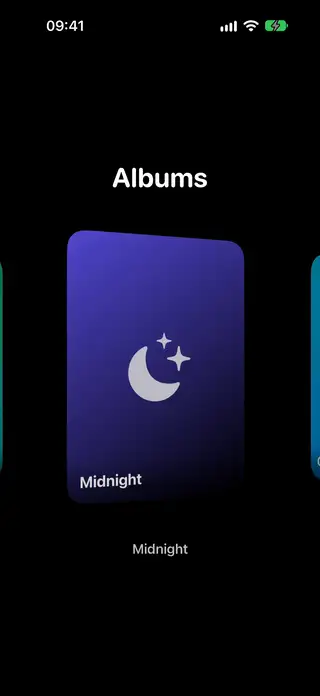
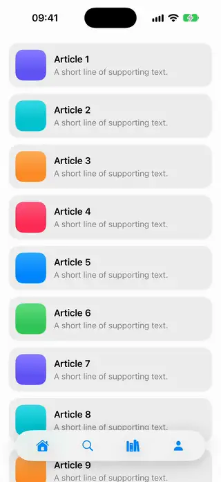
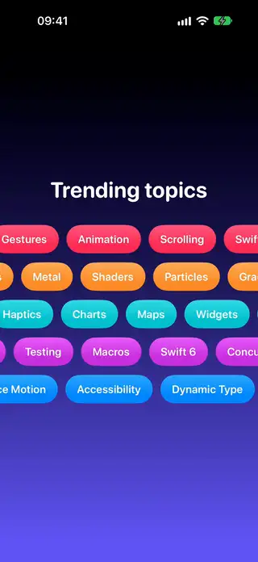
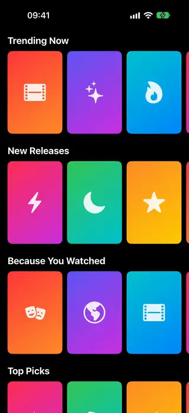
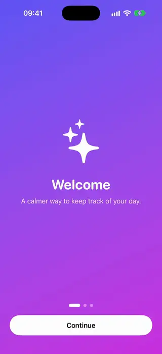
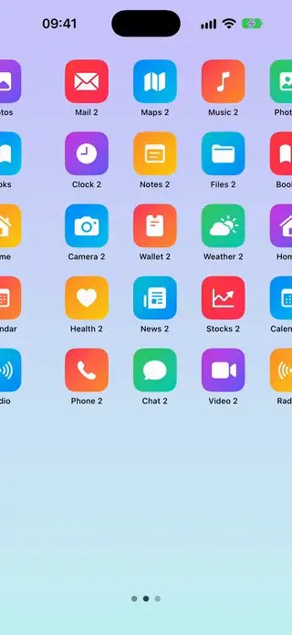
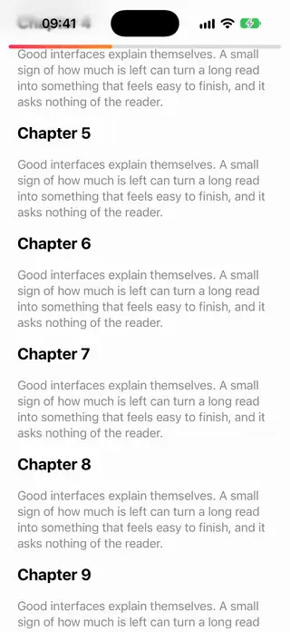
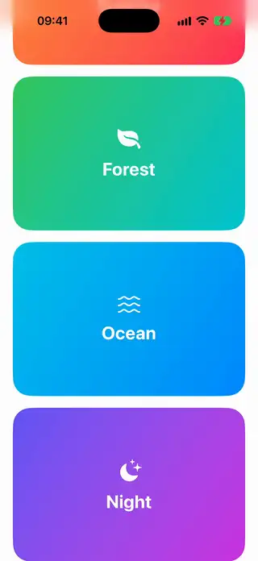
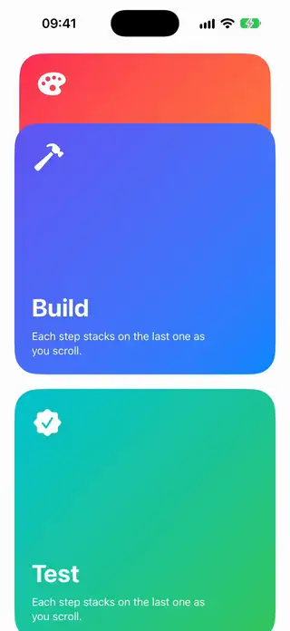
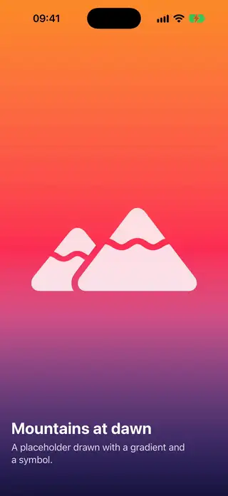

# Scrolling

[All categories](../README.md#catalog)

| Preview | Component | What it does | iOS | Level |
|---|---|---|---|---|
|  | [Auto Advance Carousel](../Components/Scrolling/AutoAdvanceCarousel/AutoAdvanceCarousel.swift) | A paged carousel that advances on a timer and pauses while the user is dragging it. | 18.0+ | beginner |
|  | [Cover Flow Carousel](../Components/Scrolling/CoverFlowCarousel/CoverFlowCarousel.swift) | A horizontal carousel where the centered item faces forward and its neighbours turn away in 3D as you scroll. | 18.0+ | intermediate |
|  | [Hide On Scroll Bar](../Components/Scrolling/HideOnScrollBar/HideOnScrollBar.swift) | A bottom bar that slides out of view while the user scrolls down and returns as soon as they scroll up. | 18.0+ | intermediate |
|  | [Infinite Marquee Row](../Components/Scrolling/InfiniteMarqueeRow/InfiniteMarqueeRow.swift) | A row of content that scrolls forever without a visible seam. | 18.0+ | intermediate |
|  | [Netflix Rows Scroller](../Components/Scrolling/NetflixRowsScroller/NetflixRowsScroller.swift) | A vertical stack of titled horizontal rows where each row scrolls on its own, like a streaming home screen. | 18.0+ | beginner |
|  | [Onboarding Pager](../Components/Scrolling/OnboardingPager/OnboardingPager.swift) | A full-screen onboarding flow with swipeable pages, a progress indicator and a button that advances or finishes. | 18.0+ | beginner |
|  | [Paged Grid Launcher](../Components/Scrolling/PagedGridLauncher/PagedGridLauncher.swift) | A launcher of icon grids that pages horizontally, with each page filled row by row like the iOS home screen. | 18.0+ | intermediate |
|  | [Parallax Cards Row](../Components/Scrolling/ParallaxCardsRow/ParallaxCardsRow.swift) | A horizontal carousel whose card artwork moves in parallax using visualEffect. | 18.0+ | intermediate |
|  | [Peek Carousel](../Components/Scrolling/PeekCarousel/PeekCarousel.swift) | A paging carousel that shows the edges of its neighbours. | 18.0+ | beginner |
|  | [Pull Progress Refresh](../Components/Scrolling/PullProgressRefresh/PullProgressRefresh.swift) | A custom pull to refresh whose ring fills with the pull distance and starts a refresh when released past a threshold. | 18.0+ | intermediate |
|  | [Scroll Fade Cards](../Components/Scrolling/ScrollFadeCards/ScrollFadeCards.swift) | A vertical scroll of cards that scale down and fade at its edges with scrollTransition. | 18.0+ | beginner |
|  | [Scroll Progress Bar](../Components/Scrolling/ScrollProgressBar/ScrollProgressBar.swift) | A thin bar pinned to the top of a scroll view that grows with the reading progress of the content. | 18.0+ | beginner |
|  | [Scroll Visibility Reveal](../Components/Scrolling/ScrollVisibilityReveal/ScrollVisibilityReveal.swift) | Sections fade and slide into place the first time they become visible while the user scrolls. | 18.0+ | beginner |
|  | [Sticky Parallax Header](../Components/Scrolling/StickyParallaxHeader/StickyParallaxHeader.swift) | A parallax header that stretches on overscroll and collapses into a pinned bar. | 18.0+ | intermediate |
|  | [Sticky Stacked Cards](../Components/Scrolling/StickyStackedCards/StickyStackedCards.swift) | Cards that pile up at the top of the screen as the next card scrolls over them. | 18.0+ | intermediate |
|  | [Vertical Full Screen Feed](../Components/Scrolling/VerticalFullScreenFeed/VerticalFullScreenFeed.swift) | A vertical feed where each item fills the screen and snaps into place, in the style of short-video apps. | 18.0+ | beginner |
