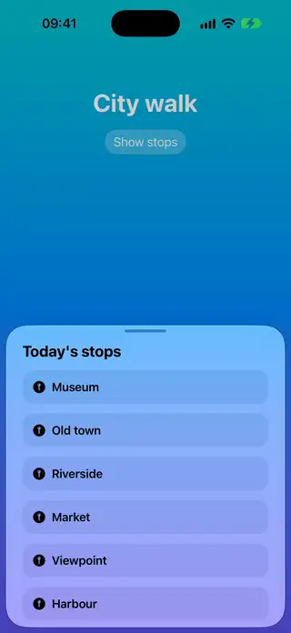

# Sheets

[All categories](../README.md#catalog)

| Preview | Component | What it does | iOS | Level |
|---|---|---|---|---|
|  | [Custom Detent Sheet](../Components/Sheets/CustomDetentSheet/CustomDetentSheet.swift) | A system sheet that snaps between custom heights using presentationDetents and a CustomPresentationDetent. | 18.0+ | beginner |
|  | [Dynamic Height Tray](../Components/Sheets/DynamicHeightTray/DynamicHeightTray.swift) | A sheet exactly as tall as its content, which grows and shrinks as one step of a flow gives way to the next. | 18.0+ | intermediate |
|  | [What's New Sheet](../Components/Sheets/WhatsNewSheet/WhatsNewSheet.swift) | A sheet that lists what a new version brings and comes up once for each version. | 18.0+ | beginner |
