# Text

[All categories](../README.md#catalog)

| Preview | Component | What it does | iOS | Level |
|---|---|---|---|---|
| 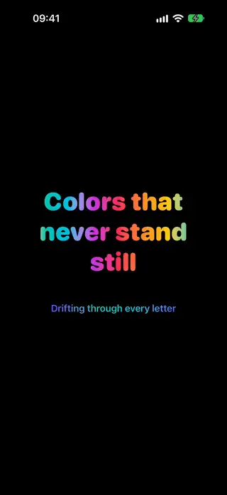 | [Animated Gradient Text](../Components/Text/AnimatedGradientText/AnimatedGradientText.swift) | Text filled with a gradient that drifts endlessly through its letters. | 18.0+ | beginner |
| 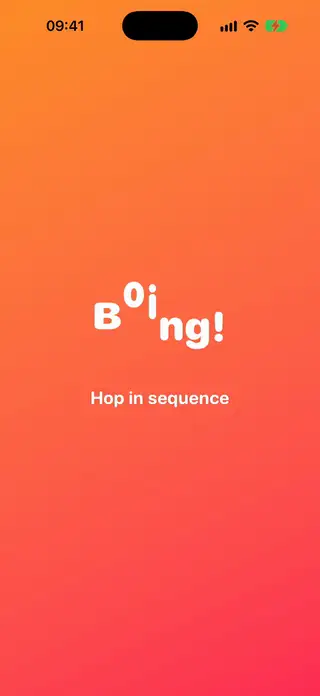 | [Bouncy Letters Text](../Components/Text/BouncyLettersText/BouncyLettersText.swift) | Letters that hop one after another in a repeating wave with squash and stretch. | 18.0+ | intermediate |
| 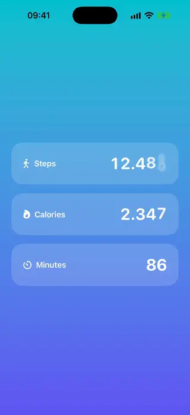 | [Counting Number Text](../Components/Text/CountingNumberText/CountingNumberText.swift) | A number that counts to its new value with its digits rolling into place. | 18.0+ | beginner |
| 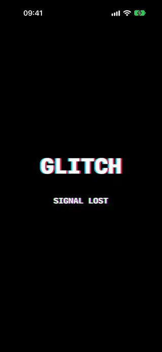 | [Glitch Text](../Components/Text/GlitchText/GlitchText.swift) | Colored copies of the text that jump and flicker in short glitch bursts. | 18.0+ | beginner |
| 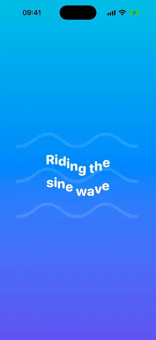 | [Glyph Wave Text](../Components/Text/GlyphWaveText/GlyphWaveText.swift) | Text whose glyphs ride a travelling sine wave, drawn by a custom TextRenderer. | 18.0+ | advanced |
| 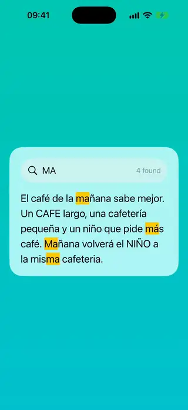 | [Highlighted Search Text](../Components/Text/HighlightedSearchText/HighlightedSearchText.swift) | Text with every match of a search query highlighted, ignoring case and accents. | 18.0+ | intermediate |
| 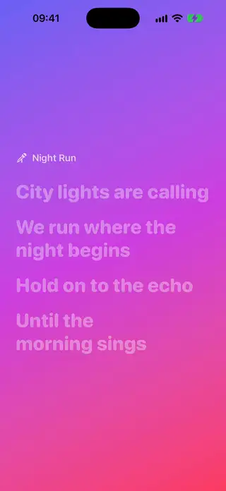 | [Karaoke Lyrics Text](../Components/Text/KaraokeLyricsText/KaraokeLyricsText.swift) | Lyrics that start dim and light up from the first letter to the last as they are sung. | 18.0+ | intermediate |
| 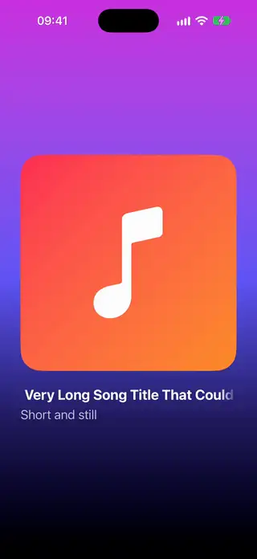 | [Marquee Text](../Components/Text/MarqueeText/MarqueeText.swift) | A single line of text that scrolls horizontally only when it does not fit. | 18.0+ | intermediate |
| 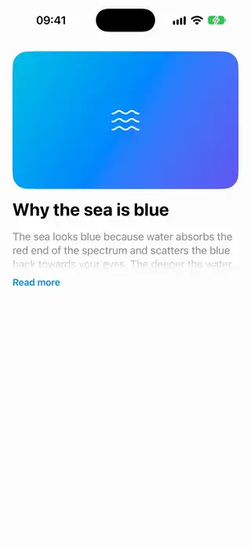 | [Read More Text](../Components/Text/ReadMoreText/ReadMoreText.swift) | A paragraph truncated with a fade that expands in place when tapped. | 18.0+ | beginner |
| 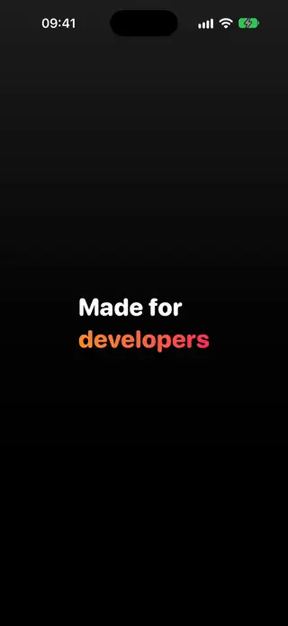 | [Rotating Words Text](../Components/Text/RotatingWordsText/RotatingWordsText.swift) | Words that take turns in the same spot, each one pushing the last out of the way. | 18.0+ | beginner |
| 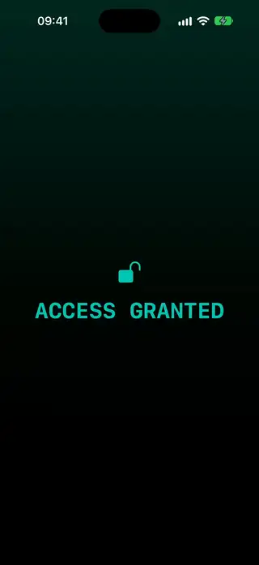 | [Scramble Text](../Components/Text/ScrambleText/ScrambleText.swift) | Random characters that settle from left to right into the final text. | 18.0+ | intermediate |
| 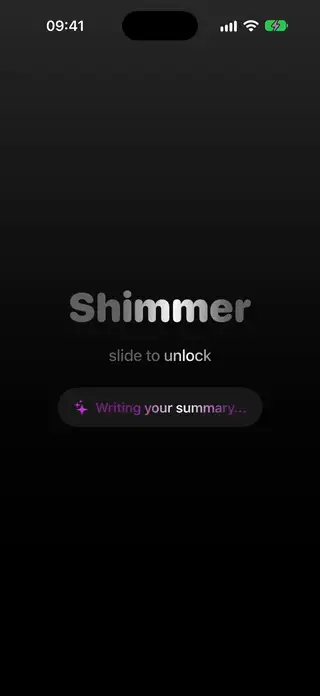 | [Shimmer Text](../Components/Text/ShimmerText/ShimmerText.swift) | Text with a band of light that sweeps across its letters through a mask. | 18.0+ | beginner |
| 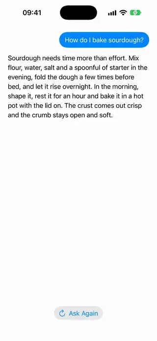 | [Streaming Text](../Components/Text/StreamingText/StreamingText.swift) | Text that arrives in chunks, like the answer of a language model, and fades each new part in from its first letter to its last. | 18.0+ | intermediate |
| 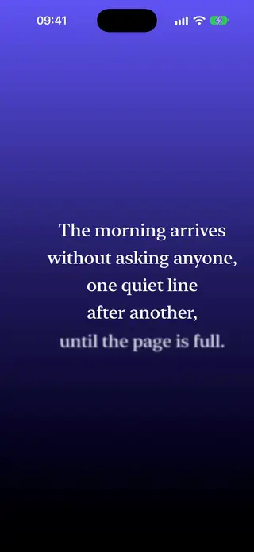 | [Text Blur Reveal](../Components/Text/TextBlurReveal/TextBlurReveal.swift) | Text that appears line by line, coming into focus as it slides up, drawn by a custom TextRenderer. | 18.0+ | advanced |
| 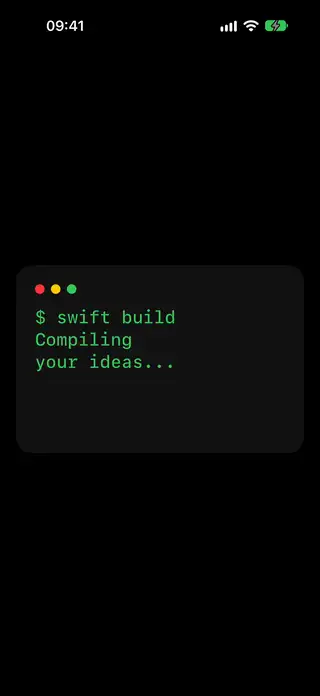 | [Typewriter Text](../Components/Text/TypewriterText/TypewriterText.swift) | Text that types itself one character at a time, followed by a blinking cursor. | 18.0+ | intermediate |
