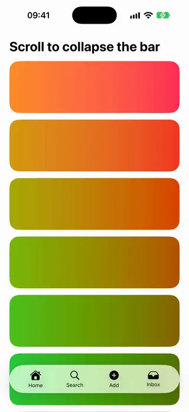

# Toolbars

[All categories](../README.md#catalog)

| Preview | Component | What it does | iOS | Level |
|---|---|---|---|---|
|  | [Collapsing Bottom Bar](../Components/Toolbars/CollapsingBottomBar/CollapsingBottomBar.swift) | A bottom toolbar that shrinks to a pill while scrolling down and expands back when scrolling up. | 18.0+ | intermediate |
|  | [Floating Dock Bar](../Components/Toolbars/FloatingDockBar/FloatingDockBar.swift) | A row of icons that magnify under the finger, in the style of the macOS dock. | 18.0+ | intermediate |
