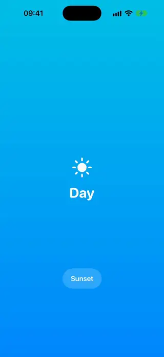
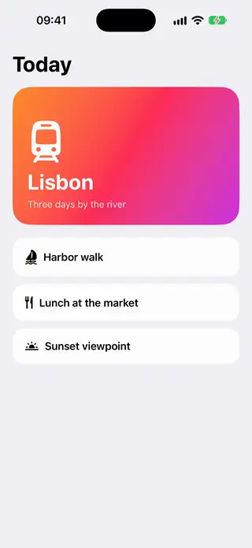
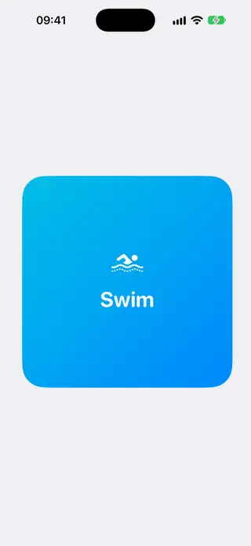
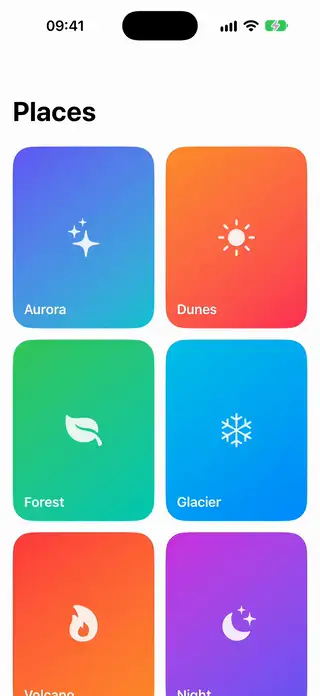

# Transitions

[All categories](../README.md#catalog)

| Preview | Component | What it does | iOS | Level |
|---|---|---|---|---|
|  | [Blur Fade Transition](../Components/Transitions/BlurFadeTransition/BlurFadeTransition.swift) | A custom transition that combines blur, fade and scale, available as .blurFade. | 18.0+ | beginner |
|  | [Circle Reveal Transition](../Components/Transitions/CircleRevealTransition/CircleRevealTransition.swift) | A custom transition that reveals a view through a circular mask growing from a point. | 18.0+ | intermediate |
|  | [Content Swap Transition](../Components/Transitions/ContentSwapTransition/ContentSwapTransition.swift) | A showcase of text value changes using numericText, interpolate and opacity content transitions. | 18.0+ | beginner |
|  | [Cross Fade Navigation](../Components/Transitions/CrossFadeNavigation/CrossFadeNavigation.swift) | A sheet that fades in over the content with the iOS 27 cross-fade navigation transition. | 27.0+ | beginner |
|  | [Flip Card Transition](../Components/Transitions/FlipCardTransition/FlipCardTransition.swift) | A two-sided card that flips in 3D without ever showing mirrored content. | 18.0+ | intermediate |
|  | [Interactive Pager Transition](../Components/Transitions/InteractivePagerTransition/InteractivePagerTransition.swift) | A page transition whose progress follows the finger during a drag and completes or cancels on release. | 18.0+ | advanced |
|  | [Matched Hero Card](../Components/Transitions/MatchedHeroCard/MatchedHeroCard.swift) | A card that expands in place into a full detail view using matched geometry. | 18.0+ | intermediate |
|  | [Parallax Push Transition](../Components/Transitions/ParallaxPushTransition/ParallaxPushTransition.swift) | A custom Transition where the incoming page slides over while the outgoing page moves at a slower parallax speed. | 18.0+ | intermediate |
|  | [Slide Scale Transition](../Components/Transitions/SlideScaleTransition/SlideScaleTransition.swift) | A custom transition that combines an offset with a scale, available as .slideScale. | 18.0+ | beginner |
|  | [Staggered Appear List](../Components/Transitions/StaggeredAppearList/StaggeredAppearList.swift) | A list whose rows enter one after another with a capped, testable delay. | 18.0+ | beginner |
|  | [Symbol Morph Toggle](../Components/Transitions/SymbolMorphToggle/SymbolMorphToggle.swift) | A toggle whose SF Symbol morphs between states with the iOS 18 magic replace effect. | 18.0+ | beginner |
|  | [Zoom Hero Transition](../Components/Transitions/ZoomHeroTransition/ZoomHeroTransition.swift) | A grid of cards that zoom into their detail screen with the native navigation zoom transition. | 18.0+ | intermediate |
